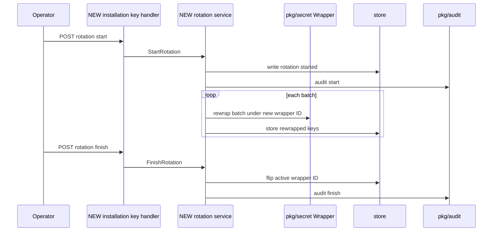
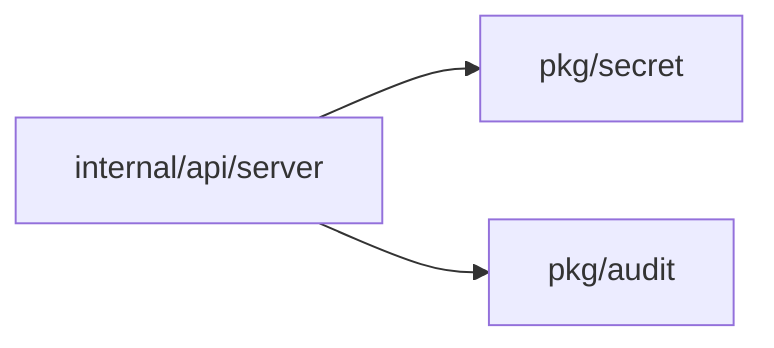
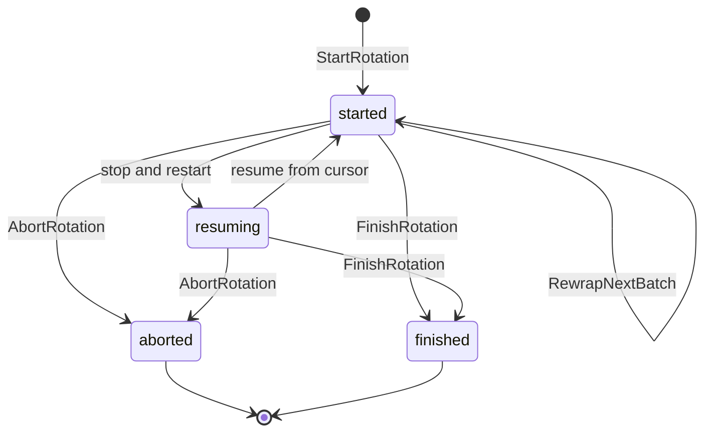
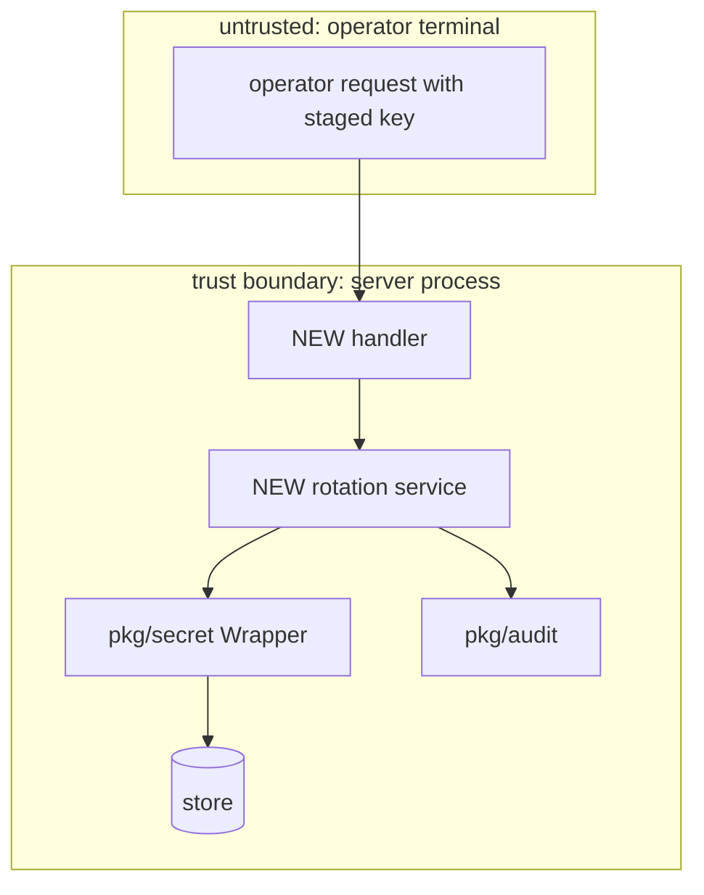

## Context

The key-encryption key sits above namespace key versions, the data keys of `@server`, and sign-in secrets. Rotation rewraps that one level without touching data key values, item keys, or customer keys, while reads continue.

## Decisions

1. **Rotation state machine owns rewraps.** A NEW unexported `rotation` struct in `pkg/secret` owns the state machine started, resuming, finished, and aborted. Only its constructor checks the staged new key, the derived wrapper ID form of ADR 23 decision 4, and the empty active rotation.
2. **Dual-read window with single-flip finish.** Reads try the new wrapper ID first and then the old wrapper ID while the rotation is active. Writes wrap under the new wrapper ID from the start of the rotation, so records made behind the cursor are already done and the cursor skips them. Finish flips one stored active wrapper ID, so the old key stops working in one step. Each replica stages both keys: the NEW allowlist variable `DUSTPAN_KEY_ENCRYPTION_KEY_PREVIOUS` holds the old key and `DUSTPAN_KEY_ENCRYPTION_KEY` holds the new key; a replica with only one key staged refuses to start while a rotation is active. Rewrap batches hold the fence of the installation and one cursor.

## Structure

NEW unexported type `rotation` in `pkg/secret` with constructor `newRotation` that checks invariants; no new tool and no custom analyzer.

## Risks

- Large key tables make rotation slow; batches and resume bound each step.
- Old key copies outside the server stay outside this change.

## Layers (defense in depth)

| Layer | Guard | Hostile test |
| --- | --- | --- |
| authorize at point of use | Handler checks NEW action `installation:rotate-key` on the installation and denies without it. | Call the NEW rotation route without the grant and check 403. |
| boundary check | Service accepts only a staged 32-byte base64 key from the configured file or variable and derives the wrapper ID by HMAC; the request body carries no key bytes. | Send key bytes, a shell string, and a short key in the body and check rejection before any rewrap. |
| limit | Rewrap batches of 100 keys per transaction with a 60 s timeout per batch; a failed batch retries the same cursor and a poison record stops with an error. | Stop the server mid-batch and check resume completes with no partial wrap. |
| encode or contain | Rewrap encodes wrapper IDs as stored values and never logs key bytes. | Run rotation with secret logging enabled and check no key bytes appear. |
| fail closed | Unknown wrapper ID fails closed and start refuses a mismatched key per ADR 23 decision 3. | Start with the old key after finish and check refusal to start. |

## Diagrams

After this change:

Modules that the change touches, and their imports on main:

New imports of this change (each one allowed by the module rules):

- `internal/api/server` imports `pkg/secret`

States on main in the touched packages:

States and transitions after this change:

## Quality attributes

| Attribute | Target | Unit | Scope |
| --- | --- | --- | --- |
| latency | 60 | s | each rewrap batch of 100 keys |
| correctness | 100 | % | reads during rotation |
| storage growth | 10 | KiB | rotation record per installation |

## Threat model

Data flow and trust boundaries:

| Boundary | STRIDE | Threat | Layer | Guard | Hostile test |
| --- | --- | --- | --- | --- | --- |
| operator terminal to server | S | Spoofed operator starts rotation with attacker key. | boundary check | Allowlist: staged 32-byte base64 key from the file or variable only, with the NEW previous-key variable for the old key; body carries no key bytes; reject and log no key bytes. | Send key bytes and shell text in the body directly to the handler. |
| operator terminal to server | S | Spoofed operator starts rotation with attacker key. | encode or contain | Key bytes stay in request-local values; audit and logs hold only wrapper IDs. | Grep logs and audit entries for key bytes after a rotation. |
| operator terminal to server | S | Spoofed operator starts rotation with attacker key. | limit | Batch cap 100 keys and 60 s per batch; handler body limit per ADR 45. | Send a large batch and a slow store and check the cap fires. |
| operator terminal to server | S | Spoofed operator starts rotation with attacker key. | authorize at point of use | NEW action `installation:rotate-key` on the installation at the point of use. | Call start, show, resume, abort, and finish without the grant and check 403. |
| operator terminal to server | S | Spoofed operator starts rotation with attacker key. | fail closed | Invalid key or unknown wrapper ID denies; start with wrong key refuses per ADR 23 decision 3. | Finish with incomplete rewraps and start with the old key after finish. |
| server to store | T | Tampered key rows downgrade wraps to the old key. | boundary check | Wrapper ID syntax check at service boundary before each write. | Inject a bad wrapper ID at the service and check rejection. |
| server to store | T | Tampered key rows downgrade wraps to the old key. | encode or contain | Placeholders only for key IDs; sealed blobs opaque to SQL. | Inject SQL in a key ID and check it stays a value. |
| server to store | T | Tampered key rows downgrade wraps to the old key. | limit | Fenced transactions per batch; cursor bounds each batch. | Kill mid-batch and check resume keeps exactly-once wraps. |
| server to store | T | Tampered key rows downgrade wraps to the old key. | authorize at point of use | Fence check in the same transaction for each rewrap batch. | Replay a batch with a stale fence and check refusal. |
| server to store | T | Tampered key rows downgrade wraps to the old key. | fail closed | Partial batch rolls back; finish needs full new-wrap coverage of directly wrapped records. | Corrupt one record mid-batch and check finish stays blocked. |

## Contracts

**Installation key-encryption-key rotation**

- Invariant: At most one rotation is active at one time.
- Invariant: Each directly wrapped record, namely each namespace key version, each data key of `@server`, and each sign-in secret, records exactly one wrapper ID.
- Invariant: Reads succeed while a rotation is active with either the old key or the new key.
- `StartRotation`: pre: No rotation is active and the caller holds the NEW action `installation:rotate-key` on the installation.. Post: The rotation record exists in state started with the new wrapper ID..
- `RewrapNextBatch`: pre: The rotation is in state started or resuming.. Post: Each returned directly wrapped record wraps under the new wrapper ID and keeps its stable ID..
- `FinishRotation`: pre: Every directly wrapped record wraps under the new wrapper ID.. Post: The rotation is in state finished and the old wrapper ID is refused..

## Failure modes

| Step | Failure | Retry | State after |
| --- | --- | --- | --- |
| RewrapNextBatch | Server stops mid-batch. | Operator restarts the server with both keys staged and calls the NEW resume operation; rewraps restart from the stored cursor. | resuming, with cursor kept |
| StartRotation | Staged new key value is invalid. | Operator stages a valid 32-byte base64 key; no keys change. | no rotation |
| FinishRotation | Some directly wrapped record still wraps under the old wrapper ID. | Finish answers 409 with the NEW error code `installation.rotation-incomplete`; operator resumes rewraps or aborts. | started |
