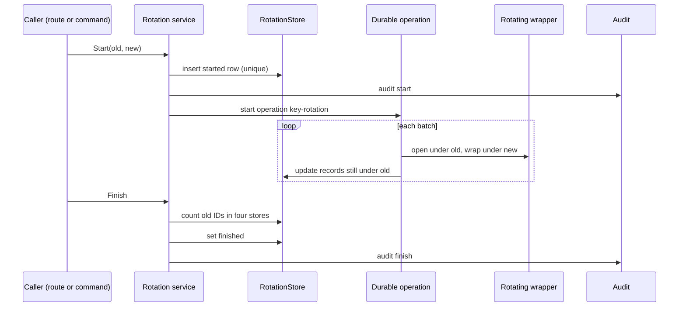
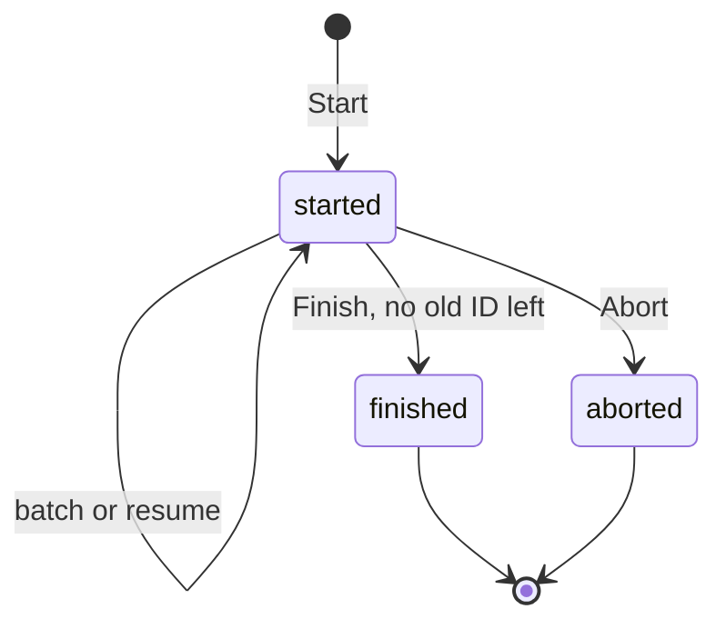

## Context

On main the key-encryption key wraps four families of records directly: the data keys of the scopes (`secret_keys`), the installation data keys (`installation_secret_keys`), the item keys (`item_keys` with one blob each) and the idempotency server key (`idempotency_server_key`). Each record stores the wrapper ID of its key. The start check refuses a database with more than one wrapper ID, and no rewrap exists.

The change adds one resumable rewrap of these four families with reads that keep working. It changes no data key value, no item key value and no content. The hierarchy of namespace keys and customer keys is not on main, so the rewrap acts on the records above. The engine takes both keys from its caller. They reach the process at start (decision 11), and a REST API and a CLI command drive the engine (decisions 12 and 13). The owner decided these on 2026-11-20.

## Decisions

1. **One rotation record, one active rotation.** A NEW table `key_rotations` in the baseline of each dialect holds one row for each rotation: ID, state (`started`, `finished` or `aborted`), old wrapper ID, new wrapper ID, actor, start time, end time and the ID of the durable operation. A partial unique index on the state `started` lets the store refuse a second active rotation. The table is a control table: a backup leaves it out and a restore keeps the live rows. Each new object sits in the name order of the baseline, and the change edits the baseline in place, with no numbered migration.
2. **The rewrap is a durable operation.** The kind is `key-rotation`, NEW const `KeyRotationKind`. Each step is one batch of at most 100 records of one family, in a fixed order of families. A claim, the step fence and the expiry give resume after a stop, and give one runner at a time, with no cursor table of our own. A batch re-reads each record in its transaction and updates it only when its stored wrapper ID is still the old one, so a replay changes nothing.
3. **Dual read, new write.** NEW `secret.Rotating` holds two `Wrapper` values. Its `ID` is the new ID, `Wrap` uses the new key and `Unwrap` tries the new key and then the old key. NEW function `secret.Holds(wrapper, id)` answers true for the ID of a plain wrapper and for either ID of a `Rotating`. The five places that compare a stored ID with the ID of the wrapper call it. A write while the rotation is active wraps under the new ID, so the rewrap skips it. Cursors that the server seals with the wrapper hold no stored ID. They open under either key during the rotation, and a cursor sealed under the old key stops opening after finish.
4. **Finish is one flip, and it needs a full count.** Finish succeeds only when the four stores list no old wrapper ID. In one transaction it sets the state `finished` and writes the audit entry. After that the start check needs the new key alone, and a database that holds the old ID is refused as on main.
5. **Item keys.** The rewrap of an item key reads the record, opens the blob under the old key, wraps again, writes a new blob (new attempt part, next version) and then updates the record in one transaction that checks the record is not shredded. It deletes the old blob from the live store after the commit. If a shred committed between the read and the write, it deletes the new blob. This follows the steps that ADR 217 decision 18 gives for the namespace key. NEW method `ItemKeyIndex.RewrapItemKey`, with a conformance test before any adapter.
6. **The idempotency server key.** The rewrap opens the key under the old key and replaces the row with the existing compare-and-swap replace of the store, so the replay records stay. The reset path of main stays for a key that no held wrapper opens.
7. **Audit is the record, and it fails closed.** Start, resume, finish and abort each write one entry of kind `change` in the scope `@server` in the transaction of the state change. A failed audit write fails the call and leaves the state as it was. An entry holds the actor, the time, the old and the new wrapper ID and, at finish, the counts. It never holds key bytes.
8. **Restore.** A restore keeps its check (the wrapper must hold one wrapper ID of the manifest), now through `secret.Holds`. The server refuses to start a restore while a rotation is active (NEW sentinel `secret.ErrRotationActive`). A backup made before finish holds old wrapper IDs. A restore of it needs the old key. After it, the operator runs a new rotation from the old key to the new key. The restore does not rewrap by itself.
9. **Start-up.** The start check reads the active rotation first. With none, or with only finished or aborted rows, it runs as on main with the one wrapper and now also counts the wrapper IDs of the item keys and the idempotency key. With an active rotation it needs a `Rotating` wrapper and refuses a plain one with NEW sentinel `secret.ErrRotationActive`; the text names the state and both IDs.
10. **The action (owner, 2026-11-20).** NEW constant `ActionInstallationRotateKeyEncryptionKey = "installation:rotate-key-encryption-key"` in `pkg/identity/identity.go`, next to `ActionInstallationStoreCheck` (line 262). Object: `ServerObject()`. `pkg/access/access.go` classifies it in `FamilyAdministration` (as `server:manage-sign-in`, line 165) and `siteOnlyActions` (`pkg/access/roles.go:150`) lists it, so only the site administrator holds it. The grant is a stored grant of the built-in role, as every grant is. The row for the table of ADR 216 decision 3 is a task.
11. **The old key (owner, 2026-11-20).** `loadKeyEncryptionKey` (`cmd/opendustpan/main.go:1887`) gets a twin for `DUSTPAN_KEY_ENCRYPTION_KEY_OLD` and `DUSTPAN_KEY_ENCRYPTION_KEY_OLD_FILE`. Both read the value or the file as the current key does: base64, 32 bytes, the file mode check of `readKeyFile` (`cmd/opendustpan/main.go:1935`), no flag. The variable is cleared at the read (as line 1893) and the direct path clears too (as line 929). When the old key is set, the process builds `Rotating(old, new)`: `Wrap` uses the new key, `Unwrap` tries the new key and then the old key. The start of the process fails when the wrapper IDs of the old key and of the new key are equal.
12. **The API (owner, 2026-11-20).** Routes under `/api/dustpan/v1/key-rotations`, each with the action of decision 10 and `ServerObject()`, in the form of `internal/api/server/store_checks.go:126`:
    - `POST /key-rotations` starts a rotation. 202. The body has no field; it never holds key bytes. Wrapped by `Handler.fresh` (`internal/api/server/freshness.go:221`). Needs `Idempotency-Key`.
    - `GET /key-rotations` lists rotations, newest first. `GET /key-rotations/{id}` answers state, old and new wrapper ID, counts for each family and the operation state.
    - `POST /key-rotations/{id}/resume` claims the durable operation again. No fresh step.
    - `POST /key-rotations/{id}/finish` and `POST /key-rotations/{id}/abort`. Wrapped by `Handler.fresh`.
    Errors have codes in the NEW file `internal/errcode/catalog_keyrotation.go`: `key-rotation.active` (409), `key-rotation.old-key-missing` (409), `key-rotation.incomplete` (409, with the counts), `key-rotation.not-found` (404), `key-rotation.not-active` (409). A refusal of the action writes the denial entry as for every route. The operation labels, the request and response types and the regenerated API description follow the store check (`internal/api/server/operations_storecheck.go:15`).
13. **The command (owner, 2026-11-20).** NEW group `opendustpan key-rotation` with `status`, `resume`, `start`, `finish` and `abort`, a client of the API (server ADR 39 decision 1). `status` calls the two GET routes and `resume` calls the resume route, with `SettingsFor("server", "ca-file")` as `internal/cli/store_check.go:9` does. `start`, `finish` and `abort` send no request and print the console path and the route, as `internal/cli/audit_chain.go:16` does for the approval, because an access token never gives a fresh step. The command never reads a key. It reads no `DUSTPAN_KEY_ENCRYPTION_KEY*` variable.
14. **Targets keep their blobs (owner, 2026-11-20).** The rewrap deletes the old item key blob in the live store (decision 5) and never in a backup target. No code path of the rewrap holds a target. Retention of backups removes the old blobs when it removes the backup.

## Structure

NEW unexported fields and a constructor for `Rotating` and for the rotation service, so a value cannot exist with equal IDs, with an empty key or with a nil store. NEW port `secret.RotationStore` with a conformance suite in `secrettest`. The store adapters implement it for SQLite and PostgreSQL. No new tool, no custom analyzer.

## Risks

- A large item key table makes the rewrap slow. Batches and resume bound each step.
- A cursor sealed under the old key stops opening after finish. The caller gets the existing invalid cursor answer and starts the list again.
- Old item key blobs in backup targets stay readable with the old key (owner, 2026-11-20). A copy of the old key must stay as long as the oldest backup that holds them.
- The fresh step blocks a CLI that holds a token alone. The docs page names the console as the place for start, finish and abort.
- Old key copies outside the server stay outside this change.

## Layers (defense in depth)

One table for each layer. Each guard has a test that fails when the guard is removed. Each redundant check gets the comment that CLAUDE.md asks for.

| Layer | Guard | Hostile test |
| --- | --- | --- |
| Port adapter (store) | `StartRotation` refuses a second active rotation by the unique index. The batch update names the old wrapper ID in its `WHERE` clause. Wrapper IDs are bound as placeholders. The new ID must not equal the old ID. | Two concurrent starts; a batch replay with a record that already holds the new ID; a wrapper ID with a quote and a semicolon; equal IDs. |
| Service (`secret`) | The constructor accepts two built wrappers only. Rewrap re-opens each record under the old key and refuses a record that opens under no held key. Finish counts all four families. Each state change and its audit entry share one transaction. | A record under a third ID; a record that fails to open; finish with one old record left in each family; an audit store that fails. |
| Wrapper | `Holds` answers true only for a held ID. `Unwrap` fails closed with `ErrDecrypt` for a ciphertext of another key. | An ID of a third key; a truncated ciphertext; a ciphertext made for another AAD. |
| Start-up and restore | An active rotation with a plain wrapper is refused. A finished rotation with the old key alone is refused (guard on main). A restore while a rotation is active is refused. | Each of the three cases with a store that holds mixed IDs. |
| Log and audit | Entries and logs hold wrapper IDs and counts, never key bytes or ciphertext. | A capture of logs and audit entries during a full rotation, searched for the key bytes in base64 and in hex. |
| HTTP handler | Each route declares the action and `ServerObject()`. Start, finish and abort need a fresh step. The body limit and a strict decode: the start body has no field, so a key field is refused. | A token of the account administrator; an access token on start; a body with a `key` field; a body over the limit. |
| Old key source | The old key comes from a variable or a file with mode 0600, never a flag. The variable is cleared at the read. Equal keys fail at start. | A file with mode 0644; a value that is not base64; equal old and new key; a read of the environment after start. |
| Target | The rewrap holds no target and deletes no blob in one. | A rewrap over a fixture with a target: the target keeps every old blob. |

## Diagrams

After this change (the engine and the routes of decision 12):

States of a rotation:

## Quality attributes

| Attribute | Target | Unit | Scope |
| --- | --- | --- | --- |
| batch size | 100 | records | each step |
| step time | 60 | s | each batch, then the step fails and the claim retries it |
| read correctness during rotation | 100 | % | reads of each family |
| record size | 1 | KiB | each rotation row |

## Threat model

| Boundary | STRIDE | Threat | Layer | Guard | Hostile test |
| --- | --- | --- | --- | --- | --- |
| caller to service | S, E | A caller starts a rotation to a key that the attacker holds. | Service | The service takes built wrappers from the process that holds the keys. No request field carries key bytes. The route needs the action of decision 10, held by the site administrator only, and a fresh step for start, finish and abort. | A start with equal IDs and with a nil wrapper. |
| service to store | T | A tampered row downgrades a record to the old key, or finish passes with an old record left. | Port adapter, service | The update names the old ID; finish counts under the transaction; an unknown ID is refused. | A record under a third ID; a record changed between count and finish. |
| store to log | I | Key bytes reach a log or an audit entry. | Log and audit | Only IDs and counts are written. | A capture of logs and entries. |
| restart | D | A process with one key serves a half-rewrapped store. | Start-up | The check needs a `Rotating` wrapper while a rotation is active. | A plain wrapper with an active rotation. |
| action | E | An account administrator or an operator starts a rotation. | HTTP handler | The action is in `siteOnlyActions`; start needs a fresh step. | The two roles; a token without a fresh step. |
| restore | T | A restore brings back old wraps and a stale rotation row. | Restore | The rotation table is kept across a restore; a restore while active is refused. | A restore with a manifest of old IDs. |

## Contract

**Rotation (package `secret`)**

- Invariant: At most one rotation has the state `started`.
- Invariant: Each directly wrapped record holds exactly one wrapper ID, and a rewrap changes only that ID and the ciphertext.
- Invariant: While a rotation is active, a read of a record under the old key or the new key succeeds.
- NEW `func NewRotating(oldWrapper, newWrapper Wrapper) (*Rotating, error)`: returns `ErrInvalidKey` for a nil wrapper or two equal IDs.
- NEW `func Holds(w Wrapper, id string) bool`.
- NEW `type RotationStore interface`: `StartRotation(ctx, Rotation) (Rotation, error)` returns `ErrRotationActive`; `GetActiveRotation(ctx) (Rotation, error)` returns `ErrNoRotation`; `RewrapKeys(ctx, family, oldID, newID, batch)` for the data keys, the installation data keys and the idempotency key; `CountWrapperIDs(ctx) (map[string]int, error)`; `FinishRotation(ctx, id, at) error` returns `ErrRotationIncomplete`; `AbortRotation(ctx, id, at) error`.
- NEW sentinels `ErrRotationActive`, `ErrNoRotation`, `ErrRotationIncomplete`. Each wraps with `fmt.Errorf("...: %w", err)`, and the adapter translates driver errors.
- `StartRotation`: pre: no rotation is active, the two IDs differ and each wrapper opens one record of each non-empty family. Post: one row `started` and one audit entry.
- `RewrapNextBatch`: pre: the rotation is `started`. Post: each record of the batch holds the new ID and the same stable ID or scope.
- `FinishRotation`: pre: no record holds the old ID. Post: the row is `finished`; the old ID is refused at start.
- NEW routes of decision 12 and NEW `ActionInstallationRotateKeyEncryptionKey`.
- NEW `ItemKeyIndex.RewrapItemKey(ctx, ref, from ItemKey, to ItemKey) (ItemKey, error)`: returns `ErrShredded` for a shredded record and `ErrKeyNotFound` when the record is gone or no longer holds the old ID.

## Failure modes

| Step | Failure | Retry | State after |
| --- | --- | --- | --- |
| Batch | The process stops mid-batch. | A new claim of the operation runs the step again. | `started`; records of the batch are all old or all new |
| Batch | One record fails to open under both keys. | The step fails with the record's scope. The operator may abort. | `started` |
| Item key | A shred commits between read and write. | The new blob is deleted and the record is skipped. | `started` |
| Finish | A record still holds the old ID. | Finish returns `ErrRotationIncomplete`; run the rest of the batches. | `started` |
| Start | The process holds no old key. | Stage the old key and restart. | unchanged |
| Fresh step | The request has an access token or an old sign-in. | Sign in again at the console. | unchanged |
| Audit | The audit write fails. | The call fails with no state change. | unchanged |
