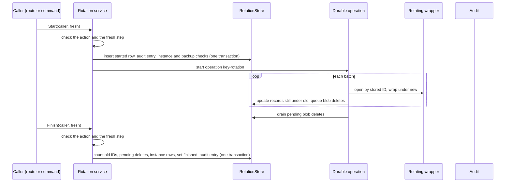
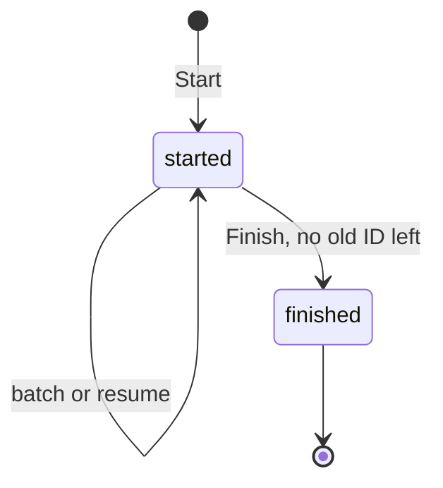

## Context

On main the key-encryption key wraps four families of records directly: the data keys of the scopes (`secret_keys`), the installation data keys (`installation_secret_keys`), the item keys (`item_keys` with one blob each) and the idempotency server key (`idempotency_server_key`). Each record stores the wrapper ID of its key. The start check refuses a database with more than one wrapper ID, and no rewrap exists.

The change adds one resumable rewrap of these four families with reads that keep working. It changes no data key value, no item key value and no content. The hierarchy of namespace keys and customer keys is not on main, so the rewrap acts on the records above. The engine takes both keys from its caller. They reach the process at start (decision 12), and a REST API and a CLI command drive the engine (decisions 14 and 15). A rotation only moves forward: start, resume, finish (decision 13). The owner decided these on 2026-11-20.

A rotation has three parts that must agree at each moment: the stored state (`started` or `finished`), the wrapper ID that each process writes with, and the wrapper IDs of the stored records. The decisions below fix the rule of each part and the check that holds the three together.

## Decisions

1. **Tables.** NEW table `key_rotation_state` in the baseline of each dialect holds one singleton row that the baseline inserts and that is always present: the key `1` (a CHECK allows no other), the `generation` (a `BIGINT`, 0 at the baseline) and the ID of the active rotation (null when none is `started`). The start and the finish each add 1 to the generation and no other write changes it. NEW table `key_rotations` holds one row for each rotation: ID, state (`started` or `finished`), old wrapper ID, new wrapper ID, actor, start time, end time and the ID of the durable operation. A partial unique index on the state `started` lets the store refuse a second active rotation. NEW table `key_rotation_blob_deletes` holds the pending deletes of decision 5: rotation ID and blob key. NEW table `instance_wrapper_ids` holds the wrapper IDs of each instance row (decision 8): instance ID (foreign key to `instance_versions`, delete cascades) and wrapper ID. NEW column `rotation_generation` of the `backups` row holds the generation that the backup read when it began (decision 9). The four new tables are control tables: a backup leaves them out and a restore keeps the live rows, as for `instance_versions` (`pkg/store/sqlite/restore.go:765` and `pkg/store/sqlite/restore.go:806`; `pkg/backup/coverage.go:52`). `backups` is a control table on main already (`TableBackups` in `pkg/backup/coverage.go`). Each new object sits in the name order of the baseline, and the change edits the baseline in place, with no numbered migration.
2. **The rewrap is a durable operation.** The kind is `key-rotation`, NEW const `KeyRotationKind`. Each step is one batch of at most 100 records of one family, in a fixed order of families, and the last step drains the pending deletes of decision 5. A claim, the step fence and the expiry give resume after a stop, and give one runner at a time. A resume starts a new pass over the families, so a record that a late write left under the old ID is found. A batch re-reads each record in its transaction and updates it only when its stored wrapper ID is still the old one, so a replay changes nothing. Resume answers 409 `key-rotation.claimed` while another instance holds a live claim. A record that opens under no held key stops the step. The rewrap writes one audit entry of kind `change`, outcome `failure`, for that record, with the family and the scope or stable ID, and no key bytes, and it logs the same fields. A repeat of the failure on a resume writes a new entry, so the operator sees each attempt.
3. **Wrapper, write rule and write fence.**
   - NEW `secret.Rotating` holds two `Wrapper` values and a read-only port `RotationState` with one method that answers the latest rotation row. NEW function `secret.Holds(wrapper, id)` answers true for the ID of a plain wrapper and for either ID of a `Rotating`. The five places that compare a stored ID with the ID of the wrapper call it.
   - **Unwrap by the stored ID, with no trial (nit N1).** The AAD of a wrapped key binds the scope and not the wrapper ID (`pkg/secret/builtin.go:73`, `pkg/secret/builtin.go:85`). So a trial under each key would work by the GCM tag and would tell nothing about which key the record names. NEW optional interface `IDUnwrapper` with `UnwrapByID(ctx, id, ciphertext, aad)`. `Rotating` implements it: it picks the key whose ID equals `id` and returns `ErrDecrypt` for any other ID. Its plain `Unwrap` method, which has no ID, returns `ErrDecrypt` and never tries a key. A helper `unwrapStored` calls `UnwrapByID` when the wrapper has it, and otherwise compares the ID and calls `Unwrap`. The data key open (`pkg/secret/envelope.go:48`), the installation key open, the item key open, the idempotency key open (`pkg/store/internal/codec/idempotency.go:320`) and the restore open (`OpenKey`, `pkg/secret/secret.go`) use the helper.
   - **Write rule (blocking B1) and fail closed (nit N-e).** `Rotating.Wrap` reads the singleton row and the latest rotation row for each wrap and picks the key: no rotation row: the old key; state `started` or `finished`: the key of the new wrapper ID of the row. A process that holds both keys therefore writes under the old key until a rotation is stored, so an instance that holds the old key alone can open every record that exists before the start. The read is two indexed lookups for each new data key, installation key, item key or idempotency key. It is not on the path of a read. `Wrap` fails closed: when the read fails it returns the error and wraps nothing, and when the new wrapper ID of the row is an ID that the process does not hold it returns `ErrWrapperMismatch` and wraps nothing. It never falls back to the old key on an error.
   - **Write fence (blocking B-a, B-b).** The fence does not depend on a row that may be missing. The singleton row `key_rotation_state` is always present. `Rotating.WrapStamped(ctx, key, aad)` returns the ciphertext and the `generation` that it read in the same call, and the four write paths (data key, installation data key, item key, idempotency key) pass that generation to the store. In the transaction of the write, the store reads the singleton row and fails with NEW `ErrRotationFence`, writing nothing, when (a) the generation of the stamp is not the generation of the row, or (b) the row holds an active rotation and the wrapper ID of the record is not its new wrapper ID. A plain wrapper gives no stamp, so only (b) applies to its writes. The service wraps again with the fresh state and writes again after one `ErrRotationFence`.
   - **PostgreSQL.** The write reads the singleton row with `FOR SHARE`. The start and the finish take the singleton row with `FOR UPDATE` before any check. A writer that holds its share lock therefore blocks the start or the finish until it commits, and a writer that reads the row after a start or a finish sees the new generation and fails once. A writer that wrapped under the generation 0, stalls, and meets the row after a start and a finish (generation 2) fails in (a): a record under the old ID cannot commit after the finish count. The check of an instance row, the check of a running backup and the insert of the rotation row run in the same transaction as the `FOR UPDATE` of the start, and the write of an instance row and the begin of a backup take the singleton row with `FOR SHARE` in their own transactions. This removes the write skew across tables: a concurrent instance write or backup begin either commits before the start reads it, or waits for the start and then fails its own check.
   - **SQLite.** Each write and the start and the finish are write transactions, and SQLite lets one write transaction run at a time (the write lock of the database). The singleton read and the generation compare run inside that transaction, so the order is strict by the lock: the same rules (a) and (b) hold with no extra statement. The test suite runs the same hostile table on both dialects.
   - **After a restore (blocking B-b).** The restore keeps the live singleton row and the live rotation rows (decision 1). Rule (b) applies only while a rotation is `started`, and a restore is refused while one is (decision 9). After a finished rotation A to B, a restore of an all-A backup, and the start of a plain A process (row 9), no rule refuses a write: the generation of its wraps is not stamped, and no rotation is active. The write works.
4. **Start.** The start succeeds only when, in the transaction that inserts the row: no rotation is `started` (the unique index); the two wrapper IDs differ and each wrapper is built; each stored wrapper ID of the four families is the old or the new ID (a third ID fails with the family and the count); the old wrapper opens one record of each non-empty family that holds the old ID; each row of `instance_versions` has both wrapper IDs in `instance_wrapper_ids` (decision 8); no backup runs (decision 9). The audit entry commits in the same transaction (decision 7). The start leaves the records as they are. Any record that holds the new ID already is skipped by the rewrap. This allows a start in the other direction after a finish, and a second start of the same pair after a stopped rewrap that the operator finished by hand with no row (none exists today).
5. **Item keys and pending deletes (blocking B5).** The rewrap of an item key reads the record, opens the blob under the old key, wraps again, writes a new blob (new attempt part, next version) and then, in one transaction, updates the record (the transaction checks the record is not shredded) and inserts one row in `key_rotation_blob_deletes` for the old blob key. After the commit it deletes the old blob from the live store and then deletes the row. A crash between the commit and the delete leaves the row, so the delete runs again at the next pass, and a delete of a blob that is gone counts as done. If a shred committed between the read and the write, the rewrap deletes the new blob and writes no row. This follows the steps that ADR 217 decision 18 gives for the namespace key. NEW method `ItemKeyIndex.RewrapItemKey`, with a conformance test before any adapter. The deleter of the rewrap works on the live store only (decision 16). Finish refuses while a row of the rotation remains in `key_rotation_blob_deletes` (decision 8).
6. **The idempotency server key (nit N5).** The rewrap opens the key under the old key and replaces the row with the existing compare-and-swap replace of the store, so the replay records stay. The start check counts the wrapper ID of the idempotency key (decision 10), so a process that holds no key for that ID does not start, and it never reaches the reset path of main (`pkg/store/internal/codec/idempotency.go:266`). No ADR line allows the silent reset of a rotation: `rg -i 'idempotency' docs/adr docs/rfc` finds no decision about the reset. This change chooses to refuse at start. The reset path stays for a row that holds a held ID and fails to open (damage), and it returns an error in place of a reset while a rotation is `started`, so a rotation never drops replay records. After `finished`, the reset path works as on main (nit N-c).
7. **Audit is the record, and it fails closed (nit N2).** Start, resume, finish and each failed record of the rewrap write one entry of kind `change` in the scope `@server`. An entry holds the actor, the time, the old and the new wrapper ID and, at finish, the counts. It never holds key bytes. SQLite `AppendServer` opens its own transaction (`pkg/store/sqlite/audit.go:61`), so it cannot join the state change. The store methods that change the rotation state take the entry and use `inAuditedTx` (`pkg/store/sqlite/audit.go:86`, `pkg/store/postgres/audit.go:125`): NEW `RotationStore.StartRotation(ctx, Rotation, audit.Entry)`, `FinishRotation(ctx, id, at, audit.Entry)` and `RecordResume(ctx, id, audit.Entry)`. A failed audit write fails the call and leaves the state as it was. The port and its conformance suite hold these signatures.
8. **Instance rows and finish (blocking B2).**
   - A process writes the wrapper IDs that it holds in `instance_wrapper_ids` in the transaction that writes its instance row: one ID for a plain wrapper, two for a `Rotating`. The transaction takes the singleton row with `FOR SHARE` (decision 3). **Order (nit N-b).** On main `startUp` calls `registerInstance` before `secret.CheckWrapper` (`pkg/dustpan/dustpan.go:2619` and `:2625`), so a refused process leaves a row. This change moves the call after the checks of decision 10, and a test shows that a refused process leaves no instance row. NEW `InstanceStore` method `RegisterInstanceKeys`. The row of a process that dies stays, as it does on main (`pkg/installation/instances.go:29`). It blocks start and finish until the administrator deletes it with `DELETE /api/server/instances/{id}`, and the answer names its ID.
   - Start and finish refuse with `key-rotation.instance-lacks-key` while a row has not both IDs of the rotation. After the start, a process that holds one key does not start (decision 10), so no new row lacks an ID.
   - Finish runs in one transaction that: counts the records that hold the old ID in the four families (each count is zero); reads `key_rotation_blob_deletes` (it is empty for the rotation); reads `instance_wrapper_ids` (each row holds both IDs); sets the state `finished` and adds 1 to the generation; and writes the audit entry with the counts. The transaction takes the singleton row with `FOR UPDATE` first, so no stamped writer can commit an old-ID record between the count and the commit (decision 3). After the commit the start check needs the new key alone (decision 10).
9. **Backup and restore (blocking B4, reviewer-prescribed).**
   - A backup is refused while a rotation is `started`. The backup start reads the singleton row (`FOR SHARE`) in the transaction that writes the backup row and stores the generation in `rotation_generation` (`pkg/backup/service.go:689`, `pkg/backup/service.go:368`) and fails with NEW `secret.ErrRotationActive`, answered as 409 `backup.key-rotation-active`. The rotation start refuses while a backup runs (409 `key-rotation.backup-running`; the text names the backup ID and `GET /api/dustpan/v1/backups/{id}`). **A stuck running backup (nit N-g).** No command on main clears or fails a running backup: `rg` over `internal/api/server/backups.go` finds the routes `POST` and `GET` of `/api/dustpan/v1/backups`, `GET` of `/backups/{id}` and `/backups/{id}/check` only, and `internal/cli/backup.go` has no cancel row. A backup whose process stops is taken over by another instance after the lease and ends `done` or `failed` (`pkg/backup/service.go:394`). This change adds no command for it. The refusal text says to wait for the end of that backup. A backup that never ends is outside this change. A backup that ends reads the singleton row again before it writes its manifest and fails when the generation is not the stored one (nit N-d: a counter, not a wall clock), so a start that commits between the two reads still cannot yield a backup with a row and no blob. A scheduled backup that is refused logs the refusal and writes an audit entry of outcome `failure`.
   - Why a refusal and not a delete in a last step: the rewrap deletes the old blob of an item key at once (decision 5), and a backup in flight can copy an item key row whose blob is gone. The refusal is the simplest rule and needs no change of the order of the rewrap. The reviewer prescribed it. The cost is that no backup runs during the rewrap, and the docs page says so.
   - A restore is refused while a rotation is `started`, in `admitStart` (`pkg/backup/restore_service.go:519`), with 409 `restore.key-rotation-active`. The restore key check needs a key for every wrapper ID of the manifest: `backupKeyCheck.run` (`pkg/backup/staging.go:295`) replaces the single comparison at line 306 with `secret.Holds` for each ID of the manifest, and it fails with `ErrWrapperMismatch` for the first ID that the wrapper does not hold (nit of blocking B3, part c). A manifest with no wrapper ID needs no key.
10. **Start-up (blocking B3).** The start check reads the latest rotation row and the wrapper IDs of the four families (the data keys, the installation data keys, the item keys through `ListItemKeyWrapperIDs`, and the idempotency key). The table gives each case. S is the set of stored IDs, P the ID of a plain wrapper, O and N the IDs of the old and the new key of a `Rotating`, and R the latest rotation row.

    | # | Latest row R | Wrapper | Stored IDs S | Result |
    | --- | --- | --- | --- | --- |
    | 1 | none | plain P | S is empty or S is {P} | Start. |
    | 2 | none | plain P | S holds an ID other than P | Refuse with `ErrWrapperMismatch`. The text names both IDs and keeps the word "rewrap". |
    | 3 | none | Rotating (O, N) | S is inside {O, N} | Start (the operator staged both keys before the start). |
    | 4 | none | Rotating (O, N) | S holds an ID outside {O, N} | Refuse with `ErrWrapperMismatch`. |
    | 5 | `started` | plain | any | Refuse with `ErrRotationActive`. The text names the state and both IDs of R. |
    | 6 | `started` | Rotating (O, N) with {O, N} not equal to {R.old, R.new} | any | Refuse with `ErrRotationActive`. |
    | 7 | `started` | Rotating (R.old, R.new) | S is inside {O, N} | Start. |
    | 8 | `started` | Rotating (R.old, R.new) | S holds an ID outside {O, N} | Refuse with `ErrWrapperMismatch`. |
    | 9 | `finished` | plain P | S is {P} | Start. |
    | 10 | `finished` | plain P | S holds an ID other than P (the old key after finish) | Refuse with `ErrWrapperMismatch`, as main does. |
    | 11 | `finished` | Rotating (O, N) with O equal to R.old | any | Refuse with NEW `ErrOldKeyHeld`: the text names `DUSTPAN_KEY_ENCRYPTION_KEY_OLD` and `DUSTPAN_KEY_ENCRYPTION_KEY_OLD_FILE`, says to remove the one that is set, and names `opendustpan serve` with the new key alone (owner, 2026-11-20, round 2). There is no warning. |
    | 12 | `finished` | Rotating (O, N) with O not equal to R.old | S is inside {O, N} | Start. This is the start in the other direction (decision 13), or a start before a later rotation. |
    | 13 | `finished` | Rotating (O, N) with O not equal to R.old | S holds an ID outside {O, N} | Refuse with `ErrWrapperMismatch`. |

    **Open (B-c, owner):** the table above refuses row 11 for any S. Whether a restore of a pre-rotation backup after a finish needs row 11 to refuse only when S holds no `R.old` ID is not decided here. See the proposal. A process with no key and a database with no wrapped key starts as on main. A process with no key and a database that holds a wrapped key is refused as on main (`ErrKeyNotConfigured`). The same table holds for each of the four families: the check reads the union of their IDs. The table is the contract of the test `TestStartUpMatrix`, one row for each line.
11. **Authorization at the service (blocking B6; the action is owner, 2026-11-20).**
    - NEW constant `ActionInstallationRotateKeyEncryptionKey = "installation:rotate-key-encryption-key"` in `pkg/identity/identity.go`, next to `ActionInstallationStoreCheck` (line 262). Object: `ServerObject()`. `pkg/access/access.go` classifies it in `FamilyAdministration` (as `server:manage-sign-in`, line 165) and `siteOnlyActions` (`pkg/access/roles.go:150`) lists it, so only the site administrator holds it. The grant is a stored grant of the built-in role, as every grant is. The row for the table of ADR 216 decision 3 is a task.
    - The route checks the action, as every route does. The service checks it too, because CLAUDE.md step 4 says that the check is at the point of use and that no layer relies on another. NEW rotation service methods `Start(ctx, caller identity.Principal, fresh FreshCheck, req)`, `Resume(ctx, caller)`, `Finish(ctx, caller, fresh FreshCheck)`, `Show(ctx, caller, id)` and `List(ctx, caller)`. Each takes the `identity.Authorizer` at construction and calls `Authorize(ctx, caller, ActionInstallationRotateKeyEncryptionKey, identity.ServerObject())` first, in the form of `internal/trustrulesvc/service.go:471 (method authorizeCreate)`. A denial returns NEW `ErrRotationDenied` (it wraps `identity.ErrDenied`), writes one audit entry of outcome `denied` with the action and the object, and changes nothing. A check that cannot run returns `ErrAccessUnchecked` and fails closed. A nil authorizer fails the constructor.
    - `FreshCheck` is `func(context.Context) error`. The handler passes the check that `Handler.fresh` uses (`internal/api/server/freshness.go:221`). `Start` and `Finish` call it after the action check and fail with the fresh-step error when it is nil or returns an error, so a new caller of the service cannot skip the step. The batches of the durable operation run as the system after a start or a resume that passed the check. They need no caller, and their audit entries name the actor of the start.
12. **The old key (owner, 2026-11-20; nits N3 and N4).**
    - `loadKeyEncryptionKey` (`cmd/opendustpan/main.go:1887`) gets a twin for `DUSTPAN_KEY_ENCRYPTION_KEY_OLD` and `DUSTPAN_KEY_ENCRYPTION_KEY_OLD_FILE`. Both read the value or the file as the current key does: base64, 32 bytes, the file mode rule (no bit for group or others), no flag.
    - **Both variables together are refused (N3).** Main lets the value win silently (`cmd/opendustpan/main.go:1905`). For the old key, a value and a file together fail the start with a text that names both variables. The change does not touch the rule of the current key.
    - **Both are sensitive (N3).** The two settings are declared in `internal/cli/settings.go` as `envSetting` entries with `WithSensitive()`, so `SensitiveEnvs` lists them and `clearSensitiveEnv` (`cmd/opendustpan/envclear.go:22`) clears them after the start. The reader also clears the value variable at the read, as line 1893 does. A test reads the process environment by name after the start and finds neither variable.
    - **Zero the bytes (N4).** The decoded old key bytes and the raw text are zeroed with `clear` after the wrapper is built. The new key keeps the behavior of main.
    - **The file read (N4, blocking B-e).** The old key file opens through a root: `os.OpenRoot(filepath.Dir(path))`, then `root.Open(base)`, then `f.Stat()` on the open descriptor for the mode check and the regular-file check. `os.Root` refuses a path that escapes the directory (a link that leads outside it, an absolute link, a `..` out of the root) and follows a link that stays inside it. A Kubernetes Secret volume shows `key` as a relative link to `..data/key` and `..data` as a link to a timestamp directory, all inside the one directory, so it opens. A swap of the path between the check and the read cannot change the file, because the mode comes from the descriptor. A refusal names `DUSTPAN_KEY_ENCRYPTION_KEY_OLD_FILE`. This is stricter than `readKeyFile`, which follows every link (`cmd/opendustpan/main.go:1935`). The change does not touch `readKeyFile` itself. The chart example is in the docs page (task 4.4): a Secret volume and `server.extraEnv` with `DUSTPAN_KEY_ENCRYPTION_KEY_OLD_FILE` (`deploy/helm/opendustpan/values.yaml:236`).
    - When the old key is set, the process builds `Rotating(old, new)`. The start of the process fails when the wrapper IDs of the old key and of the new key are equal.
13. **A rotation only moves forward (owner, 2026-11-20, round 2).** The states are `started` and `finished`. There is no abort route, command, code or audit action. A rotation that stops is resumed. A rotation that cannot end, for example because a record opens under no held key, stays `started`: the operator stages the right key and resumes. To go back to the old key, the operator finishes, then starts a rotation in the other direction (table row 12), with the keys swapped between the two variables. No state of this change is an aborted state.
14. **The API (owner, 2026-11-20).** Routes under `/api/dustpan/v1/key-rotations`, each with the action of decision 11 and `ServerObject()`, in the form of `internal/api/server/store_checks.go:126`:
    - `POST /key-rotations` starts a rotation. 202. The body has no field; it never holds key bytes, and the decode is strict. Wrapped by `Handler.fresh`. Needs `Idempotency-Key`.
    - `GET /key-rotations` lists rotations, newest first. `GET /key-rotations/{id}` answers state, old and new wrapper ID, counts for each family, the pending deletes and the operation state.
    - `POST /key-rotations/{id}/resume` claims the durable operation again. No fresh step.
    - `POST /key-rotations/{id}/finish`. Wrapped by `Handler.fresh`.
    Errors have codes in the NEW file `internal/errcode/catalog_keyrotation.go`: `key-rotation.active` (409), `key-rotation.old-key-missing` (409), `key-rotation.incomplete` (409, with the counts), `key-rotation.not-found` (404), `key-rotation.not-active` (409, for a resume or a finish of a finished rotation), `key-rotation.claimed` (409), `key-rotation.instance-lacks-key` (409), `key-rotation.backup-running` (409). The catalogs of the backup and the restore get `backup.key-rotation-active` and `restore.key-rotation-active` (409), in `internal/errcode/catalog_backup.go` and `internal/errcode/catalog_restore.go`. A refusal of the action writes the denial entry as for every route. **Open (Q-1, owner):** whether the documented API path (the password sign-in) also reaches start and finish when the MFA policy asks site administrators for a second factor is not decided here. See the proposal. The operation labels, the request and response types and the regenerated API description follow the store check (`internal/api/server/operations_storecheck.go:15`).
15. **The command (owner, 2026-11-20).** NEW group `opendustpan key-rotation` with `status`, `resume`, `start` and `finish`, a client of the API (server ADR 39 decision 1). `status` calls the two GET routes and `resume` calls the resume route, with `SettingsFor("server", "ca-file")` as `internal/cli/store_check.go:9` does. `start` and `finish` send no request. They print the documented path (the sign-in, the CSRF read, the call with the cookie, the CSRF header and `Origin`) and the docs page, as `internal/cli/audit_chain.go:17` does for the approval (owner, 2026-11-20, round 2). The command never reads a key. It reads no `DUSTPAN_KEY_ENCRYPTION_KEY*` variable.
16. **Targets keep their blobs (owner, 2026-11-20).** The rewrap deletes the old item key blob in the live store (decision 5) and never in a backup target. No code path of the rewrap holds a target. Retention of backups removes the old blobs when it removes the backup.
17. **Old wraps stay in storage (nit N7).** An update of a row in PostgreSQL leaves the old row version in the table until vacuum, and SQLite leaves free pages and the write-ahead log. A backup made before the finish holds the old wraps. A rotation therefore does not protect against a person who holds the old key and a copy of the database from before the finish. The docs page `docs/guides/key-rotation.md` says so in its first section, and names the follow-up that removes the copies: a vacuum and a delete of old backups, which the operator does.
18. **Page cursors carry the wrapper ID (blocking B-d).** NEW functions `secret.SealWithID(ctx, w, plain, aad)` and `secret.OpenWithID(ctx, w, sealed, aad)` in `pkg/secret`. The sealed value is one length byte, the wrapper ID, and the ciphertext. `SealWithID` calls `WrapStamped` when the wrapper has it, and `Wrap` otherwise, and reads the ID from the wrapper that wrapped. `OpenWithID` reads the ID, and calls `unwrapStored` (decision 3), so a `Rotating` picks the key by the stored ID. An ID that the wrapper does not hold, a length byte that is 0 or longer than the rest, and a ciphertext of another AAD fail with `ErrDecrypt`. The four call sites (`internal/api/jobs/list.go:188` and `:215`, `internal/api/server/namespaces.go:394` and `:417`) call these two functions. A test lists every non-test call of `.Unwrap(` with `rg` and shows that each one is in `unwrapStored`, in `OpenWithID` or in a test. The old cursor format is not kept: no tag shipped it (ADR 322).

## Structure

NEW unexported fields and a constructor for `Rotating` and for the rotation service, so a value cannot exist with equal IDs, with an empty key, with a nil store or with a nil authorizer. NEW port `secret.RotationStore` with a conformance suite in `secrettest`. The store adapters implement it for SQLite and PostgreSQL. No new tool, no custom analyzer.

## Risks

- A large item key table makes the rewrap slow. Batches and resume bound each step. No backup runs during the rewrap (decision 9).
- Page cursors are sealed with the wrapper (`pkg/dustpan/dustpan.go:3051`, `pkg/dustpan/jobs.go:86`) and are opened with the plain `Unwrap` (`internal/api/jobs/list.go:215`, `internal/api/server/namespaces.go:417`). The plain `Unwrap` of `Rotating` returns `ErrDecrypt`, so without a change every list cursor would fail for the whole window of the staged keys. Decision 18 fixes it. A cursor sealed under the old key stops opening after the finish. The caller gets the existing invalid cursor answer and starts the list again.
- Old item key blobs in backup targets stay readable with the old key (owner, 2026-11-20). A copy of the old key must stay as long as the oldest backup that holds them.
- A stale instance row blocks start and finish until an administrator deletes it. The answer names the row.
- A rotation that cannot end stays `started` and blocks backups. The operator resumes it with the right key staged.
- Old key copies outside the server stay outside this change.

## Layers (defense in depth)

One table for each layer. Each guard has a test that fails when the guard is removed. Each redundant check gets the comment that CLAUDE.md asks for.

| Layer | Guard | Hostile test |
| --- | --- | --- |
| Port adapter (store) | `StartRotation` refuses a second active rotation by the unique index. The batch update names the old wrapper ID in its `WHERE` clause. Wrapper IDs are bound as placeholders. The new ID must not equal the old ID. The write fence reads the always-present singleton row (`FOR SHARE` on PostgreSQL, the write lock on SQLite) and refuses a stale generation, and refuses an ID other than the new ID while a rotation is `started`. Start and finish take the singleton row `FOR UPDATE`. Finish counts, checks the pending deletes and the instance rows in its transaction. | Two concurrent starts; a batch replay with a record that already holds the new ID; a wrapper ID with a quote and a semicolon; equal IDs; an insert of a record under the old ID after the start; a PostgreSQL write that holds its fence read (its share lock) across a start and a finish: the start waits, and a writer with a stale generation fails after both; a finish that races with such an insert; a finish with one pending delete; a finish with one instance row that lacks an ID; a concurrent instance write and a concurrent backup begin against a start. |
| Service (`secret`) | The constructor accepts two built wrappers, a store and an authorizer. Each method checks `installation:rotate-key-encryption-key` on `ServerObject` before it reads or writes, and `Start` and `Finish` call the fresh check. Rewrap re-opens each record under its stored ID and refuses a record that opens under no held key. Finish counts all four families. Each state change and its audit entry share one transaction. | A caller without the action on each method (with the denial entry); a nil fresh check; a record under a third ID; a record that fails to open; finish with one old record left in each family; an audit store that fails. |
| Wrapper | `Holds` answers true only for a held ID. `UnwrapByID` fails closed with `ErrDecrypt` for an ID that the wrapper does not hold and for a ciphertext of another key. The plain `Unwrap` of `Rotating` tries no key. `Wrap` fails closed when the state read fails and when the new ID of the row is not held. `OpenWithID` fails closed for an unheld ID. | An ID of a third key; a truncated ciphertext; a ciphertext made for another AAD; a call of `Unwrap` without an ID; a state store that returns an error on `Wrap`; a row whose new ID is a key that the process does not hold; a cursor with a length byte of 0. |
| Start-up and restore | The table of decision 10, one test for each row. A restore needs every wrapper ID of the manifest and is refused while a rotation is active. | Each of the 13 rows with a store that holds the IDs of the row; a manifest with two IDs and a plain wrapper; a restore while active. |
| Backup | A backup is refused while a rotation is active and the rotation start refuses while a backup runs. | A backup start after a rotation start; a rotation start during a backup; a backup that ends after a rotation start. |
| Instance rows | Start and finish refuse while a row lacks an ID of the rotation. A refused process leaves no row. | A row with one ID; a row with no ID; a row that a process left; a process that start-up refuses. Removal proof: take out the instance check of the start once and show `TestStartRefusesInstanceWithOneID` fail. |
| Log and audit | Entries and logs hold wrapper IDs and counts, never key bytes or ciphertext. | A capture of logs and audit entries during a full rotation, searched for the key bytes in base64 and in hex. |
| HTTP handler | Each route declares the action and `ServerObject()`. Start and finish need a fresh step. The body limit and a strict decode: the start body has no field, so a key field is refused. | A token of the account administrator; an access token on start and finish; a body with a `key` field; a body over the limit. |
| Old key source | The old key comes from a variable or from a file that opens through `os.OpenRoot` of its directory, is a regular file, and has no mode bit for group or others (read from the descriptor), never from a flag. The variable and the file together are refused. The variables are sensitive and cleared. The bytes are zeroed after use. Equal keys fail at start. | A file with mode 0644; a link that escapes the directory; an absolute link; a relative link such as `..data/key` inside the directory (it opens); a file that is not regular; a value that is not base64; the variable and the file together; equal old and new key; a read of the environment after start. |
| Target | The rewrap holds no target and deletes no blob in one: the deleter takes the live store only, and the rewrap code imports no target type. | A rewrap over a fixture with a live store and two targets: each target keeps every old blob, the live store keeps none, and a deleter that is given a target fails the compile or the test. Removal proof: give the deleter the target list once and show `TestRewrapKeepsTargetBlobs` fail. |

## Diagrams

After this change (the engine and the routes of decision 14):

States of a rotation:

## Quality attributes

| Attribute | Target | Unit | Scope |
| --- | --- | --- | --- |
| batch size | 100 | records | each step |
| step time | 60 | s | each batch, then the step fails and the claim retries it |
| read correctness during rotation | 100 | % | reads of the four families and opens of page cursors, while both keys are staged (a cursor sealed under the old key fails after the finish) |
| record size | 1 | KiB | each rotation row |

## Threat model

| Boundary | STRIDE | Threat | Layer | Guard | Hostile test |
| --- | --- | --- | --- | --- | --- |
| caller to service | S, E | A caller starts a rotation to a key that the attacker holds. | Service | The service takes built wrappers from the process that holds the keys. No request field carries key bytes. The service checks the action of decision 11, held by the site administrator only, and a fresh step for start and finish. | A start with equal IDs and with a nil wrapper; a caller without the action. |
| service to store | T | A tampered row downgrades a record to the old key, or finish passes with an old record left. | Port adapter, service | The update names the old ID; the write fence refuses an old ID after the start; finish counts under the transaction; an unknown ID is refused. | A record under a third ID; a record written between count and finish. |
| instance to store | T, D | A running process that holds the old key alone writes old-ID records, or replaces the idempotency key. | Port adapter, start-up | Each instance row names its IDs; start and finish refuse; the fence refuses its writes; the reset path returns an error during a rotation. | An old-only row; an old-ID write after the start. |
| store to log | I | Key bytes reach a log or an audit entry. | Log and audit | Only IDs and counts are written. | A capture of logs and entries. |
| restart | D | A process with one key serves a half-rewrapped store. | Start-up | The table of decision 10 needs a `Rotating` wrapper while a rotation is active. | A plain wrapper with an active rotation. |
| action | E | An account administrator or an operator starts a rotation. | Service, HTTP handler | The action is in `siteOnlyActions`; the service and the route check it; start needs a fresh step. | The two roles; a token without a fresh step. |
| restore and backup | T | A backup or a restore across a rotation brings back old wraps, a row with no blob or a stale rotation row. | Backup, restore | A backup and a restore are refused while active; a restore needs every manifest ID. | A restore with a manifest of two IDs; a backup during the rewrap. |

## Contract

**Rotation (package `secret`)**

- Invariant: At most one rotation has the state `started`.
- Invariant: Each directly wrapped record holds exactly one wrapper ID, and a rewrap changes only that ID and the ciphertext.
- Invariant: While a rotation is active, a read of a record under the old key or the new key succeeds.
- Invariant: While a rotation is `started`, no write commits a record under an ID other than the new ID.
- Invariant: A stamped write commits only when its generation is the generation of the singleton row at commit.
- NEW `func NewRotating(oldWrapper, newWrapper Wrapper, state RotationState) (*Rotating, error)`: returns `ErrInvalidKey` for a nil wrapper, a nil state or two equal IDs.
- NEW `func Holds(w Wrapper, id string) bool`.
- NEW `func (r *Rotating) WrapStamped(ctx, key, aad []byte) (ciphertext []byte, generation int64, err error)`; NEW `func SealWithID(ctx, w Wrapper, plain, aad []byte) ([]byte, error)` and `func OpenWithID(ctx, w Wrapper, sealed, aad []byte) ([]byte, error)`.
- NEW `type IDUnwrapper interface`: `UnwrapByID(ctx, id string, ciphertext, aad []byte) ([]byte, error)`.
- NEW `type RotationStore interface`: `StartRotation(ctx, Rotation, audit.Entry) (Rotation, error)` returns `ErrRotationActive`, `ErrInstanceLacksKey` or `ErrBackupRunning`; `GetLatestRotation(ctx) (Rotation, error)` returns `ErrNoRotation`; `CurrentState(ctx) (RotationView, error)` answers the singleton row (generation and the active rotation ID) and never returns `ErrNoRotation`; `RewrapKeys(ctx, family, oldID, newID, batch)` for the data keys, the installation data keys and the idempotency key; `QueueBlobDelete`, `PendingBlobDeletes` and `DoneBlobDelete`; `CountWrapperIDs(ctx) (map[string]int, error)`; `FinishRotation(ctx, id, at, audit.Entry) error` returns `ErrRotationIncomplete`, `ErrInstanceLacksKey`; `RecordResume(ctx, id, audit.Entry) error`.
- NEW sentinels `ErrRotationActive`, `ErrNoRotation`, `ErrRotationIncomplete`, `ErrRotationFence`, `ErrRotationDenied`, `ErrOldKeyHeld`, `ErrInstanceLacksKey`, `ErrBackupRunning`. Each wraps with `fmt.Errorf("...: %w", err)`, and the adapter translates driver errors.
- `StartRotation`: pre: no rotation is active, the two IDs differ and each wrapper opens one record of each non-empty family that holds its ID. Post: one row `started` and one audit entry.
- `RewrapNextBatch`: pre: the rotation is `started`. Post: each record of the batch holds the new ID and the same stable ID or scope.
- `FinishRotation`: pre: no record holds the old ID, no pending delete remains, each instance row holds both IDs. Post: the row is `finished`; the old ID is refused at start.
- NEW routes of decision 14 and NEW `ActionInstallationRotateKeyEncryptionKey`.
- NEW `ItemKeyIndex.RewrapItemKey(ctx, ref, from ItemKey, to ItemKey, oldBlob blob.Key) (ItemKey, error)`: returns `ErrShredded` for a shredded record and `ErrKeyNotFound` when the record is gone or no longer holds the old ID. It writes the pending delete row of the old blob in the same transaction as the record.

## Failure modes

| Step | Failure | Retry | State after |
| --- | --- | --- | --- |
| Batch | The process stops mid-batch. | A new claim of the operation runs the step again. | `started`; records of the batch are all old or all new |
| Batch | One record fails to open under both keys. | The step fails with the record's scope and writes one audit entry. The operator stages the right key and resumes. | `started` |
| Item key | A shred commits between read and write. | The new blob is deleted and the record is skipped. | `started` |
| Item key | The process stops after the commit of the record and before the delete of the old blob. | The next pass deletes the blob from the stored list. Finish refuses until the list is empty. | `started`; one pending delete |
| Finish | A record still holds the old ID. | Finish returns `ErrRotationIncomplete`; run the rest of the batches. | `started` |
| Finish or start | An instance row lacks an ID. | Restart that instance with both keys, or delete the row of a process that is gone. | unchanged |
| Start | The process holds no old key. | Stage the old key and restart. | unchanged |
| Start | A backup runs. | Repeat after the backup ends. | unchanged |
| Resume | Another instance holds the claim. | Repeat after the lease ends. | `started` |
| Fresh step | The request has an access token or an old sign-in. | Sign in again over the API as the docs page shows. | unchanged |
| Write | A stamped write meets a new generation. | One `ErrRotationFence`; the service wraps again and writes again. | unchanged |
| Audit | The audit write fails. | The call fails with no state change. | unchanged |
