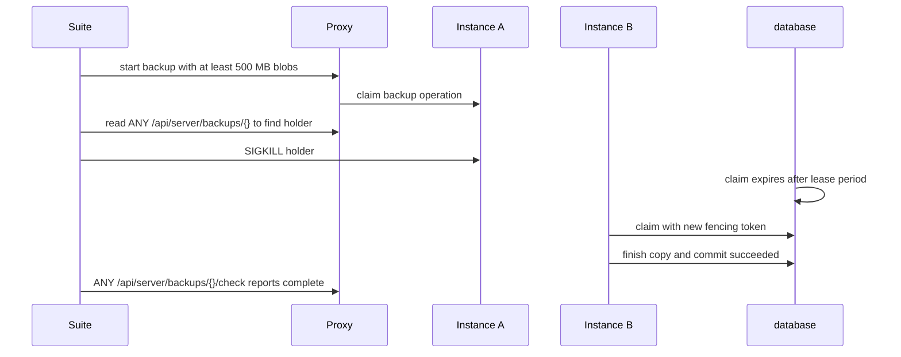
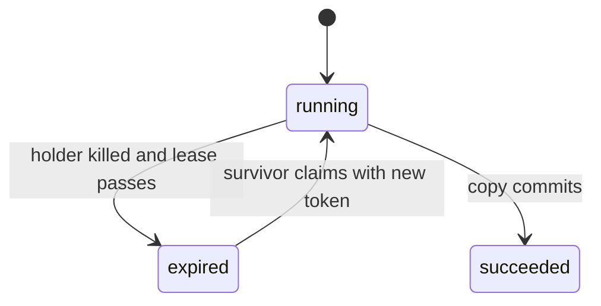
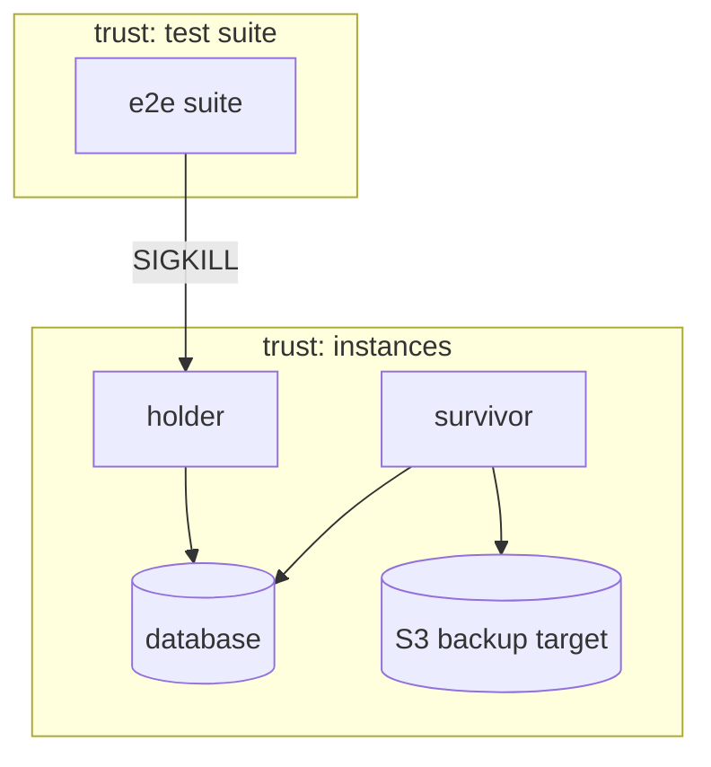

## Context

Three serve processes share one PostgreSQL database and one S3-compatible bucket and backup target. The backup runs as a claimed durable operation. SIGKILL stops the holder without release.

## Decisions

1. **Takeover by claim expiry.** Reuse the existing durable operation claim with expiry and fencing token. Add no new lease table and no holder heartbeat outside the database.
2. **Deterministic kill window.** Seed at least 500 MB of blobs, throttle the backup target copy so the copy still runs at kill time, and check backup status before the kill. The suite kills the holder named by backup status and waits the lease period plus 60 seconds.

## Structure

No new type. The change reuses the durable operation claim with expiry and fencing token. The NEW field expiryCount is a plain count read from the operation row.

## Risks

- Copy finishes before the kill on fast storage; mitigation is a throttled target and a status check at kill time.
- The proxy sends reads to the killed holder during drain; mitigation is active checks on /health/ready with retry on the survivor.

## Diagrams

After this change:

States and transitions after this change:

## Quality attributes

| Attribute | Target | Unit | Scope |
| --- | --- | --- | --- |
| takeover time | 90 seconds, which is the 30 second lease period plus 60 seconds, from kill to succeeded | seconds | one backup of at least 500 MB of blobs on PostgreSQL with S3-compatible target |
| correctness | exactly 1 expiry counted | count | killed backup operation |

## Threat model

Data flow and trust boundaries:

| Boundary | STRIDE | Threat | Layer | Guard | Hostile test |
| --- | --- | --- | --- | --- | --- |
| Instance to shared database | T | Stale holder writes backup rows after takeover. | boundary check | Check the fencing token on every backup step write and refuse an old token. | Send a step write with a stale token after takeover and expect refusal. |
| Instance to shared database | T | Stale holder writes backup rows after takeover. | encode or contain | Bind the token as a query value with placeholders. | Send a token with SQL text and expect refusal with no claim change. |
| Instance to shared database | T | Stale holder writes backup rows after takeover. | limit | Allow one claim per backup through one conditional update. | Claim the same backup from two workers at once and expect one winner. |
| Instance to shared database | T | Stale holder writes backup rows after takeover. | authorize at point of use | Check claim ownership in the same transaction that writes the backup row. | Write backup rows with an old token after takeover and expect denial. |
| Instance to shared database | T | Stale holder writes backup rows after takeover. | fail closed | Roll back a step when the database connection is lost. | Drop the connection mid-commit and expect no succeeded state. |

## Contracts

**BackupOperation**

- Invariant: One backup claim holder at a time.
- Invariant: The fencing token increases on each takeover.
- Invariant: A backup that ends succeeded never changes state.
- `ClaimExpired`: pre: Expiry passed on the database clock.. Post: After the lease period the claim is available to another worker..
- `ResumeCopy`: pre: Survivor holds the current fencing token.. Post: Target holds only bytes that match the backup manifest..
- `ReclaimAfterCrash`: pre: Survivor stopped before commit and its expiry passed.. Post: A live survivor holds the claim or the backup ends failed with a reason..

## Failure modes

| Step | Failure | Retry | State after |
| --- | --- | --- | --- |
| Copy blobs to target | Holder SIGKILL mid-copy. | Survivor claims after the lease period and resumes the copy against the manifest. | running with new fencing token |
| Commit backup succeeded | Survivor stops before commit. | Next survivor claims after expiry and commits once. | running with increased fencing token, or failed when no survivor claims |
| Renew claim | Database gap during renewal. | A gap shorter than the lease extends the claim; a longer gap lets another worker claim. | running or expired |
