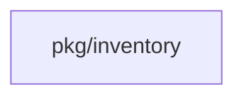

## Context

Issue 2037 records owner decisions of 27 October 2026 for later work. The first tier, lineage on inventory entries with filters and counts and new event types, ships with the Catalog store. The fleet migration object, server-driven upgrade waves, and batch upgrade tooling wait for deep design work. Main already builds inventory entries and keeps the inventory package, and this record changes neither fact.

## Decisions

1. **Defer fleet lifecycle work.** Record the deferred fleet lifecycle scope with no behavior change, so later design starts from issue 2037 and the Catalog store work owns the first tier.

## Structure

No structure change. No new type or constructor; this change adds no code.

## Risks

- Early work on migrations or waves without deep design produces an unsafe done-check.

## Diagrams

Modules that the change touches, and their imports on main:

## Quality attributes

| Attribute | Target | Unit | Scope |
| --- | --- | --- | --- |
| none affected | No behavior change; no target changes |  |  |
