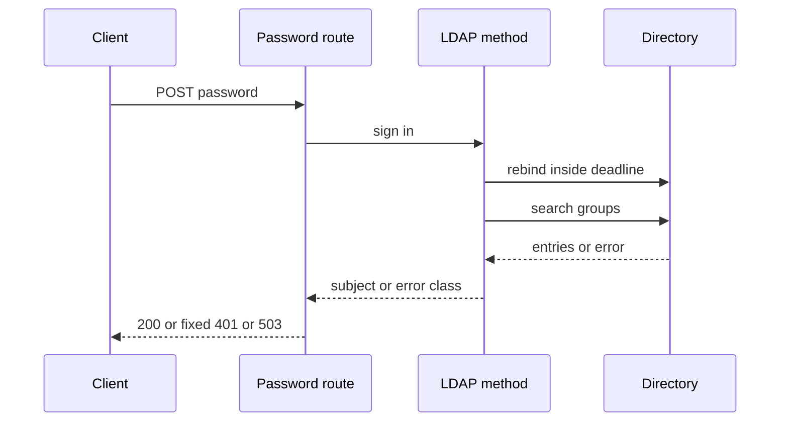
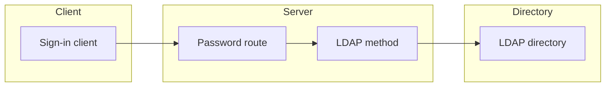

## Context

The LDAP method rebinds as the service account, then searches groups. The deadline must cover both steps. The route must never write directory or wrapped error text into an answer.

## Decisions

1. **Deadline covers the rebind.** The group phase makes its 30 s deadline context first. The rebind runs inside it with a 10 s limit. The search uses the time that is left. On a passed limit the code closes the directory connection. No new setting.
2. **Fixed reasons at the route.** The route maps a wrong credential or a disabled user to 401 sign-in.failed with the text "The user name or the password is wrong.". It maps any other error to 503 sign-in.unavailable with a fixed reason. The mapping reads the error class and never its text.
3. **Binary e2e.** The e2e starts ldaptest on a private non-loopback address and starts the binary as a child process. Both close with t.Cleanup. It passes only that range to --ldap-allowed-ranges and uses entryUUID as the subject. When CI has no private address, the test fails with a message that names it.

## Structure

The route holds an unexported function that turns any error into one of two fixed answers. Its only input is the class of the error, never its text.

## Risks

- The worst case of the group phase grows if the deadline starts late.
- Wrapped error text reaches an answer if a handler writes it.

## Layers (defense in depth)

| Layer | Guard | Hostile test |
| --- | --- | --- |
| boundary check | The user name has 1 to 256 bytes and no control character. An empty password is refused before any bind. | Send an empty password, a 257-byte name and a control character; each gets the fixed refusal. |
| encode or contain | No error text is written to an answer. No referral is followed. | Return a referral and force an error with CR LF text; the answer holds only the fixed reason. |
| limit | The group deadline of 30 s covers the rebind of 10 s and the search of at most 1000 entries. | Stall the rebind for 11 s and return 1001 entries; each sign-in is refused. |
| authorize at point of use | The bind gate runs for the found subject before the user bind. | Sign in as a disabled subject with a good password; the sign-in is refused. |
| fail closed | Each error or timeout refuses the sign-in with a fixed answer and an audit entry with no directory text. | Force a timeout and a directory failure; each gives the fixed refusal and an audit entry. |

## Diagrams

After this change:

Modules that the change touches, and their imports on main:

## Quality attributes

| Attribute | Target | Unit | Scope |
| --- | --- | --- | --- |
| latency | 30 | s | LDAP group phase including the service-account rebind |

## Threat model

Data flow and trust boundaries:

| Boundary | STRIDE | Threat | Layer | Guard | Hostile test |
| --- | --- | --- | --- | --- | --- |
| Server to directory | D | A stalled directory holds the sign-in past its deadline. | boundary check | Only an allowed range or loopback is a plain directory address. | Use a plain non-loopback address and no range; the connection is refused. |
| Server to directory | D | A stalled directory holds the sign-in past its deadline. | encode or contain | No referral is followed and no error text reaches an answer. | Return a referral; the sign-in is refused with a fixed reason. |
| Server to directory | D | A stalled directory holds the sign-in past its deadline. | limit | The deadline of 30 s covers the rebind of 10 s. | Stall the rebind for 11 s; the sign-in is refused. |
| Server to directory | D | A stalled directory holds the sign-in past its deadline. | authorize at point of use | The bind gate runs before the user bind. | Use a disabled subject; the sign-in is refused. |
| Server to directory | D | A stalled directory holds the sign-in past its deadline. | fail closed | A timeout refuses with sign-in.unavailable and an audit entry. | Force a timeout and check the audit entry. |

## Contracts

**LDAP sign-in method**

- Invariant: No directory text reaches a sign-in answer.
- Invariant: The group phase never runs longer than 30 s including the rebind.

## Failure modes

| Step | Failure | Retry | State after |
| --- | --- | --- | --- |
| Service-account rebind | The directory stalls for more than 10 s | The person signs in again; the server does no retry | The connection is closed, the sign-in is refused with 503 and no session exists |
| Group search | The 30 s deadline passes, or the answer holds more than 1000 entries | The person signs in again; the server does no retry | The connection is closed, the sign-in is refused with 503, no partial groups are applied and an audit entry exists |
