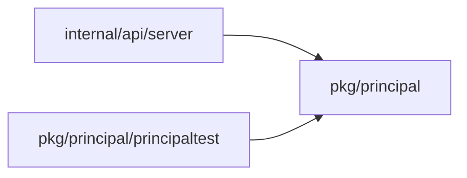
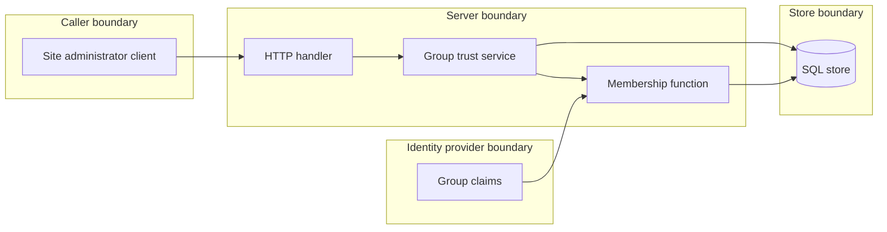

## Context

Trust and full sync both feed one membership function.

## Decisions

1. **Trust as checked state.** An unexported groupTrust value is made only by a constructor that checks reach cover and fresh authentication. The write runs in one transaction on the group row, so changes serialize and the last commit wins. A sync reads the committed value at its start. The value is stored with the stable ID of the group.
2. **Full sync as setting input.** The membership function reads full sync from the settings resource. Provisional decision: the API is the only layer that sets it, until the owner confirms the open question.
3. **Fresh step by method.** The Freshness port decides the step. SSO methods use their protocol parameter. OAuth and trusted header use a factor of OpenDustpan. Owner decision, 13 Nov 2026 (queue P21): a write-access group is protected by default. Trust still overrides protection for one group, with the same checks.

## Structure

Unexported groupTrust type with a constructor. Stored references use stable IDs. No new tool. Schema edits go in place in the baseline.

## Risks

- A trusted group widens access.
- Full sync makes each removal final.
- Baseline edits need a dev reset on a dev installation.

## Layers (defense in depth)

| Layer | Guard | Hostile test |
| --- | --- | --- |
| HTTP handler | Checks the action, the fresh step and the input. | Calls with no fresh step, no factor, an agent token, no action and bad IDs get 403, 404 or 400. |
| service | Checks reach and fresh authentication. | Stale step and uncovered reach are refused. |
| port adapter | Write in one transaction on the group row. | Two parallel writes leave one stored value. |

## Diagrams

Modules that the change touches, and their imports on main:

## Quality attributes

| Attribute | Target | Unit | Scope |
| --- | --- | --- | --- |
| Latency of a trust change | 500 | ms at the 99th percentile | PUT and DELETE /api/server/groups/{id}/trust on one server process |
| Audit completeness | 100 | percent of trust and full sync changes with an audit entry | one installation |

## Threat model

Data flow and trust boundaries:

| Boundary | STRIDE | Threat | Layer | Guard | Hostile test |
| --- | --- | --- | --- | --- | --- |
| Caller boundary | E | A caller without reach or a fresh step sets trust and widens access. | boundary check | The handler validates the group ID and body. | A bad ID and a bad body give 404 and 400. |
| Caller boundary | E | A caller without reach or a fresh step sets trust and widens access. | authorize at point of use | The service checks server:manage-sign-in and reach cover for the group. | An uncovered caller and a caller without the action get 403. |
| Caller boundary | E | A caller without reach or a fresh step sets trust and widens access. | fail closed | A stale step, no factor, an agent token or IdP-started SAML is refused and audited. | Each of these gets 403 mfa.fresh-step-required. |
| Identity provider boundary | T | The identity provider adds members to a protected group that is not trusted. | authorize at point of use | The membership function refuses the add unless the group is trusted or full sync is on. | An add to an untrusted protected group is refused and audited. |
| Identity provider boundary | T | The identity provider adds members to a protected group that is not trusted. | limit | A closed group and a break-glass account stay unchanged. | A sync over a closed group and a break-glass member changes nothing. |
| Store boundary | R | A trust change has no record of who made it. | fail closed | The audit entry is written in the same transaction as the change. | A failed audit write rolls back the trust change. |
