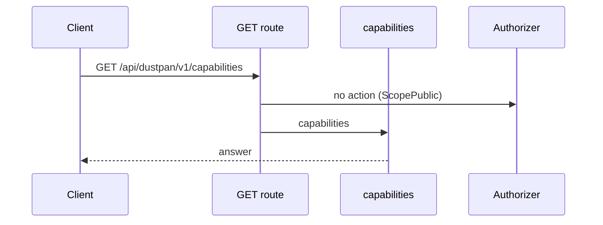
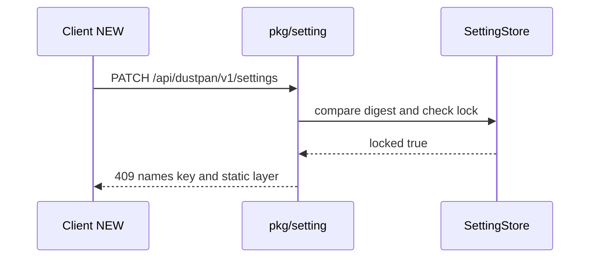
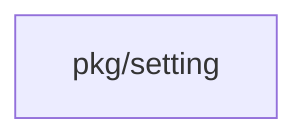
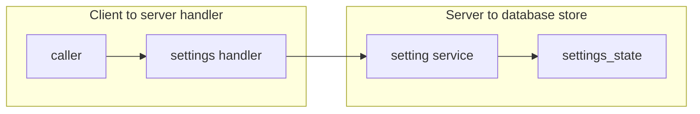

## Context

Two or more serve instances share one database; each has a local static layer from flag, env, and file; all reads and locks use one stored snapshot.

## Decisions

1. **One stored snapshot wins.** At start and at each applied reload, Sync stores the static digest in settings_state under a row lock; the first committer wins; a later instance with a distinct digest keeps serving reads from the stored snapshot, refuses writes with 503 with the existing error code settings.unavailable plus Retry-After 30 seconds, and fails readiness; the operator aligns the file and reloads or restarts; a binary upgrade with an identical file never mismatches.
2. **Declared switches only.** The constructor accepts only declared switch keys from internal/cli/settings_api.go; an undeclared file key refuses the start; a lock on a non-switch key has no module effect and the settings API still shows it locked.
3. **Security switch reports and console signal.** A security switch lock writes at each start one WARN log line, one @server audit entry, one per-namespace audit entry on first apply, and one row in the admin access report; the console signal is locked true with source static and no control.

## Structure

Unexported lockedSwitches set made only by NewStaticLayer from declared switches in internal/cli/settings_api.go.

## Risks

- A divergent file blocks writes on the divergent instance until the operator aligns it.

## Layers (defense in depth)

| Layer | Guard | Hostile test |
| --- | --- | --- |
| boundary check | NewStaticLayer in internal/cli/settings_api.go accepts only declared switch keys; an unknown key refuses the start. | Start with an undeclared key in the file and check the start refusal. |
| encode or contain | Service encodes the key as data with placeholders only and strips CR LF from log text. | Send CR LF in a key and check it never reaches logs raw. |
| limit | PATCH accepts one merge patch within the body size limit with a declared-key allowlist. | Send an oversize patch and check the refusal. |
| authorize at point of use | Service checks each PATCH key against the stored snapshot lock at the point of use after the manage-settings check. | PATCH a locked switch in pkg/setting and check 409 settings.locked with no change. |
| fail closed | Locked PATCH fails closed with 409 settings.locked; divergent instance fails readiness and fails writes closed with 503 settings.unavailable. | Start a second instance with a distinct file and check readiness failure and 503. |

## Diagrams

Today: `GET /api/dustpan/v1/capabilities` on main (from the route table and the handler body, route row internal/api/server/capabilities.go:45, handler internal/api/server/capabilities.go:54).

After this change:

Modules that the change touches, and their imports on main:

## Quality attributes

| Attribute | Target | Unit | Scope |
| --- | --- | --- | --- |
| latency | 50 | ms p95 | PATCH /api/dustpan/v1/settings with a locked key |
| latency | 50 | ms p95 | GET /api/dustpan/v1/capabilities signed in with caller read |

## Threat model

Data flow and trust boundaries:

| Boundary | STRIDE | Threat | Layer | Guard | Hostile test |
| --- | --- | --- | --- | --- | --- |
| Client to server handler | T | A caller turns a locked-off switch on through PATCH. | boundary check | Handler allows declared switch keys only and rejects unknown keys. | Send an undeclared key and check the refusal. |
| Client to server handler | T | A caller turns a locked-off switch on through PATCH. | encode or contain | Handler encodes the key as data, never as SQL or log text with CR LF. | Send CR LF in a key and check it never reaches logs raw. |
| Client to server handler | T | A caller turns a locked-off switch on through PATCH. | limit | Handler limits PATCH body to one merge patch with a key allowlist. | Send an oversize patch and check the refusal. |
| Client to server handler | T | A caller turns a locked-off switch on through PATCH. | authorize at point of use | Handler checks manage-settings on the scope object before the service call. | Call without the grant and check 403. |
| Client to server handler | T | A caller turns a locked-off switch on through PATCH. | fail closed | Handler fails closed with 409 settings.locked on a locked key. | PATCH a locked switch and check no value changes. |
| Server to database store | T | A divergent instance overwrites the stored snapshot. | boundary check | Sync writes digest and revision under a row lock; only installation start path calls it. | Call Sync from a namespace path and check the refusal. |
| Server to database store | T | A divergent instance overwrites the stored snapshot. | encode or contain | Digest uses placeholders only; no string-built SQL. | Send a digest with quote marks and check safe storage. |
| Server to database store | T | A divergent instance overwrites the stored snapshot. | limit | One digest per installation scope; row lock orders concurrent syncs. | Sync twice at once and check one winner. |
| Server to database store | T | A divergent instance overwrites the stored snapshot. | authorize at point of use | Store checks the fence scope before the write commits. | Write with a wrong scope fence and check the refusal. |
| Server to database store | T | A divergent instance overwrites the stored snapshot. | fail closed | Digest mismatch keeps the stored digest and refuses writes with 503 settings.unavailable. | Sync a distinct digest and check reads still use the stored one. |

## Contracts

**setting**

- Invariant: One revision per scope.
- Invariant: A statically locked key never changes through the API.
- Invariant: Reads and locks use the stored static snapshot.
- `Get`: pre: The stored static snapshot is current.. Post: The answer carries effective value, source static, and locked true for a locked key..
- `Patch`: pre: The caller holds the manage-settings action of the scope.. Post: A locked key refuses with settings.locked and changes nothing; mixed keys change all or none..
- `Sync`: pre: The caller is the installation start path.. Post: The first committer stores its digest; a divergent instance keeps the stored digest..

## Failure modes

| Step | Failure | Retry | State after |
| --- | --- | --- | --- |
| Reload static snapshot | Audit write fails at reload. | No retry; the reload fails and the old configuration stays. | Old snapshot and old revision stay; the next poll retries. |
| Sync static digest | Two instances sync at once with distinct digests. | Row lock orders them; the loser keeps the stored digest and fails readiness. | One stored digest; the divergent instance refuses writes with 503. |
| Remove static lock | Operator removes the lock from the file. | Next applied reload stores the new digest and bumps the revision. | The key unlocks and a later PATCH may set it. |

## Change impact (computed from main)

Tests:

- `pkg/egress/plainconn/plainconn_test.go` names `setting.Declaration`
- `pkg/dustpan/settings_resource_test.go` names `setting.Declaration`
- `pkg/principal/removalalert_test.go` names `setting.Declaration`
