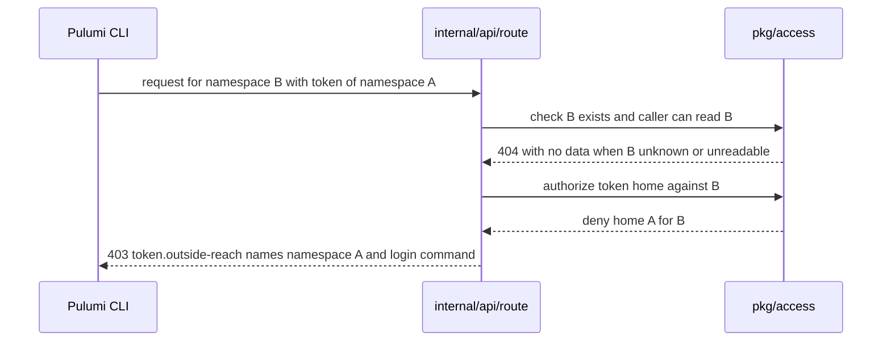
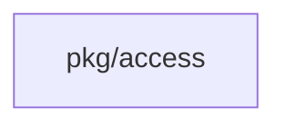
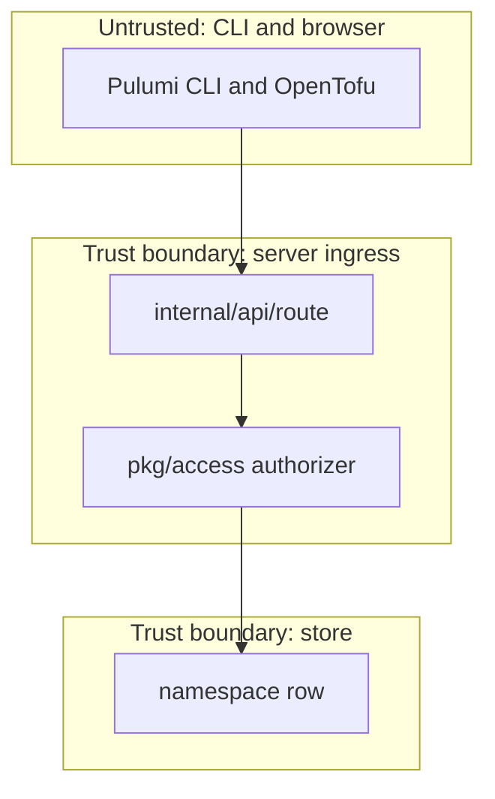

## Context

Hosted routing builds on the per-namespace provider setup of part 1. This part changes only routing copy, token refusal text at the existing authorizer decision, the no-account-object guard, and docs.

## Decisions

1. **404 first, then 403 refusal with fixed command allowlist.** Check namespace existence and read grant first; answer 404 with no data for unknown or unreadable B. Only when B is known and readable and the token home is A, refuse 403 token.outside-reach. The refusal reuses the existing access decision and error code. It names the token namespace by its current name resolved from its stable namespace ID, uses the word namespace, and names one login command from a fixed allowlist: pulumi login for a Pulumi token path and tofu login for an OpenTofu token path.
2. **Path prefix without a stored account type.** Console first path segment maps to a namespace name through the existing namespace lookup; reserved first segments stay with the server and console. No account object and no account ID exist in code or API.

## Structure

No new stored type. No account object or account ID. The console path prefix maps the first segment to a namespace name through the existing namespace lookup keyed by stable namespace ID; refusals reuse the existing access decision and error code token.outside-reach.

## Risks

- Token namespace name in a 403 names A to a holder of a valid token of A; B existence is not told because unknown or unreadable B answers 404 first.

## Layers (defense in depth)

| Layer | Guard | Hostile test |
| --- | --- | --- |
| boundary check | Route finds the namespace of B and the read grant before it reads the token home; unknown or unreadable B answers 404 with no name and no ID. | Request B unknown with token of A and check 404 holds no A and no B; remove the existence check and the test fails. |
| encode or contain | Refusal text encodes the namespace name for display and repeats no input beyond the stored name. | Present a token whose namespace name holds markup or control characters and check the 403 body is encoded; remove encoding and the test fails. |
| limit | Refusal rate limits repeated cross-namespace attempts per principal. | Burst cross-namespace requests with one token and check limit applies; remove the limit and the test fails. |
| authorize at point of use | Authorizer checks the token home against the requested namespace ID at point of use on each request. | Replay token of A against B after a grant change and check 403 persists; remove the home check and the test fails. |
| fail closed | Unknown token, expired token, or failed lookup answers token.invalid or 404 without naming any namespace. | Send an invalid token for B and check no namespace name appears; change fail-open to naming and the test fails. |

## Diagrams

After this change:

Modules that the change touches, and their imports on main:

## Quality attributes

| Attribute | Target | Unit | Scope |
| --- | --- | --- | --- |
| none affected | Text and docs change only; no latency or storage budget change |  |  |

## Threat model

Data flow and trust boundaries:

| Boundary | STRIDE | Threat | Layer | Guard | Hostile test |
| --- | --- | --- | --- | --- | --- |
| server ingress | I | Probe learns whether namespace B exists from 403 versus 404. | boundary check | Route finds B and the read grant before it reads the token home; unknown or unreadable B answers 404 with no data. | Probe unknown B names with token of A and check all answers are 404 with no names. |
| server ingress | I | Probe learns whether namespace B exists from 403 versus 404. | encode or contain | Refusal encodes the stored namespace name and repeats no request input. | Use a namespace name with markup and check the 403 body is encoded. |
| server ingress | I | Probe learns whether namespace B exists from 403 versus 404. | limit | Per-principal limit on cross-namespace refusals. | Burst cross-namespace requests and check the limit answers 429. |
| server ingress | I | Probe learns whether namespace B exists from 403 versus 404. | authorize at point of use | Authorizer compares token home namespace ID with requested namespace ID at point of use. | Replay token of A against B after grant change and check 403 persists. |
| server ingress | I | Probe learns whether namespace B exists from 403 versus 404. | fail closed | Invalid token or failed lookup answers token.invalid or 404 with no names. | Send an invalid token and check no namespace name appears. |
| store | T | Hostile namespace name or path alters lookup or refusal display. | boundary check | Lookup of B uses stable namespace ID, not the raw path string, in placeholders. | Send a path with SQL metacharacters and check it matches no row. |
| store | T | Hostile namespace name or path alters lookup or refusal display. | encode or contain | Display name is encoded for the 403 body. | Store a hostile namespace name and check the 403 body is encoded. |
| store | T | Hostile namespace name or path alters lookup or refusal display. | limit | Lookup has a timeout and bounded rows. | Send slow lookups and check the timeout ends them. |
| store | T | Hostile namespace name or path alters lookup or refusal display. | authorize at point of use | Fenced write path rechecks the namespace ID at commit. | Change the namespace during a write and check the commit fails. |
| store | T | Hostile namespace name or path alters lookup or refusal display. | fail closed | Missing row fails closed to 404 with no data. | Delete B during lookup and check the answer is 404 with no names. |
