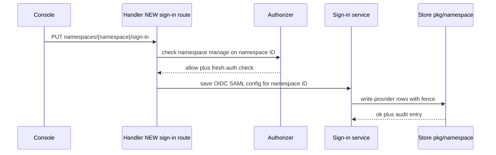
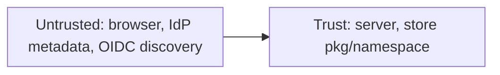

## Context

Namespace administrator manages OIDC and SAML for one namespace only at .../namespaces/{namespace}/sign-in per ADR 216 decision 14. Installation providers stay unchanged. Path routing and token refusal text stay in the routing part.

## Decisions

1. **Home-scoped provider records keyed by namespace ID.** Store namespace OIDC and SAML config as rows keyed by stable namespace ID, not by namespace name. Constructor checks issuer URL allowlist, size limits, and SAML metadata pins before save. Sign-in lookup filters by home namespace ID in the same transaction. Callback reuses existing /sign-in/{id}/callback with a namespace-bound pending request; per-namespace ACS and redirect URIs are derived from that pending request, so no new path is needed.

## Structure

Unexported type namespaceProviderStore with constructor that checks invariants; only it can make provider records, keyed by stable namespace ID.

## Risks

- Cross-namespace principal confusion if home filter is skipped.
- SAML signature wrapping if response checks are skipped.
- Secret leak in logs or audit if provider secrets are echoed.

## Layers (defense in depth)

| Layer | Guard | Hostile test |
| --- | --- | --- |
| boundary check | API checks namespace ID from path, provider belongs to that namespace, and fresh authentication is present. | Change provider of namespace B with a token for namespace A and with stale authentication; both fail. |
| encode or contain | Service saves OIDC issuer and SAML entity ID from allowlist fields only, with size limits, and never logs secrets. | Send oversize metadata and secret in URL field; server refuses with validation error and writes no secret. |
| authorize at point of use | Sign-in service filters principal lookup by home namespace ID in the same transaction. | Sign in through namespace A with a subject that exists in namespace B; server makes or finds only an A principal. |
| fail closed | Provider secrets come only from stored secrets; restore keeps home filter; unknown provider refuses closed. | Sign in with provider off or unknown; server refuses and writes namespace audit entry. |
| limit | Config change limited to namespace admins and rate limited per principal. | Flood provider saves; server throttles and writes audit entries. |

## Diagrams

After this change:

## Quality attributes

| Attribute | Target | Unit | Scope |
| --- | --- | --- | --- |
| latency | 900 ms p95 on dev server | ms | PUT namespace sign-in settings |

## Threat model

Data flow and trust boundaries:

| Boundary | STRIDE | Threat | Layer | Guard | Hostile test |
| --- | --- | --- | --- | --- | --- |
| Namespace sign-in settings and sign-in callback | S | Spoofed IdP metadata or assertion makes a principal of another namespace. | boundary check | Allowlist OIDC issuer https URL and SAML metadata size and CA pins at boundary. | Send http issuer, oversize metadata, rogue CA; server refuses before fetch. |
| Namespace sign-in settings and sign-in callback | S | Spoofed IdP metadata or assertion makes a principal of another namespace. | encode or contain | Fetch IdP metadata through egress rules with timeouts; parse XML with no DTD and depth limit. | Send XXE metadata and slow IdP; fetch refuses or times out. |
| Namespace sign-in settings and sign-in callback | S | Spoofed IdP metadata or assertion makes a principal of another namespace. | limit | Limit metadata fetch size, assertion size, and provider saves per principal. | Flood saves and replay assertion ID; server throttles and refuses replay. |
| Namespace sign-in settings and sign-in callback | S | Spoofed IdP metadata or assertion makes a principal of another namespace. | authorize at point of use | Check manage action on namespace ID and home match at sign-in point of use. | Use namespace A token to save B config or sign in as B; server refuses. |
| Namespace sign-in settings and sign-in callback | S | Spoofed IdP metadata or assertion makes a principal of another namespace. | fail closed | Fail closed on unknown provider or bad signature; write namespace audit entry; never log secrets. | Send bad SAML signature; server refuses and audit holds no secret. |

## Contracts

**namespace sign-in settings**

- Invariant: Provider config of namespace A never authenticates a principal whose home is not A.
- Invariant: One stored provider record per namespace for OIDC and one for SAML.
- `FindOrMakeSignInPrincipal`: pre: Provider is on and belongs to the sign-in namespace.. Post: Returned principal home equals the provider namespace..
- `SaveProviderConfig`: pre: Caller holds manage action on the namespace and passes a fresh authentication.. Post: On success the namespace holds the new OIDC or SAML config and an audit entry exists in the namespace scope..
