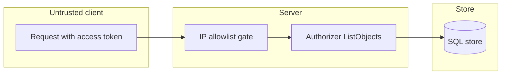

## Context

A scope with All set cannot name refused namespaces, so lists show namespaces that Authorize refuses.

## Decisions

1. **Exclusion list on the scope.** The scope gets an unexported excluded-namespaces field. Only a constructor makes it; the constructor drops the list when All is false and sorts and dedupes names. The gate fills it per request.

## Structure

Unexported field on the scope value, set only by its constructor.

## Risks

- A consumer that ignores the field fails open; the conformance check covers each consumer.
- An allowlist that changes between the gate read and the list query can show in that one request; the next request recomputes.

## Layers (defense in depth)

| Layer | Guard | Hostile test |
| --- | --- | --- |
| port adapter | NOT IN clause in the namespace filter | List with a refused namespace on sqlite and postgres |
| service | The gate fills exclusions and fails closed on a read error | Gate with a failing NamespacesWithList |
| HTTP handler | Caller access shows the exclusions | Caller access from a refused address |

## Quality attributes

| Attribute | Target | Unit | Scope |
| --- | --- | --- | --- |
| Latency of a namespace list | 20 | percent added at most | list call with 1000 namespaces that have an allowlist |

## Threat model

Data flow and trust boundaries:

| Boundary | STRIDE | Threat | Layer | Guard | Hostile test |
| --- | --- | --- | --- | --- | --- |
| Untrusted client to server | I | A client outside the allowlist learns the name of a namespace from a list. | authorize at point of use | The gate puts each refusing namespace in the exclusion list | Admin list from a refused address leaves out the namespace |
| Untrusted client to server | I | A client outside the allowlist learns the name of a namespace from a list. | fail closed | A failed NamespacesWithList read denies the list | Gate with a failing NamespacesWithList gives an error |
| Server to store | E | A consumer ignores the exclusion list and shows objects of a refused namespace. | encode or contain | NOT IN clause with placeholders in both dialects | Filter test with a refused namespace on sqlite and postgres |
| Server to store | E | A consumer ignores the exclusion list and shows objects of a refused namespace. | limit | Bound on the number of names that NamespacesWithList returns | Conformance rows at the limit and one past it |

## Failure modes

| Step | Failure | Retry | State after |
| --- | --- | --- | --- |
| Gate fill | NamespacesWithList fails | Retry the request | The list call fails closed |

## Change impact (computed from main)

Tests:

- `e2e/claim_gate_test.go` names `identity.Scope`
- `internal/removalalertsvc/removalalertsvc_test.go` names `identity.Scope`
- `e2e/jobs_api_test.go` names `identity.Scope`

Docs pages:

- `docs/guides/access-review.md:200` names `identity.Scope`

ADRs:

- `docs/adr/INDEX.md` names `identity.Scope`
- `docs/adr/0210-the-tool-neutral-api-prefix-paths-actions-versions-and-style.md` names `identity.Scope`
- `docs/adr/0058-console-stack.md` names `identity.Scope`
