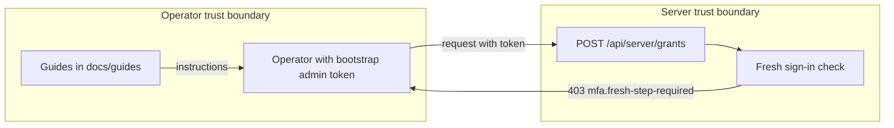

## Context

Docs-only fix. The server stays closed: grant, role, group-member and gate writes need a console session with a recent sign-in.

## Decisions

1. **Docs fix boundary.** Edit console-sign-in.md, local-users.md and host-recovery.md in docs/guides, and any other file in docs/guides that the rg task finds. Change no route, error code or service.

## Structure

No code structure changes. No new type or constructor.

## Risks

- The guides name the block, but the operator stays blocked until the owner decides the first administrator path in RFC 117.

## Quality attributes

| Attribute | Target | Unit | Scope |
| --- | --- | --- | --- |
| none affected | Docs-only change. |  |  |

## Threat model

Data flow and trust boundaries:

| Boundary | STRIDE | Threat | Layer | Guard | Hostile test |
| --- | --- | --- | --- | --- | --- |
| Operator trust boundary | E | A guide tells the operator to weaken the fresh sign-in rule or to share a token to get the first grant. | boundary check | The guides name only the existing rule and opendustpan dev as the way to work now. The rg task checks the removed sentence. | `rg -n -F 'Give the first roles with the bootstrap admin token' docs/guides` returns no match. |
| Operator trust boundary | E | A guide tells the operator to weaken the fresh sign-in rule or to share a token to get the first grant. | encode or contain | The change edits text only. No route, error code or service changes. | The diff holds only files under docs/guides. |
| Operator trust boundary | E | A guide tells the operator to weaken the fresh sign-in rule or to share a token to get the first grant. | limit | The guide gives no new credential kind and no longer-lived token. | `rg -n -i 'bootstrap admin token' docs/guides` lists no sentence that tells the operator to make a grant, gate or group change with a token. |
| Operator trust boundary | E | A guide tells the operator to weaken the fresh sign-in rule or to share a token to get the first grant. | authorize at point of use | The server keeps the fresh sign-in check on each grant write. The guide does not change it. | The existing route test of the fresh authentication routes stays green under make check. |
| Operator trust boundary | E | A guide tells the operator to weaken the fresh sign-in rule or to share a token to get the first grant. | fail closed | The server answers 403 mfa.fresh-step-required and changes nothing. The guide states this answer. | `rg -n 'mfa.fresh-step-required' docs/guides/console-sign-in.md` returns a match. |
