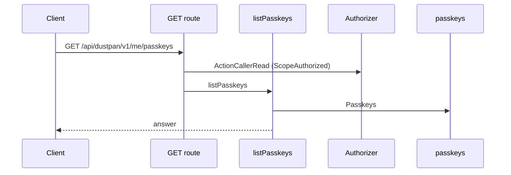
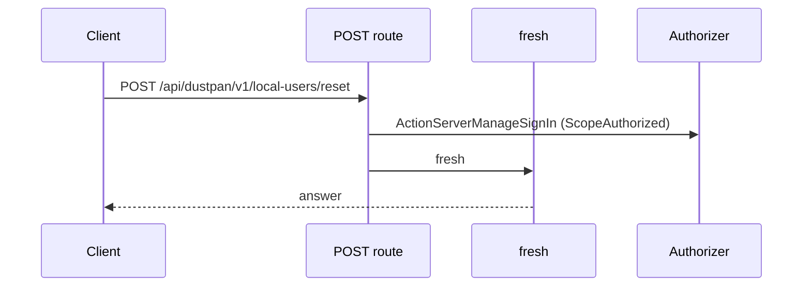
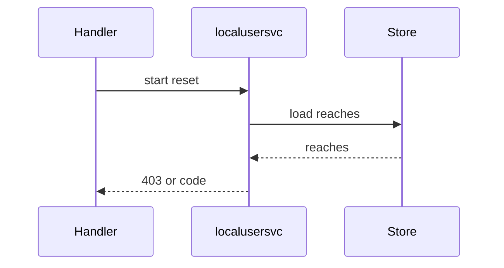
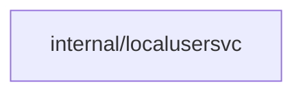

## Context

RemovePassword and DeleteUser fail closed without a live passkey count, a reset has no reach cover check, and the passkey start omits the allowCredentials list.

## Decisions

1. **One live passkey count in the removal transaction.** RemovePassword and DeleteUser in pkg/store/internal/localuserstore/localuserstore.go call a shared count of live passkeys in the same transaction under the principal lock. Suspended passkeys do not count. The demo person fails first with ErrDemoFixed.
2. **Reach cover check before a reset code.** The service in internal/localusersvc loads the reach of the starter and the reach of the target and refuses with 403 and the NEW error code local-user.reset-denied before it makes a code. A store error makes no code and writes an audit entry.

## Structure

No new type. The existing store transaction reads the password and the live passkey count together, so a torn count cannot commit.

## Risks

- A concurrent passkey add or suspend waits on the principal lock.

## Diagrams

Today: `GET /api/dustpan/v1/me/passkeys` on main (from the route table and the handler body, route row internal/api/server/passkeys.go:206, handler internal/api/server/passkeys.go:357).

Today: `POST /api/dustpan/v1/local-users/reset` on main (from the route table and the handler body, route row internal/api/server/localusers.go:254, handler internal/api/server/freshness.go:152).

After this change:

Modules that the change touches, and their imports on main:

## Quality attributes

| Attribute | Target | Unit | Scope |
| --- | --- | --- | --- |
| none affected | The count read stays inside the existing removal transaction. |  |  |

## Contracts

**local user credentials**

- Invariant: An enabled local user keeps a password or one live passkey.
- `RemovePassword`: pre: The caller holds installation:manage-sign-in.. Post: If no live credential would remain then ErrLastCredential is returned and nothing changes..
- `DeleteUser`: pre: The caller holds installation:manage-sign-in.. Post: An enabled user with no live credential is refused and kept..

## Failure modes

| Step | Failure | Retry | State after |
| --- | --- | --- | --- |
| Count live passkeys inside the removal transaction | The count read fails or a concurrent passkey change holds the principal lock | The caller repeats the call after the transaction rolls back | The password or user is unchanged and no audit entry of a removal exists |
| Load the reach of the starter and the person before a reset | The reach load fails | The administrator repeats the reset call | No code is made and an audit entry records the denial |

## Change impact (computed from main)

Tests:

- `internal/localusersvc/service_test.go` names `localuser.ErrLastCredential`
- `pkg/store/internal/localuserstore/localuserstore_test.go` names `localuser.ErrLastCredential`
- `pkg/localuser/localuser_test.go` names `localuser.ErrLastCredential`

ADRs:

- `docs/adr/0285-local-users-sign-in-with-a-password-and-a-passkey.md` names `localuser.ErrLastCredential`
