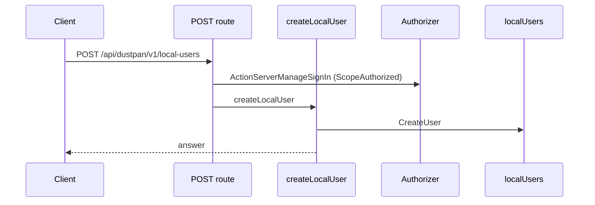
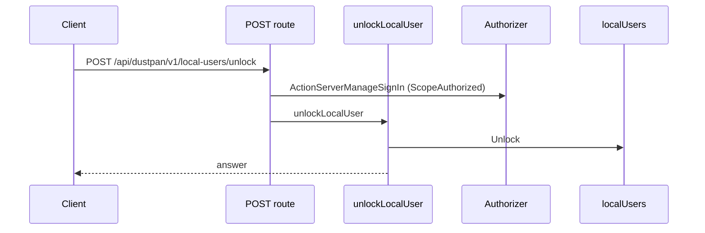
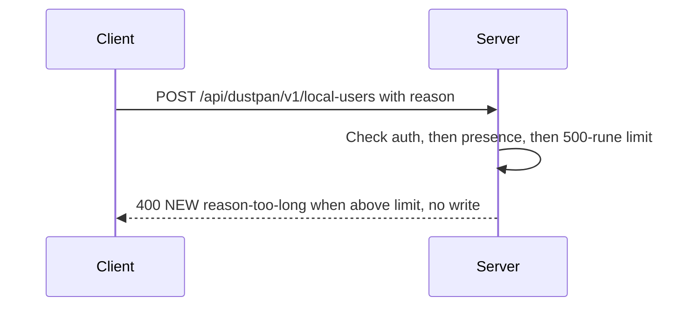

## Context

Local-user create and unlock take a reason. A reason of 501 to 1024 characters answers 500 on create and 503 on unlock, and a longer reason answers 400 with the wrong reason-required code. The fix validates the reason at the service boundary before any store write.

## Decisions

1. **Validate auth then reason before any write.** Check authorization first, then reason presence, then reason length at the service boundary before any store or audit call. Create and unlock refuse input above one shared limit of 500 Unicode code points (runes) with the same code, so no partial write happens.
2. **Count limit in Unicode code points.** Count the limit as 500 Unicode code points (runes) and state runes in the guide and error. Test a multibyte boundary with 500 runes.

## Structure

One shared limit constant used by the create and unlock paths; no new tool and no custom analyzer.

## Risks

- Multibyte reasons near the boundary need a rune-count test.
- The guide states no reason limit today.

## Diagrams

Today: `POST /api/dustpan/v1/local-users` on main (from the route table and the handler body, route row internal/api/server/localusers.go:246, handler internal/api/server/localusers.go:507).

Today: `POST /api/dustpan/v1/local-users/unlock` on main (from the route table and the handler body, route row internal/api/server/localusers.go:259, handler internal/api/server/localusers.go:595).

After this change:

## Quality attributes

| Attribute | Target | Unit | Scope |
| --- | --- | --- | --- |
| none affected | Validation only; no storage, rate, or latency target changes |  |  |

## Contracts

**LocalUser**

- Invariant: A refused create writes no user row and no audit entry.
- Invariant: A refused unlock changes no lock state.
- `CreateLocalUser`: pre: The caller holds the local-user write grant.; The reason is present and within the limit.. Post: If the reason is above the limit, CreateLocalUser refuses without a store write..
- `UnlockLocalUser`: pre: The caller holds the local-user write grant.; The reason is present and within the limit.. Post: If the reason is above the limit, UnlockLocalUser refuses without a state change..

## Failure modes

| Step | Failure | Retry | State after |
| --- | --- | --- | --- |
| Validate reason length before any store write | Service crashes after the length check and before the store write | Rerun the same POST with the same reason within the limit | No user row and no audit entry; safe to retry |
| Validate unlock reason length before any lock-state write | Service crashes after the unlock length check and before the lock-state write | Rerun the same unlock POST with the same reason within the limit | No lock-state change; safe to retry |
