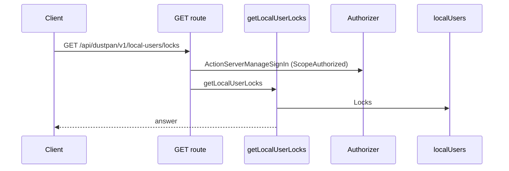
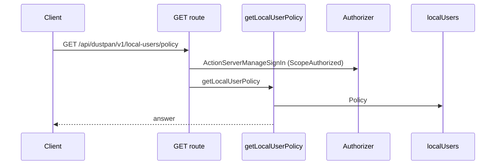
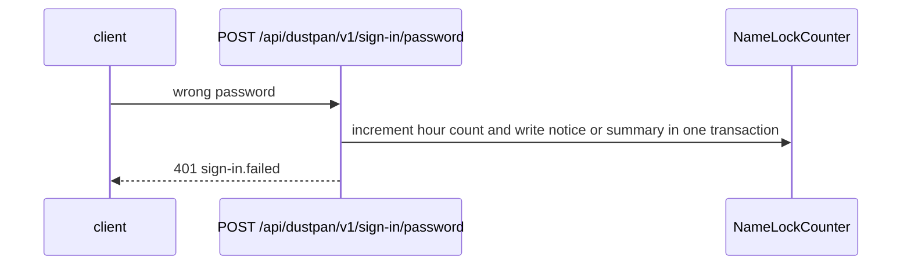
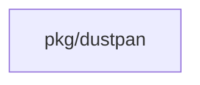
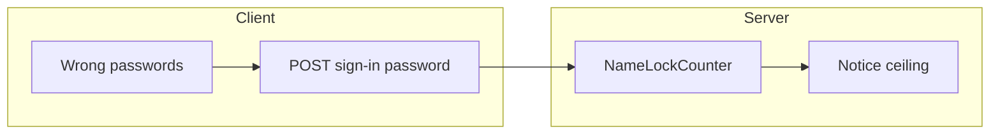

## Context

Made-up names lock like real names on purpose, so an attacker who tries many names can flood the lock notices. ADR 333 decision 5 sets a ceiling of 10 notices for each installation and hour, then one summary notice.

## Decisions

1. **Ceiling and summary in one transaction.** At most 10 local password name-lock notices for each installation and each fixed UTC clock hour. The hourly counter increment and the notice write or the summary write run in one database transaction on both dialects, so parallel instances cannot pass the ceiling. The first lock past the ceiling writes one summary row for the hour; each later lock in the same hour updates that row count in the same transaction. The next UTC hour starts a new count. The scope is local password name-lock notices only; LDAP locks and passkey factor counts do not share the count. A notice or summary write failure never changes the 401 answer and never changes the lock.
2. **Ceiling is a settable installation setting.** The ceiling is the installation setting localuser.lock-notice-ceiling with default 10 and allowed values 1 to 100, changed through the installation settings resource with action installation:manage-sign-in and an audit entry. GET /api/dustpan/v1/local-users/policy shows the set value and its effective value. Hourly counter rows older than 2 hours are deleted by the same write path. The summary holds only the count of notices left out and the grouped client addresses that the server already records, never a user name.

## Structure

The fix keeps the unexported hourly counter behind the constructor of the local-user sign-in service in pkg/dustpan/localusers.go:206 (func newLocalUserService); only that constructor makes the counter value and it checks the 1 to 100 range before each write.

## Risks

- The summary could leak probe targets, so it holds only counts and client addresses.

## Layers (defense in depth)

| Layer | Guard | Hostile test |
| --- | --- | --- |
| boundary check | One 401 answer with code sign-in.failed for an unknown name, a wrong password, or a locked name; a notice failure never changes it. | Fail the notice store and flood made-up names; each sign-in still answers one 401 with the same text. |
| encode or contain | The summary notice holds only the count left out and the grouped client addresses, never a user name. | Flood 30 made-up names; read the summary and find no user name in it. |
| limit | Atomic hourly increment in one transaction on both dialects; 10 notices then one updated summary row for the hour. | Lock 30 names from parallel clients in one hour; count at most 10 notices and one summary. |
| authorize at point of use | The policy read and the ceiling change need installation:manage-sign-in at the point of use. | Read the policy and set the ceiling without the action; the server denies both. |
| fail closed | A ceiling outside 1 to 100 is refused with no effect; an unknown settings key is refused. | Set the ceiling to 0 and to 101; the server denies both and the stored value stays. |

## Diagrams

Today: `GET /api/dustpan/v1/local-users/locks` on main (from the route table and the handler body, route row internal/api/server/localusers.go:263, handler internal/api/server/localusers.go:624).

Today: `GET /api/dustpan/v1/local-users/policy` on main (from the route table and the handler body, route row internal/api/server/localusers.go:250, handler internal/api/server/localusers.go:534).

After this change:

Modules that the change touches, and their imports on main:

## Quality attributes

| Attribute | Target | Unit | Scope |
| --- | --- | --- | --- |
| rate limit | 10 lock notices, then one updated summary notice | notices | each installation and fixed UTC clock hour |

## Threat model

Data flow and trust boundaries:

| Boundary | STRIDE | Threat | Layer | Guard | Hostile test |
| --- | --- | --- | --- | --- | --- |
| Client to the password sign-in route | D | A notice flood across made-up names hides a real lock notice. | boundary check | One 401 answer for each failure; a notice failure never changes it. | Fail the notice store; the answer stays one 401. |
| Client to the password sign-in route | D | A notice flood across made-up names hides a real lock notice. | encode or contain | The summary holds no user name, only the count and the grouped client addresses. | Flood made-up names; the summary holds none. |
| Client to the password sign-in route | D | A notice flood across made-up names hides a real lock notice. | limit | Atomic hourly ceiling in one transaction on both dialects. | 30 parallel names give 10 notices and one summary. |
| Client to the password sign-in route | D | A notice flood across made-up names hides a real lock notice. | authorize at point of use | Policy read and ceiling change need installation:manage-sign-in at the point of use. | Read and set without the action; the server denies both. |
| Client to the password sign-in route | D | A notice flood across made-up names hides a real lock notice. | fail closed | A ceiling outside 1 to 100 is refused with no effect. | Set 0 and 101; the server denies both. |

## Failure modes

| Step | Failure | Retry | State after |
| --- | --- | --- | --- |
| Count failure and write lock notice | Two instances lock two names past the ceiling at the same time. | Both run the same atomic increment in one transaction; one writes the summary row and the other updates its count. | At most 10 notices and one summary row for the hour. |
| Count failure and write lock notice | The instance stops after the counter increment and before the notice commit. | The transaction rolls back; the next lock runs the same transaction again. | Counter and notice are both applied or neither is applied. |

## Change impact (computed from main)

Tests:

- `internal/signinsvc/password_test.go` names `authgate.NameLockCounter`
- `pkg/store/sqlite/namelocks_test.go` names `authgate.NameLockCounter`
- `pkg/store/postgres/namelocks_test.go` names `authgate.NameLockCounter`

ADRs:

- `docs/adr/0285-local-users-sign-in-with-a-password-and-a-passkey.md` names `authgate.NameLockCounter`
- `docs/adr/0320-one-sign-in-path-for-every-sign-in-method.md` names `authgate.NameLockCounter`
