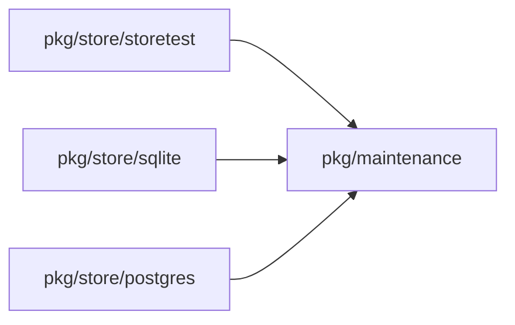
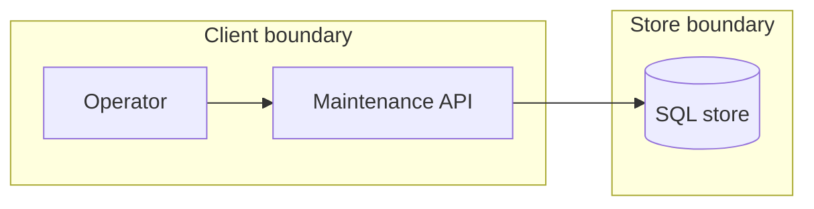

## Context

Maintenance enter and restore check running mutating updates before they stop writes. Backup and restore copy state versions. Each path reads one row at a time, so store round trips grow with stacks and versions.

## Decisions

1. **Batch the maintenance active-update check.** Add NEW port method ListActiveUpdates(namespace) that returns one row per stack with a running mutating update, ordered by stack ID, keyed by stable stack ID with prefix stk-. activeUpdates in pkg/maintenance/maintenance.go calls it once per check. No route and no authorization action changes.
2. **Page state-version backup and restore reads.** Backup and restore run while maintenance holds writes, so no concurrent write occurs during the copy. Read state versions by integer primary-key cursor pages of 200 rows ordered by id. Read each workspace row and each secret key row once per copy.

## Structure

Unexported type activeCheck in pkg/maintenance holds the batch result, so callers cannot reintroduce per-stack ActiveUpdate calls. Unexported type versionPager in the backup copy path holds the id cursor and page size 200.

## Risks

- Batch read returns a different set than repeated single reads.
- Paging misses a version when ids are not ordered.

## Diagrams

Modules that the change touches, and their imports on main:

## Quality attributes

| Attribute | Target | Unit | Scope |
| --- | --- | --- | --- |
| store round trips | 2 reads per check: 1 batch read plus 1 fence read | reads | maintenance active-update check per namespace |
| store round trips | 3 reads per 200-row page | reads | backup and restore state-version copy |

## Threat model

Data flow and trust boundaries:

| Boundary | STRIDE | Threat | Layer | Guard | Hostile test |
| --- | --- | --- | --- | --- | --- |
| Client boundary | S | Forged maintenance enter misuses the batch read to bypass active-work refusal. | boundary check | Allowlist namespace name and reject unknown fields at the handler. | Send an invalid namespace to ANY/POST /api/dustpan/v1/maintenance/enter and expect 400 without a store call. |
| Client boundary | S | Forged maintenance enter misuses the batch read to bypass active-work refusal. | encode or contain | Encode error text and strip CR and LF from reflected input. | Send CRLF in the namespace and check the error body keeps one line. |
| Client boundary | S | Forged maintenance enter misuses the batch read to bypass active-work refusal. | limit | Limit page size to 200 rows and bound the batch result. | Request a namespace with 300 stacks and check the read count stays flat. |
| Client boundary | S | Forged maintenance enter misuses the batch read to bypass active-work refusal. | authorize at point of use | Check the maintenance gate at the point of use for the namespace object. | Call the enter route with an access token without the grant and expect denial. |
| Client boundary | S | Forged maintenance enter misuses the batch read to bypass active-work refusal. | fail closed | Fail closed with maintenance.unavailable and audit the denial on batch failure. | Force the batch read to fail and check the server refuses without entering maintenance. |
| Store boundary | T | Tampered store rows or cursor cause the batch or paged read to miss running updates. | boundary check | Allowlist ordered id-cursor paging with placeholders only. | Inject SQL into the cursor and check the query rejects it. |
| Store boundary | T | Tampered store rows or cursor cause the batch or paged read to miss running updates. | encode or contain | Contain store rows to stack IDs with prefix stk- and namespace scope. | Plant a row of another namespace and check the batch result omits it. |
| Store boundary | T | Tampered store rows or cursor cause the batch or paged read to miss running updates. | limit | Limit each page to 200 rows and one workspace and secret key read per copy. | Copy 500 versions and check round trips grow by at most 3 reads per page. |
| Store boundary | T | Tampered store rows or cursor cause the batch or paged read to miss running updates. | authorize at point of use | Re-check the namespace fence in the same transaction as the batch read. | Advance the failover version mid-check and check the write path refuses. |
| Store boundary | T | Tampered store rows or cursor cause the batch or paged read to miss running updates. | fail closed | Fail closed on a store error and keep maintenance.busy on active work. | Fail the page read and check backup stops instead of copying a partial set. |

## Contracts

**Maintenance active work**

- Invariant: activeUpdates reports each running mutating update of one namespace once
- Invariant: A failed batch read refuses the enter
- `activeUpdates`: pre: Caller holds a namespace fence.. Post: Return the same set as repeated ActiveUpdate calls..
