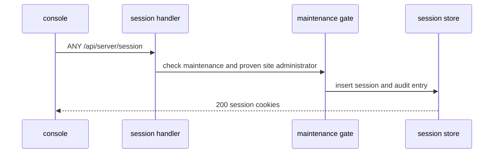
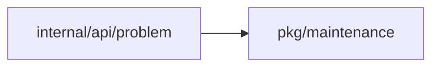
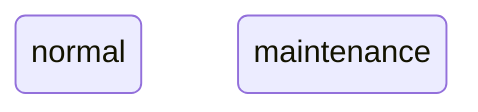
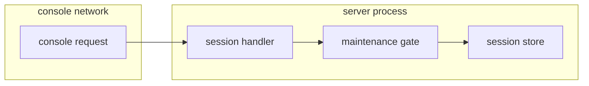

## Context

Maintenance mode refuses writes. The audit chain change needs a fresh console session, but the session write is also refused. The fix opens one narrow path only after proof of non-interference.

## Decisions

1. **Narrow session exception gated by proof.** Keep the session write refused until a test with a running backup and a running restore proves the session insert plus its audit entry cannot change backup or restore state. After that proof, allow only ANY /api/server/session start for a proven site administrator in maintenance mode. The gate check runs after the sign-in proof inside the same request: failed sign-in returns the sign-in error and creates no session; an authenticated non-administrator or an unauthenticated caller gets maintenance.in-maintenance with no account detail. The session insert and its audit entry commit in one transaction; a failed audit write or a read-only or locked store creates no session and returns the write error with no extra denial write.

## Structure

An unexported maintenance gate type with one constructor that checks the allowlist of one route and the site administrator flag; no other caller can build an allowed write.

## Risks

- A broad exception lets other writes through during backup or restore.

## Layers (defense in depth)

| Layer | Guard | Hostile test |
| --- | --- | --- |
| authorize at point of use | Store maintenance gate allows only the session insert plus its audit entry when the proven identity is a site administrator. | Attempt a non-session write as site administrator in maintenance mode and confirm refusal with maintenance.in-maintenance. |

## Diagrams

After this change:

Modules that the change touches, and their imports on main:

States on main in the touched packages:

## Quality attributes

| Attribute | Target | Unit | Scope |
| --- | --- | --- | --- |
| none affected | Short fix opens one refused path; no latency or storage target changes. |  |  |

## Threat model

Data flow and trust boundaries:

| Boundary | STRIDE | Threat | Layer | Guard | Hostile test |
| --- | --- | --- | --- | --- | --- |
| console network to server process | E | Elevation by using maintenance exception to perform other writes. | boundary check | Allowlist single session start route and proven site administrator flag at boundary. | Send non-session write in maintenance mode and confirm refusal. |
| console network to server process | E | Elevation by using maintenance exception to perform other writes. | encode or contain | Bind session cookies with the session seal path used by the session handler; no new encoding. | Replay session body with control characters and confirm safe storage. |
| console network to server process | E | Elevation by using maintenance exception to perform other writes. | limit | One session per request with the limit write in the same fail-closed transaction. | Flood session starts and confirm limit holds in maintenance mode. |
| console network to server process | E | Elevation by using maintenance exception to perform other writes. | authorize at point of use | Gate checks proven site administrator at point of use in the same transaction. | Call session insert as non-administrator in maintenance and confirm denial. |
| console network to server process | E | Elevation by using maintenance exception to perform other writes. | fail closed | Unknown caller or gate error denies with no extra write. | Force gate lookup error and confirm closed session start. |

## Contracts

**maintenance**

- Invariant: While maintenance mode is active, every write except the narrow session start path and an authorized audit chain approval stays refused.
- `StartSession`: pre: The caller proved site administrator identity with a password or provider proof inside the same request before the gate check runs.. Post: A session exists for the site administrator and an audit entry records its start, or no session exists when the audit write fails or the store is read-only..
