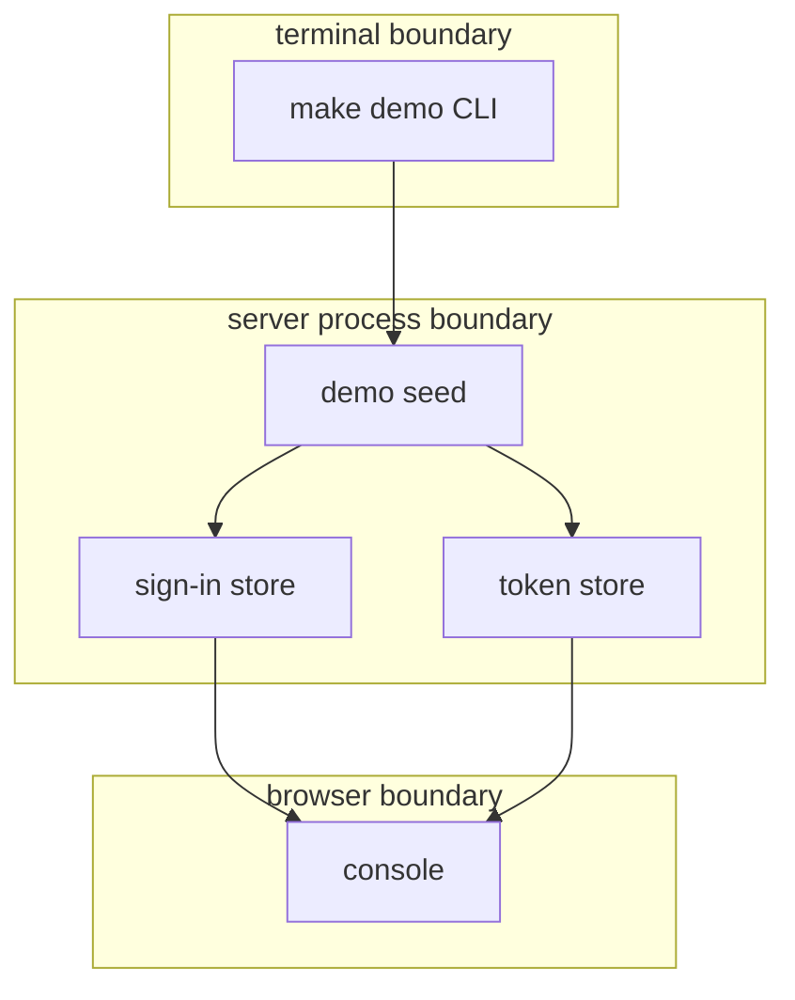

## Context

Part 1 of the demo sign-in split. The demo seed creates one person and its sign-in material. Workspace, view, approval default, trigger, and sink seeds stay in part 2.

## Decisions

1. **Seed demo-admin with sign-in and token.** Seed one fixed person demo-admin as a person principal with admin grants on both demo namespaces, then issue one single-use console sign-in valid 15 minutes and one personal token valid 24 hours for that person, and print the sign-in instead of the bootstrap token. The demo seed runs only when installation kind is dev.
2. **Leave bootstrap token alone.** Keep bootstrap admin token behavior unchanged outside the demo seed; the demo path only replaces what it prints and stores for demo-admin. Rerun of the seed reuses person demo-admin, revokes prior demo sign-ins, and issues fresh sign-in and token; a halfway failure leaves no sign-in material and rerun starts from the person record.

## Structure

Reuse the existing demo seed constructor in cmd/opendustpan/devdemo.go; add no new server type. If a new value is needed, use an unexported demoSeed struct whose constructor checks the person name allowlist and the grant set before any write.

## Risks

- Demo token leaks into shell history when printed; print it once with a rotation note.

## Layers (defense in depth)

| Layer | Guard | Hostile test |
| --- | --- | --- |
| boundary check | Dev-kind guard in the demo seed constructor refuses to run when installation kind is not dev. | Call the seed against a production-kind store and check it refuses without creating demo-admin. |
| encode or contain | Store demo-admin person by stable subject person:demo-admin; grants reference the subject, never the display name. | Remove and remake demo-admin and check the grants still resolve to the same subject. |
| limit | Single-use sign-in with 15 minute expiry; personal token with 24 hour expiry and caller-bound read. | Replay a used sign-in and read with an expired token and check both are refused. |
| authorize at point of use | Per-person routes check the caller is a person at the point of use; bootstrap token callers keep the existing person-missing refusal. | Call GET preferences with the bootstrap token and check the person-missing refusal stays. |
| fail closed | Seed failure before commit stores nothing; rerun is safe and prior demo sign-ins are revoked on reseed. | Fail the seed between person and token and check rerun creates exactly one person and no valid old sign-in. |

## Quality attributes

| Attribute | Target | Unit | Scope |
| --- | --- | --- | --- |
| none affected | demo seed path only; no request latency or storage target changes |  |  |

## Threat model

Data flow and trust boundaries:

| Boundary | STRIDE | Threat | Layer | Guard | Hostile test |
| --- | --- | --- | --- | --- | --- |
| terminal to server process | S | Attacker reuses a printed demo sign-in or token to gain demo-admin reach. | boundary check | Dev-kind guard refuses non-dev installation before any write. | Seed against production kind and check refusal with no person created. |
| terminal to server process | S | Attacker reuses a printed demo sign-in or token to gain demo-admin reach. | encode or contain | Fixed allowlist person name demo-admin; no caller-supplied name or token value. | Seed with another name and check refusal. |
| terminal to server process | S | Attacker reuses a printed demo sign-in or token to gain demo-admin reach. | limit | Single-use sign-in 15 minute expiry; personal token 24 hour expiry. | Replay used sign-in and expired token and check refusal. |
| terminal to server process | S | Attacker reuses a printed demo sign-in or token to gain demo-admin reach. | authorize at point of use | Per-person routes check caller is a person at point of use. | Call preferences with bootstrap token and check person-missing refusal. |
| terminal to server process | S | Attacker reuses a printed demo sign-in or token to gain demo-admin reach. | fail closed | Halfway failure commits nothing; reseed revokes prior demo sign-ins. | Fail between person and token then rerun and check one person and no old sign-in valid. |
| server process to browser | I | Attacker steals the printed demo sign-in from terminal or CI logs and opens a session. | boundary check | One-time sign-in is single-use with short expiry; token printed once with rotation note. | Read a second time with the same sign-in and check refusal. |
| server process to browser | I | Attacker steals the printed demo sign-in from terminal or CI logs and opens a session. | encode or contain | Token secret stored as hash; cookie and header handling strips CR LF. | Inject CR LF into sign-in value and check it is refused, not echoed. |
| server process to browser | I | Attacker steals the printed demo sign-in from terminal or CI logs and opens a session. | limit | 15 minute sign-in and 24 hour token bounds the leak window. | Use expired material and check refusal. |
| server process to browser | I | Attacker steals the printed demo sign-in from terminal or CI logs and opens a session. | authorize at point of use | Session read binds to demo-admin subject. | Use demo token as another subject and check refusal. |
| server process to browser | I | Attacker steals the printed demo sign-in from terminal or CI logs and opens a session. | fail closed | Unknown or expired values deny without revealing which half failed. | Send random sign-in value and check generic denial with audit entry. |
