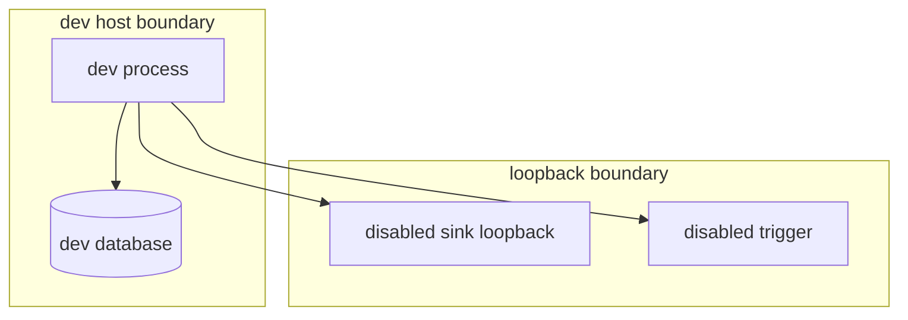

## Context

Part 2 builds on the demo-admin person from part 1. It extends cmd/opendustpan/devdemo.go:40 (func devRun.seedDemo) to seed one workspace with one state version, one saved view, one approval default, one disabled trigger, and one disabled sink. All targets stay local and disabled.

## Decisions

1. **Seed by stable ID with repair of partial seed.** Seed through existing domain services for workspace, saved view, approval default, trigger, and sink. Match each object by its demo stable ID. Create only missing objects. Never update or delete a user-changed object. Skip all seeding when demo-admin is absent. Run seeding only when installation kind is dev, else refuse with dev seed refused on non-dev installation.
2. **Local disabled sink and trigger only.** Sink uses a disabled webhook with a loopback URL and trigger uses disabled schedule with no fire. No secret value is seeded. Idempotence comes from unique demo stable IDs and insert-if-absent writes, so two concurrent seeds keep one row per object.

## Structure

Extend the unexported demo seed type behind cmd/opendustpan/devdemo.go:40 (func devRun.seedDemo) with one constructor-checked seed record per object, so a missing field cannot compile. The constructor checks stable IDs, loopback sink target, and disabled flags.

## Risks

- Partial seed after a stop during seeding leaves some demo objects missing.
- Concurrent dev starts create duplicate demo objects.

## Layers (defense in depth)

| Layer | Guard | Hostile test |
| --- | --- | --- |
| boundary check | Refuse seeding unless installation kind is dev and demo-admin is present | Call seed against a non-dev installation and check refusal with no row written |
| encode or contain | Sink stays disabled loopback with no credential; trigger stays disabled with no fire | Remove a disabled flag and check the seed constructor refuses the value |
| authorize at point of use | Seed runs as the local dev process in the demo namespace only | Request seeding in another namespace and check denial |
| fail closed | Unknown kind or bad URL fails closed with no send and no partial row | Pass an unknown kind and check no row is written and no message leaves the host |

## Quality attributes

| Attribute | Target | Unit | Scope |
| --- | --- | --- | --- |
| none affected | Demo seed runs once at dev start with one workspace and four linked objects |  |  |

## Threat model

Data flow and trust boundaries:

| Boundary | STRIDE | Threat | Layer | Guard | Hostile test |
| --- | --- | --- | --- | --- | --- |
| dev host boundary | S | Spoofed dev seed writes demo objects to a production database. | boundary check | Refuse seeding unless installation kind is dev. | Call seed against a production database and check refusal. |
| dev host boundary | S | Spoofed dev seed writes demo objects to a production database. | encode or contain | Sink target stays loopback and disabled; trigger stays disabled. | Remove the disabled flag and check the seed constructor refuses the value. |
| dev host boundary | S | Spoofed dev seed writes demo objects to a production database. | limit | Seed writes at most 6 rows per dev start. | Run seed twice and check row count stays at 6. |
| dev host boundary | S | Spoofed dev seed writes demo objects to a production database. | authorize at point of use | Seed runs as the local dev process with no new grant. | Call seed from a non-dev caller and check denial. |
| dev host boundary | S | Spoofed dev seed writes demo objects to a production database. | fail closed | Unknown installation kind denies seeding and writes no row. | Pass an unknown kind and check no row is written. |
| loopback boundary | E | Seeded sink or trigger calls an outside host. | boundary check | Allowlist sink URL to loopback only. | Send a public sink URL to the seed constructor and check refusal. |
| loopback boundary | E | Seeded sink or trigger calls an outside host. | encode or contain | Store sink as disabled with no credential. | Remove the disabled flag and check the sink stays unsent. |
| loopback boundary | E | Seeded sink or trigger calls an outside host. | limit | Fire no trigger and send no sink message during seeding. | Run seed and check zero outbound calls. |
| loopback boundary | E | Seeded sink or trigger calls an outside host. | authorize at point of use | Seed creates objects only in the demo namespace. | Request another namespace and check denial. |
| loopback boundary | E | Seeded sink or trigger calls an outside host. | fail closed | Invalid sink URL fails seeding with no partial send. | Pass a bad URL and check no message leaves the host. |
