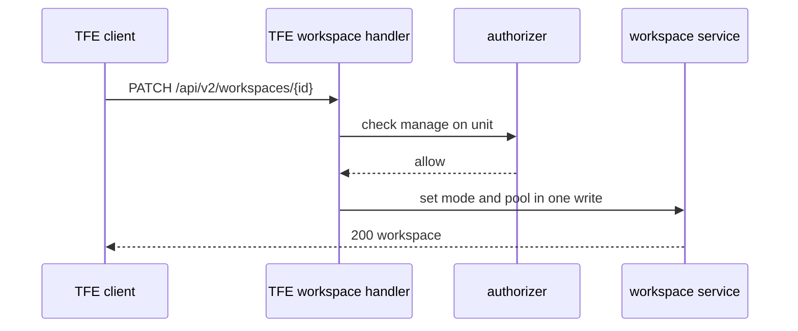
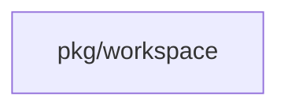
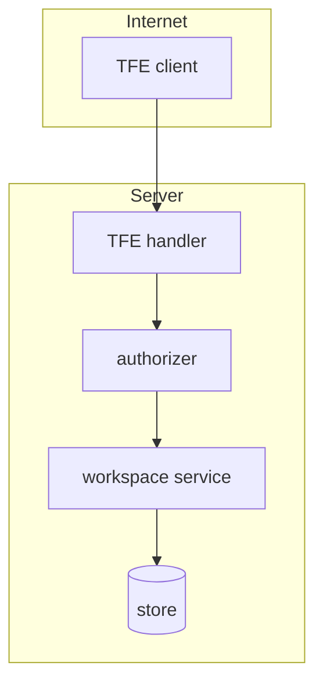

## Context

The TFE workspace PATCH writes the same unit settings as the tool-neutral route, in one store transaction.

## Decisions

1. **One atomic write.** The handler parses mode and pool with parseWorkspacePatch, checks one authorization, then calls setExecutionMode with setPool once in one store transaction with row-version last-writer-wins, so no partial mode is stored and two writers end with one whole winner.
2. **Closed mode allowlist.** The allowlist is local and agent. Remote and other strings fail with a JSON:API error. Other provider attributes are read and ignored, never stored. Mode agent needs a pool of the same namespace. Null relation clears the pool. Mode local keeps the stored pool ID for audit and runs on the workstation. A namespace with no runner pool refuses agent.

## Structure

The unexported type tfeWorkspacePatch is built only by parseWorkspacePatch. The constructor checks the mode allowlist and the pool ID shape, so no invalid value reaches the service. The pool is stored by stable ID.

## Risks

- The TFE provider sends other attributes with execution-mode; the server ignores them and stores nothing extra.
- The stored pool ID can outlive its pool; the run is refused until a person sets a live pool or local.

## Diagrams

After this change:

Modules that the change touches, and their imports on main:

## Quality attributes

| Attribute | Target | Unit | Scope |
| --- | --- | --- | --- |
| latency | 300 | ms p95 | PATCH /api/v2/workspaces/{id} on the SQLite store |

## Threat model

Data flow and trust boundaries:

| Boundary | STRIDE | Threat | Layer | Guard | Hostile test |
| --- | --- | --- | --- | --- | --- |
| TFE API boundary | T | A caller routes jobs to a foreign pool or sets an unknown mode. | boundary check | Allowlist for the mode and the pool ID shape, body limit 64 KiB. | Send remote, an empty value and a 1 MiB body; each is refused. |
| TFE API boundary | T | A caller routes jobs to a foreign pool or sets an unknown mode. | encode or contain | The pool is a stable ID and a store placeholder; the token never reaches a log. | Send a pool ID with path characters; the store holds no such value and logs hold no token. |
| TFE API boundary | T | A caller routes jobs to a foreign pool or sets an unknown mode. | limit | Body limit 64 KiB and request timeout 30 seconds. | Send a large body; the server answers 413. |
| TFE API boundary | T | A caller routes jobs to a foreign pool or sets an unknown mode. | authorize at point of use | The service checks the manage action on the unit. | Call with a read-only token; the server answers 403. |
| TFE API boundary | T | A caller routes jobs to a foreign pool or sets an unknown mode. | fail closed | An unknown value stores nothing; a denial writes no change entry. | Send an unknown pool; the store and the audit log show no change. |

## Contracts

**workspace unit settings**

- Invariant: The stored reference is the stable unit ID.
- Invariant: The mode is local or agent.
- Invariant: The pool is empty or the stable ID of a pool of the same namespace that the namespace may use for units.
- `setExecutionMode`: pre: The caller holds the manage action on the unit.; The mode is local or agent.. Post: The mode and the pool are stored in one transaction..
- `setPool`: pre: The caller holds the manage action on the unit.; The pool is null or a unit-usable pool of the same namespace.. Post: The mode and the pool are stored in one transaction..

## Failure modes

| Step | Failure | Retry | State after |
| --- | --- | --- | --- |
| Plan run on a unit with mode agent | The pool was removed. | No retry; a person sets a live pool or mode local. | The unit keeps the dead pool ID and the run is refused. |
| Concurrent PATCH | Two writers collide. | The loser reads back the winner and sends its PATCH again. | One whole winner is stored. |
