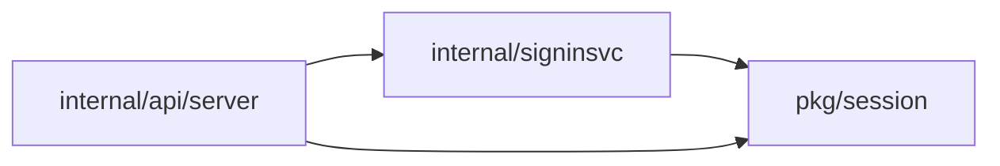
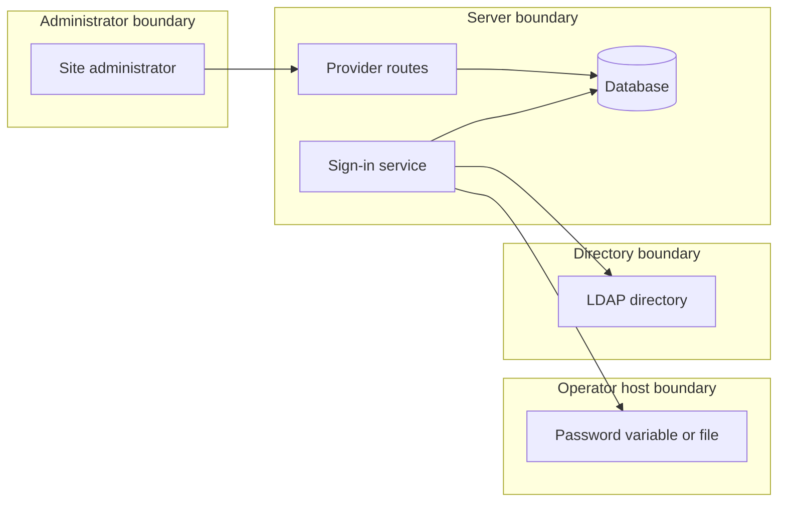

## Context

The static provider reads flags and files. Stored providers live in the database and share the LDAP adapter, the group applier and the egress and TLS guards.

## Decisions

1. **Stored provider record.** A record holds URL, TLS mode, CA bundle reference, base DN, filters, group settings, limits and a password reference. The subject attribute is entryUUID or objectGUID only (Owner decision, 13 Nov 2026, queue P20). The URL is immutable after create. The static ID is reserved, and a deleted ID stays reserved.
2. **Password reference.** The reference names a variable or a file path from an allowlist that the operator sets at start. Files open under a root with os.Root. An empty, missing or unreadable value refuses the sign-in.
3. **TLS rule.** A plain URL to a non-loopback address is refused unless the plain-connection setting is on. Certificate checks stay. A check at each sign-in covers a setting that turned off.
4. **Group claims path.** Memberships change only through the one membership function with source ldap. A user absent from the directory is refused and gets no change.
5. **Static binding.** A row with a unique key on the ID holds the URL and a start marker, written in one transaction. A changed URL or a missing row after the marker refuses the start.
6. **Rebind and delete.** Rebind needs its own action and a reason, checks the URL, changes it, revokes sessions and writes an audit entry. Delete revokes sessions and removes grants.

## Structure

Unexported ldapProvider type with constructor newLDAPProvider that checks ID, URL, DN, filters, subject attribute and limits. Only the constructor makes a value. The URL has no setter. The password is a reference field with no plain value in the API model.

## Risks

- A group claim adds a member to a protected group.
- The bind password leaks through the API, logs or audit entries.
- A changed directory reuses old subjects.

## Layers (defense in depth)

| Layer | Guard | Hostile test |
| --- | --- | --- |
| API validation | Allowlist for URL scheme, DN, filters, attribute names, subject attribute, password reference and limits. | POST an ldap:// URL, a mail subject attribute, a reference outside the allowlist, a symlink path and an oversize filter; each is refused before any connection. |
| service | Reserved ID check, immutable URL, rebind action, binding comparison, audit entry. | Create with the static ID, update the URL, recreate a deleted ID, rebind without the action, delete the binding row and start. |
| database | Unique index on the directory URL and on the binding ID. | Two parallel creates with one URL, and two parallel first starts; one loses each time. |
| LDAP adapter | Egress, TLS, no referrals, no empty password, user-name bounds, 10 second limits, 1000 entry limit, disabled user refused. | Use a blocked host, a bad certificate, a referral answer, an empty password and a disabled user; each sign-in is refused and no password is logged. |

## Diagrams

Modules that the change touches, and their imports on main:

## Quality attributes

| Attribute | Target | Unit | Scope |
| --- | --- | --- | --- |
| LDAP operation time limit | 10 | seconds | each connection and each operation of one LDAP sign-in |
| Group search size limit | 1000 | entries | one group search of one sign-in |
| Rebind effect on sessions | 0 | sessions of the provider kept | one rebind or delete of a provider |

## Threat model

Data flow and trust boundaries:

| Boundary | STRIDE | Threat | Layer | Guard | Hostile test |
| --- | --- | --- | --- | --- | --- |
| Administrator boundary | E | A caller without the sign-in management action creates, rebinds or deletes a provider. | authorize at point of use | Each route declares its action and the service checks it. | Call each route without the action; each answers 403 and changes no record. |
| Server boundary | T | A changed URL lets a new directory reuse old subjects and grants. | fail closed | The update refuses a URL change and the static binding refuses the start. | Update the URL and start with another URL; both are refused. |
| Operator host boundary | I | The bind password leaks through the API, logs or audit entries, or a symlink reads another file. | encode or contain | A reference allowlist, os.Root and no password in any answer or log. | Read a provider and a sign-in log, and name a symlink path; no password shows and the symlink is refused. |
| Directory boundary | S | A hostile directory sends a referral, an oversize answer, or a bad certificate. | limit | No referrals, 10 second limits, 1000 entries and certificate checks. | Answer with a referral, 1001 entries and an untrusted certificate; each sign-in is refused. |
| Server boundary | R | A rebind, a delete or a group change happens without a record. | boundary check | Rebind needs a typed reason, and each change writes an audit entry. | Rebind with no reason is refused, and a rebind with a reason writes an audit entry with the old and new URL. |
| Server boundary | D | Two parallel writes or starts make duplicate records or block sign-in. | limit | Unique indexes and bounded directory limits. | Two parallel creates with one URL; one answers 409. |
