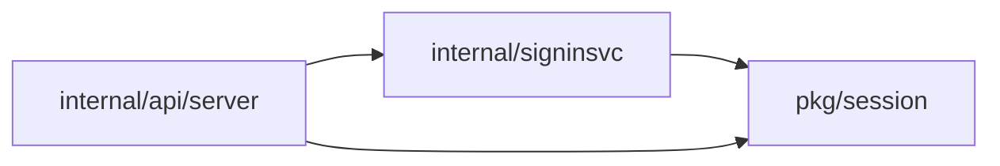
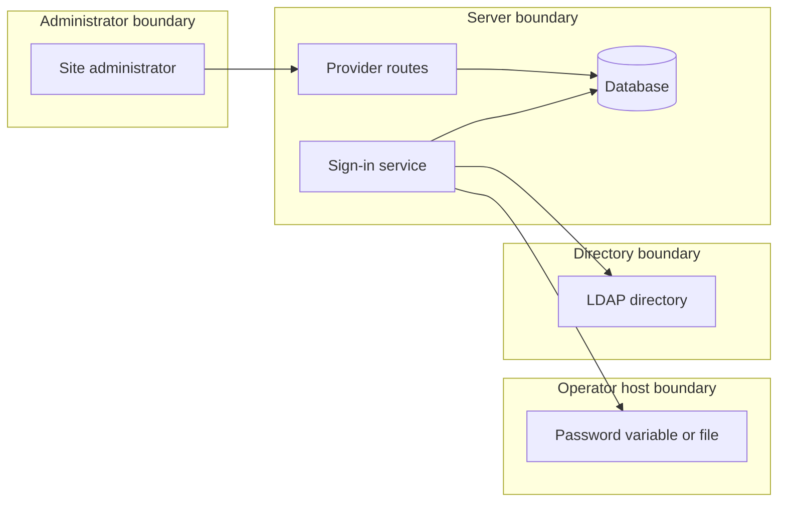

## Context

The static provider reads flags and files. Stored providers live in the database and share the LDAP adapter, the group applier and the egress and TLS guards.

## Decisions

1. **Stored provider record.** A record holds URL, TLS mode, CA bundle reference, base DN, filters, group settings, limits and a password reference. The subject attribute is entryUUID or objectGUID only (Owner decision, 13 Nov 2026, queue P20). The URL is immutable after create. The static ID is reserved, and a deleted ID stays reserved.
2. **Password reference.** The reference names a variable or a file path from an allowlist that the operator sets at start. Files open under a root with os.Root. An empty, missing or unreadable value refuses the sign-in.
3. **TLS rule.** A plain URL to a non-loopback address is refused unless the plain-connection setting is on. Certificate checks stay. A check at each sign-in covers a setting that turned off.
4. **Group claims path.** Memberships change only through the one membership function with source ldap. A user absent from the directory is refused and gets no change.
5. **Static binding.** A row with a unique key on the ID holds the URL and a start marker, written in one transaction. A changed URL or a missing row after the marker refuses the start.
6. **Rebind and delete.** Rebind needs its own action and a reason, checks the URL, changes it, revokes sessions and writes an audit entry. Delete revokes sessions and removes grants.

## Structure

Unexported ldapProvider type with constructor newLDAPProvider that checks ID, URL, DN, filters, subject attribute and limits. Only the constructor makes a value. The URL has no setter. The password is a reference field with no plain value in the API model.

## Risks

- A group claim adds a member to a protected group.
- The bind password leaks through the API, logs or audit entries.
- A changed directory reuses old subjects.

## Layers (defense in depth)

| Layer | Guard | Hostile test |
| --- | --- | --- |
| API validation | Allowlist for URL scheme, DN, filters, attribute names, subject attribute, password reference and limits. | POST an ldap:// URL, a mail subject attribute, a reference outside the allowlist, a symlink path and an oversize filter; each is refused before any connection. |
| service | Reserved ID check, immutable URL, rebind action, binding comparison, audit entry. | Create with the static ID, update the URL, recreate a deleted ID, rebind without the action, delete the binding row and start. |
| database | Unique index on the directory URL and on the binding ID. | Two parallel creates with one URL, and two parallel first starts; one loses each time. |
| LDAP adapter | Egress, TLS, no referrals, no empty password, user-name bounds, 10 second limits, 1000 entry limit, disabled user refused. | Use a blocked host, a bad certificate, a referral answer, an empty password and a disabled user; each sign-in is refused and no password is logged. |

## Diagrams

Modules that the change touches, and their imports on main:

## Quality attributes

| Attribute | Target | Unit | Scope |
| --- | --- | --- | --- |
| LDAP operation time limit | 10 | seconds | each connection and each operation of one LDAP sign-in |
| Group search size limit | 1000 | entries | one group search of one sign-in |
| Rebind effect on sessions | 0 | sessions of the provider kept | one rebind or delete of a provider |

## Threat model

Data flow and trust boundaries:

| Boundary | STRIDE | Threat | Layer | Guard | Hostile test |
| --- | --- | --- | --- | --- | --- |
| Administrator boundary | E | A caller without the sign-in management action creates, rebinds or deletes a provider. | boundary check | The handler checks the body with an allowlist and refuses an invalid field. | Send a create with a bad field; it answers 400 and stores nothing. |
| Administrator boundary | E | A caller without the sign-in management action creates, rebinds or deletes a provider. | encode or contain | Queries use placeholders only. | Send a provider ID with SQL text; the store keeps it as a plain value. |
| Administrator boundary | E | A caller without the sign-in management action creates, rebinds or deletes a provider. | limit | The body has a size limit. | Send an oversize body; it is refused. |
| Administrator boundary | E | A caller without the sign-in management action creates, rebinds or deletes a provider. | authorize at point of use | Each route declares its action and the service checks it for the provider. | Call each route without the action; each answers 403 and changes no record. |
| Administrator boundary | E | A caller without the sign-in management action creates, rebinds or deletes a provider. | fail closed | An unknown action state denies and writes an audit entry. | Break the authorizer; the route denies. |
| Server boundary | T | A changed URL lets a new directory reuse old subjects and grants. | boundary check | The update body names no URL field that changes the record. | Update with another URL; it answers 409. |
| Server boundary | T | A changed URL lets a new directory reuse old subjects and grants. | encode or contain | The binding row has a unique key on the ID. | Insert a second row for one ID; the store refuses it. |
| Server boundary | T | A changed URL lets a new directory reuse old subjects and grants. | limit | Only the rebind route changes the URL, one provider at a time. | Rebind two providers to one URL; the second is refused. |
| Server boundary | T | A changed URL lets a new directory reuse old subjects and grants. | authorize at point of use | Rebind needs its own action on the provider. | Rebind with the update action only; it answers 403. |
| Server boundary | T | A changed URL lets a new directory reuse old subjects and grants. | fail closed | The start refuses on a changed URL or a lost row. | Start with another URL and with the row deleted; both refuse. |
| Operator host boundary | I | The bind password leaks through the API, logs or audit entries, or a symlink reads another file. | boundary check | The reference must be on the operator allowlist. | Create with a reference outside the list; it answers 400. |
| Operator host boundary | I | The bind password leaks through the API, logs or audit entries, or a symlink reads another file. | encode or contain | Files open under os.Root and the password is never in a model field. | Name a symlink path; the server refuses it. |
| Operator host boundary | I | The bind password leaks through the API, logs or audit entries, or a symlink reads another file. | limit | The file read has a size limit. | Point at a huge file; the sign-in is refused. |
| Operator host boundary | I | The bind password leaks through the API, logs or audit entries, or a symlink reads another file. | authorize at point of use | Only the sign-in service reads the value, at the time of the bind. | Read a provider through the API; no password shows. |
| Operator host boundary | I | The bind password leaks through the API, logs or audit entries, or a symlink reads another file. | fail closed | An empty or unreadable value refuses the sign-in. | Empty the variable; the sign-in is refused and the log holds no password. |
| Directory boundary | S | A hostile directory sends a referral, an oversize answer, or a bad certificate. | boundary check | The adapter checks the user name and the answer shape. | Send a control character in the name; it is refused before any connection. |
| Directory boundary | S | A hostile directory sends a referral, an oversize answer, or a bad certificate. | encode or contain | The filter escapes the user name and the egress rules check the resolved address. | Send a filter metacharacter and a blocked host; each is refused or escaped. |
| Directory boundary | S | A hostile directory sends a referral, an oversize answer, or a bad certificate. | limit | 10 second limits and 1000 entries. | Answer with 1001 entries; the sign-in is refused. |
| Directory boundary | S | A hostile directory sends a referral, an oversize answer, or a bad certificate. | authorize at point of use | The bind as the user proves the password, not the service bind. | Give a wrong password; the sign-in is refused. |
| Directory boundary | S | A hostile directory sends a referral, an oversize answer, or a bad certificate. | fail closed | No referrals and certificate checks; any error denies. | Answer with a referral and an untrusted certificate; each is refused. |
| Server boundary | R | A rebind, a delete or a group change happens without a record. | boundary check | Rebind needs a typed reason. | Rebind with no reason; it answers 400. |
| Server boundary | R | A rebind, a delete or a group change happens without a record. | encode or contain | The audit entry strips CR and LF from the reason. | Send a reason with a line break; the entry holds one line. |
| Server boundary | R | A rebind, a delete or a group change happens without a record. | limit | The reason has a length limit. | Send a long reason; it is refused. |
| Server boundary | R | A rebind, a delete or a group change happens without a record. | authorize at point of use | The audit entry names the caller from the checked identity. | Rebind with a token; the entry names its principal. |
| Server boundary | R | A rebind, a delete or a group change happens without a record. | fail closed | The change and the audit entry commit together. | Fail the audit write; the change does not apply. |
| Server boundary | D | Two parallel writes or starts make duplicate records or block sign-in. | boundary check | Create checks the URL and ID before the write. | Create with a duplicate ID; it answers 409. |
| Server boundary | D | Two parallel writes or starts make duplicate records or block sign-in. | encode or contain | One transaction writes the row and the marker. | Start two servers together; one row exists. |
| Server boundary | D | Two parallel writes or starts make duplicate records or block sign-in. | limit | Unique indexes and bounded directory limits. | Two parallel creates with one URL; one answers 409. |
| Server boundary | D | Two parallel writes or starts make duplicate records or block sign-in. | authorize at point of use | Only a holder of the action creates a provider, so an outsider cannot fill the table. | Create 100 providers without the action; each answers 403. |
| Server boundary | D | Two parallel writes or starts make duplicate records or block sign-in. | fail closed | A lost row after the marker refuses the start. | Delete the row and start; the server refuses. |
