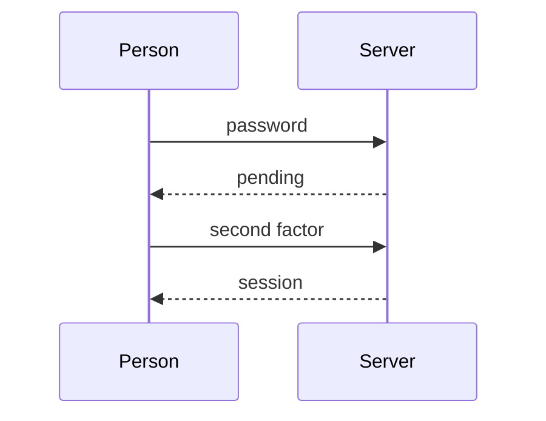
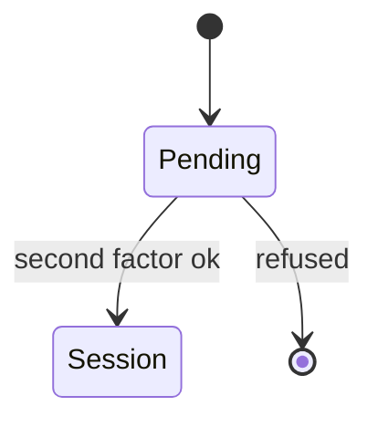
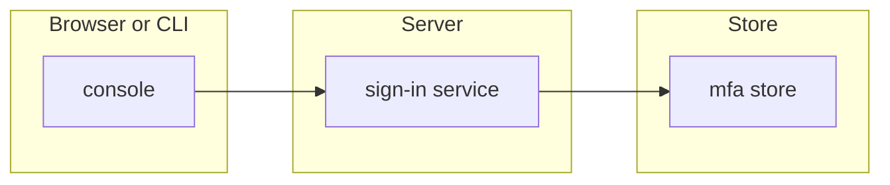

## Context

Built-in MFA for local and LDAP sign-in, no step for SSO, fresh-step checks for tokens and reveal.

## Decisions

1. **Service-owned MFA gate.** The sign-in service issues a session only after a valid second factor.
2. **Cookie-bound freshness.** The fresh step lives in the sealed access cookie of the sign-in that did it.
3. **One route for each factor.** The second factor goes to POST /api/dustpan/v1/sign-in/second-factor with a `method` field (`totp`, `recovery-code`, `passkey-options`, `passkey`), next to the password route (POST /api/dustpan/v1/sign-in/password). The password route answers 202 with the pending cookie when require MFA is on, and 204 with the session cookie as before when it is off. A passkey needs two calls on the same route: `passkey-options` returns the options, `passkey` takes the response.
4. **The sign-in counts apart from the step-up.** The sign-in counts wrong factors with `PendingStore.FailPending` only. It uses the step-up TOTP port only for the single-use rule of the time step, through the NEW method `AcceptSignInStep` of the change `mfa-store`, which touches no step-up counter, so a step-up lockout never blocks a sign-in.
5. **The stores come from the change `mfa-store`.** The SQLite and PostgreSQL adapters of `mfa.PendingStore`, `mfa.RecoveryCodeStore` and `stepup.TOTPStore`, their conformance suites and the backup rules land there first. This change starts when they are on main. The routes that enroll a TOTP factor and issue recovery codes belong to app-level-second-factor-totp, which depends on this change. The e2e step uses a registered passkey as the second factor, because the passkey routes exist on main.
6. **SSO is not changed.** The refusal for a password next to an identity provider stays as on main. Built-in MFA adds no step for SSO.
7. **The policy is three installation settings.** `mfa.Policy` (`pkg/mfa/mfa.go:343`) has no store on main, and no code reads it. This change stores the field Enabled as `mfa.enabled`, the field RequireForAll as `mfa.requireForAll` and the field EnrollmentGraceDays as `mfa.enrollmentGraceDays` (whole days, default 0, at most 14), with the settings resource of `pkg/setting`. All are off or 0 by default. The sign-in and the freshness checks read them through the port `mfa.PolicySource`. A weaker change needs a fresh step, as for `freshAuthEnabled`. The other fields of `mfa.Policy` stay at their defaults and are not stored here.
8. **The gate rule follows ADR 285 decisions 20 and 21.** With `mfa.enabled` on, a correct password makes a pending sign-in and no session when the person has a factor, when `mfa.requireForAll` is on, or when an SSO provider exists and `signIn.localPassword.enabled` is on. The value of `mfa.requireForAll` does not decide the first and the third case. With `mfa.enabled` off, a password sign-in needs no second factor. A person with no factor and a required factor gets no session from this change; the enroll-only session belongs to app-level-second-factor-totp.
9. **The second-factor time in the session.** The session keeps the time of its last second-factor step (task 2.9). The design of this field in the session and in the sealed cookie is to be reviewed by an Opus security review before merge.

## Interaction with the fresh step

The change fresh-auth-enabled-setting makes the fresh step opt-in with the installation setting `freshAuthEnabled` (ADR 385 decisions 1 to 3). This change keeps the rule that ADR 385 sets. The two settings answer two different questions:

- `freshAuthEnabled` decides whether the server asks for a fresh step at all. With it off, token creation and secret reveal ask for no step, and `mfa.enabled` does not change that.
- `mfa.enabled` decides which factor satisfies a step that the server asks for. With `freshAuthEnabled` on and `mfa.enabled` on, only a step from POST /api/dustpan/v1/sign-in/second-factor inside the window satisfies the step for local and LDAP sign-in. A sign-in with a password only does not. With `mfa.enabled` off, the step stays as on main (the age of the sign-in).
- The turn of either setting from on to off needs a fresh step.

The requirement `fresh-step` of this change applies when `mfa.enabled` and `freshAuthEnabled` are on.

## Structure

The pending sign-in is `mfa.Pending` (`pkg/mfa/mfa.go:275`), kept in `mfa.PendingStore`. A session issues only through `PendingStore.CompletePending` (`pkg/mfa/mfa.go:315`). This change adds no second pending type.

## Risks

- TOTP clock drift locks a person out.

## Layers (defense in depth)

| Layer | Guard | Hostile test |
| --- | --- | --- |
| HTTP handler | Reject malformed factor input. | Send a malformed code; it is refused. |
| Service | Accept a TOTP code once. | Reuse a code; no session. |
| Service | Count a wrong factor on the pending sign-in only. | Lock the step-up, then sign in with a valid code; a session issues. |
| Store adapter | Keep digests and the sealed secret, never a plain code. | Read each row; no plain code. |

## Diagrams

After this change:

Modules that the change touches, and their imports on main:

States and transitions after this change:

## Quality attributes

| Attribute | Target | Unit | Scope |
| --- | --- | --- | --- |
| correctness | 0 sessions issued from a reused TOTP code | sessions | second-factor check |

## Threat model

Data flow and trust boundaries:

| Boundary | STRIDE | Threat | Layer | Guard | Hostile test |
| --- | --- | --- | --- | --- | --- |
| console to sign-in service | S | An attacker replays a TOTP code. | boundary check | Reject a code that is not 6 digits. | Send a malformed code; refused. |
| console to sign-in service | S | An attacker replays a TOTP code. | encode or contain | Compare the code in constant time. The store keeps the accepted time step (`TOTP.LastStep`) and no code. | Read the factor record; it holds no plain code. |
| console to sign-in service | S | An attacker replays a TOTP code. | limit | Count wrong factors on the pending sign-in with `PendingStore.FailPending`. | Send wrong codes past the count; the pending sign-in is void. |
| console to sign-in service | S | An attacker replays a TOTP code. | authorize at point of use | Single-use check of the time step, with the rule of the `stepup` package (`AcceptStep`). | Reuse a code; no session. |
| console to sign-in service | S | An attacker replays a TOTP code. | fail closed | Deny on a store error and write an audit entry. | Fail the store during verify; no session and an audit entry. |

## Contracts

**mfa.Pending**

- Invariant: A pending sign-in never authenticates a request.
- `CompletePending`: pre: The pending sign-in exists, is not void and did not expire. Post: A valid factor issues one session and deletes the pending sign-in.; A used code issues no session.

## Failure modes

| Step | Failure | Retry | State after |
| --- | --- | --- | --- |
| Second-factor check | TOTP code replayed | Use a new code. | No session issued. |
| Second-factor check | Pending sign-in void after 5 wrong factors | Sign in again with the password. | No session issued. |
| Second-factor check | Store error | Try again. | No session issued and an audit entry. |
