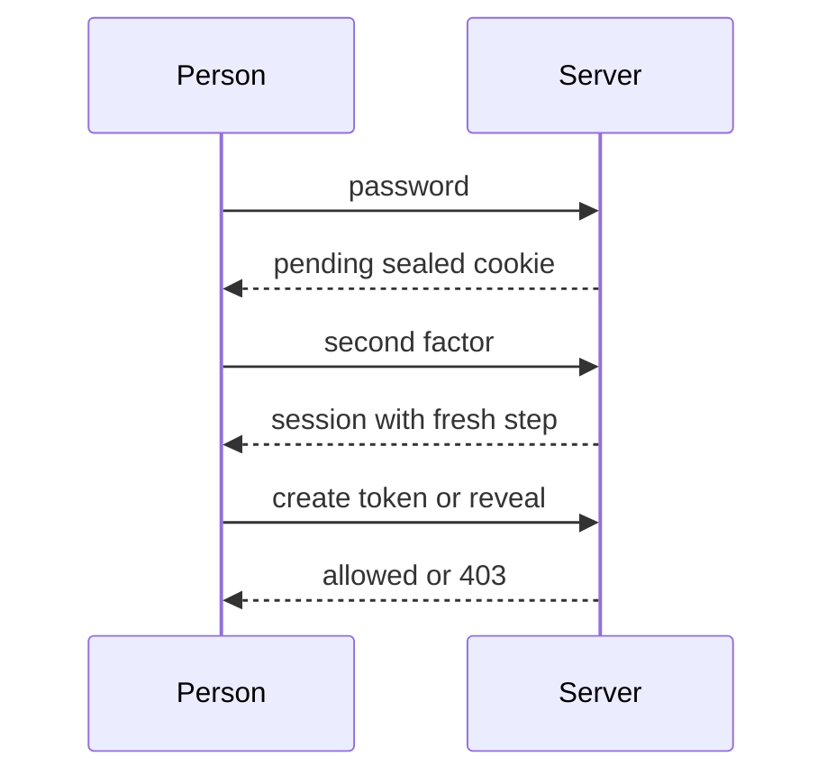
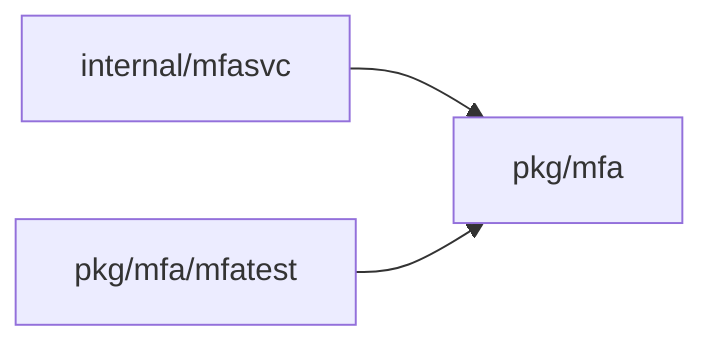
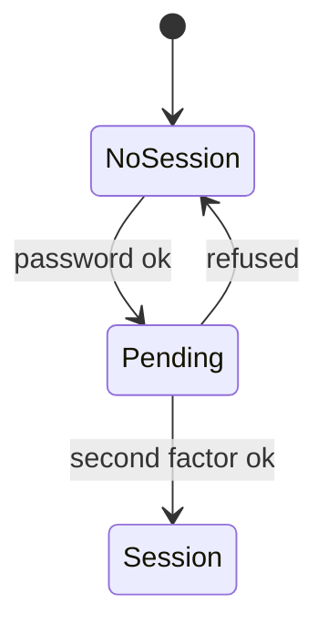
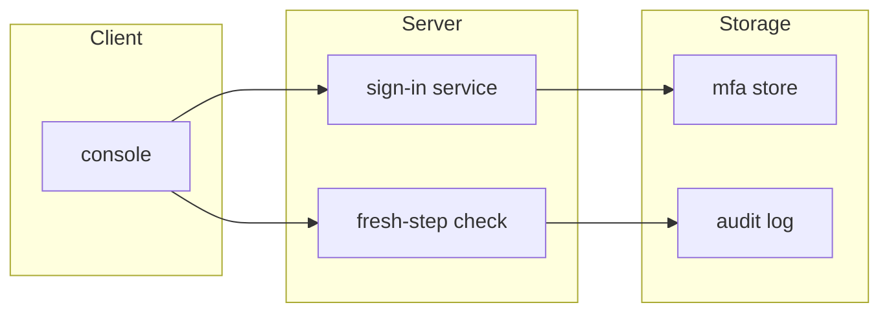

## Context

Built-in MFA for local and LDAP sign-in with require MFA on, no added step for SSO, and fresh-step checks for token creation, token rotation and secret reveal.

## Decisions

1. **Service-owned MFA gate.** Enforce MFA in the sign-in service, not in each HTTP adapter. A pending sign-in issues a session only after a valid second factor.
2. **Cookie-bound freshness time.** Record the fresh step in the sealed access cookie of the sign-in that did it. Compare its age with the one freshAuthSeconds window.
3. **One factor store.** Keep one factor store in pkg/mfa with service internal/mfasvc for enrollment, recovery codes and administrator reset.

## Structure

Unexported mfa.Verifier built only by NewVerifier, which checks the enrolled factors and the window; no session issues without VerifySecondFactor.

## Risks

- TOTP clock drift locks a person out.
- Lost factors need an administrator reset path.

## Layers (defense in depth)

| Layer | Guard | Hostile test |
| --- | --- | --- |
| HTTP handler | Reject malformed factor input and rate limit before the service runs. | Send wrong TOTP codes and replayed assertions to the handler; each fails. |
| Service | Check enrollment, accept a TOTP code once, never issue a session from the first factor alone. | Valid password with a reused TOTP code gives no session. |
| Port adapter | Keep secrets sealed and write an audit entry for each enrollment, use and reset. | Replay a used code and read the stored row; replay fails and the secret stays sealed. |

## Diagrams

After this change:

Modules that the change touches, and their imports on main:

States and transitions after this change:

## Quality attributes

| Attribute | Target | Unit | Scope |
| --- | --- | --- | --- |
| correctness | 0 sessions issued from a reused TOTP code | sessions | second-factor check of one installation |

## Threat model

Data flow and trust boundaries:

| Boundary | STRIDE | Threat | Layer | Guard | Hostile test |
| --- | --- | --- | --- | --- | --- |
| console to sign-in service | S | An attacker replays a TOTP code or WebAuthn assertion to complete a pending sign-in. | boundary check | Reject malformed factor input at the handler. | Send a malformed code to the handler; it is refused. |
| console to sign-in service | S | An attacker replays a TOTP code or WebAuthn assertion to complete a pending sign-in. | encode or contain | Keep secrets sealed in the store and bind the pending sign-in to a sealed cookie. | Read the stored row directly; the secret is not plain text. |
| console to sign-in service | S | An attacker replays a TOTP code or WebAuthn assertion to complete a pending sign-in. | limit | Count wrong factors under the factor lock and rate limit by address. | Send wrong codes in a row; the lock refuses further checks. |
| console to sign-in service | S | An attacker replays a TOTP code or WebAuthn assertion to complete a pending sign-in. | authorize at point of use | Verify the second factor in the service with single use before a session issues. | Call the service with a valid password and a reused code; no session issues. |
| console to sign-in service | S | An attacker replays a TOTP code or WebAuthn assertion to complete a pending sign-in. | fail closed | Refuse a cookie from another sign-in and any unknown value. | Present a cookie from another sign-in; the check refuses it. |

## Contracts

**mfa.PendingSignIn**

- Invariant: A pending sign-in never authenticates a request.
- Invariant: A pending sign-in completes at most once.
- Invariant: A fresh step belongs to the sealed access cookie of the sign-in that did it.
- `VerifySecondFactor`: pre: The pending sign-in is valid and not completed.; The factor input is well-formed.. Post: A valid factor issues a session and ends the pending state.; A wrong or reused factor issues no session and counts the failure..
- `CheckFreshStep`: pre: The caller presents the sealed access cookie of the sign-in.. Post: A stale or foreign step is refused with mfa.fresh-step-required.; A fresh step of the same sign-in allows the operation..

## Failure modes

| Step | Failure | Retry | State after |
| --- | --- | --- | --- |
| Second-factor check | TOTP code replayed on the same or another replica | Refuse the reused code; the person generates a new code. | No session is issued and the failure counter grows. |
| Recovery-code sign-in | One recovery code used at the same time on two replicas | One use wins; the other is refused as used. | One session is issued and the code is marked used. |
| Pending sign-in | Server restart during pending sign-in | Verify the sealed pending cookie with no stored server state. | The pending sign-in stays usable until it is no longer valid. |
