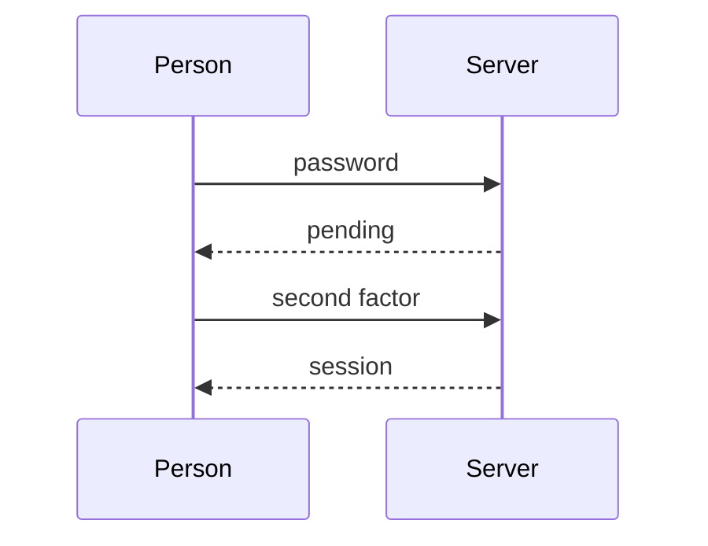
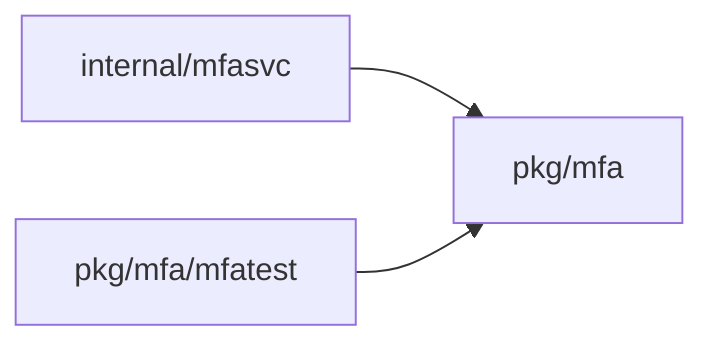
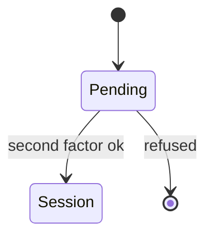
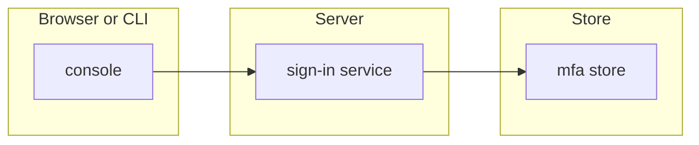

## Context

Built-in MFA for local and LDAP sign-in, no step for SSO, fresh-step checks for tokens and reveal.

## Decisions

1. **Service-owned MFA gate.** The sign-in service issues a session only after a valid second factor.
2. **Cookie-bound freshness.** The fresh step lives in the sealed access cookie of the sign-in that did it.

## Structure

The pending sign-in is `mfa.Pending` (`pkg/mfa/mfa.go:275`), kept in `mfa.PendingStore`. A session issues only through `PendingStore.CompletePending` (`pkg/mfa/mfa.go:315`). This change adds no second pending type.

## Risks

- TOTP clock drift locks a person out.

## Layers (defense in depth)

| Layer | Guard | Hostile test |
| --- | --- | --- |
| HTTP handler | Reject malformed factor input. | Send a malformed code; it is refused. |
| Service | Accept a TOTP code once. | Reuse a code; no session. |

## Diagrams

After this change:

Modules that the change touches, and their imports on main:

States and transitions after this change:

## Quality attributes

| Attribute | Target | Unit | Scope |
| --- | --- | --- | --- |
| correctness | 0 sessions issued from a reused TOTP code | sessions | second-factor check |

## Threat model

Data flow and trust boundaries:

| Boundary | STRIDE | Threat | Layer | Guard | Hostile test |
| --- | --- | --- | --- | --- | --- |
| console to sign-in service | S | An attacker replays a TOTP code. | boundary check | Reject a code that is not 6 digits. | Send a malformed code; refused. |
| console to sign-in service | S | An attacker replays a TOTP code. | encode or contain | Compare the code in constant time. The store keeps the accepted time step (`TOTP.LastStep`) and no code. | Read the factor record; it holds no plain code. |
| console to sign-in service | S | An attacker replays a TOTP code. | limit | Count wrong factors on the pending sign-in with `PendingStore.FailPending`. | Send wrong codes past the count; the pending sign-in is void. |
| console to sign-in service | S | An attacker replays a TOTP code. | authorize at point of use | Single-use check of the time step, with the rule of the `stepup` package (`AcceptStep`). | Reuse a code; no session. |
| console to sign-in service | S | An attacker replays a TOTP code. | fail closed | Deny on a store error and write an audit entry. | Fail the store during verify; no session and an audit entry. |

## Contracts

**mfa.Pending**

- Invariant: A pending sign-in never authenticates a request.
- `CompletePending`: pre: The pending sign-in exists, is not void and did not expire. Post: A valid factor issues one session and deletes the pending sign-in.; A used code issues no session.

## Failure modes

| Step | Failure | Retry | State after |
| --- | --- | --- | --- |
| Second-factor check | TOTP code replayed | Use a new code. | No session issued. |
