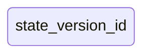

## Context

Fix only the lock and unlock trip regression of issue 2347. This change closes 2347 only; 2027, 2033 and 2040 stay open.

## Decisions

1. **Read the unit ID once.** The lock handler reads the inventory row once and passes the stable unit ID to both gate read transactions. The gate query constrains by that ID. When the ID no longer resolves, the lock fails with 404 workspace.not-found and writes no gate row.
2. **One write for lock and last release.** The lock save and the unlock save each write the lock record and the workspace row in one statement, on PostgreSQL and on SQLite. When no lock row returns, the workspace-row update does not run.

## Structure

No new type. The fix removes two reads and one write per save; the stable unit ID replaces a name lookup.

## Risks

- A recreated unit with the same name must not pass the gate query.
- A conflicting lock must not change the last-release fields.

## Diagrams

Modules that the change touches, and their imports on main:

States on main in the touched packages:

## Quality attributes

| Attribute | Target | Unit | Scope |
| --- | --- | --- | --- |
| latency | 42 or fewer sequential round trips, down from 45 | round trips | OpenTofu lock on PostgreSQL |
| latency | 10 or fewer sequential round trips, down from 11 | round trips | OpenTofu unlock on PostgreSQL |

## Failure modes

| Step | Failure | Retry | State after |
| --- | --- | --- | --- |
| Gate reads with the passed unit ID | The unit was renamed, removed or recreated. | 404 workspace.not-found; the CLI sends a new request. | No lock row and no gate row. |
| Folded lock write | Connection lost before COMMIT. | Rollback; 503 with Retry-After: 5; no server resend. | No lock row and no last-release change. |
