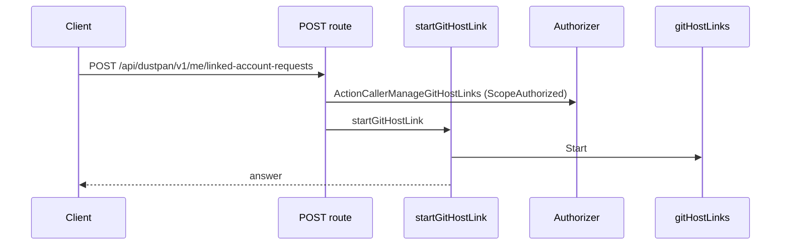
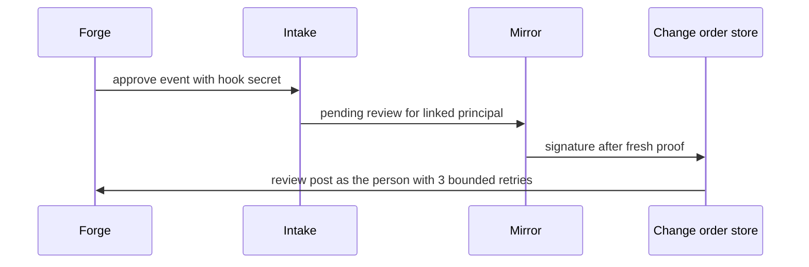
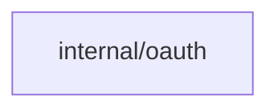
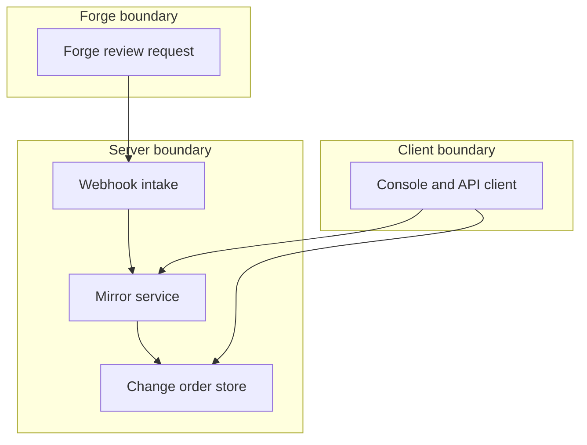

## Context

Change orders hold approvals as signatures. Review requests hold approvals as forge reviews. They stay in sync for one person only when the forge connection links identity through OAuth. This change owns the approve route, the mirror both ways, the namespace switch and the window key for approvals. Review modes 2 and 4 belong to pull-request-automation-first-slice and apply-after-merge. The webhook intake shape belongs to git-host-webhook-intake-post. Approval rule evaluation belongs to approval-defaults-take-effect-live.

## Decisions

1. **Pending review then fresh-checked signature.** A forge approve or request-changes event creates a pending review for the linked principal, keyed on the stable forge user ID. It never writes a signature directly. The review becomes a signature only when the same principal completes the approve route with a fresh proof, checked at the point of write. The pending review expires after 24 hours and can be canceled. Each direction writes one audit entry.
2. **Read-only without OAuth.** Without an OAuth link, the change-order page of a version-control unit reads but refuses approve, request-changes and dismiss with a 403 reason that names the missing link.

## Structure

Unexported type approvalMirror with constructor newApprovalMirror(linkResolver, freshChecker) that builds only linked, fresh-checked signatures; no direct signature write path bypasses it.

## Risks

- A forge identity links to the wrong principal and grants a false approval.
- A replayed forge event writes a duplicate signature.
- A concurrent duplicate delivery writes two signatures.

## Layers (defense in depth)

| Layer | Guard | Hostile test |
| --- | --- | --- |
| intake | Webhook intake checks the hook secret and event shape before any mapping. | Send a forged approve with a wrong secret; no pending review and no signature. |
| service | The mirror resolves identity through the stored OAuth link and rechecks ownership at signature write. | Send events for an unlinked user, another person's link and a revoked link; no signature in each case. |
| handler | The approve path checks the shortest fresh window at the point of use, including window 0. | Submit a stale approval for a destroy and for a rule window; 403 mfa.fresh-step-required and no signature. |

## Diagrams

Today: `POST /api/dustpan/v1/me/linked-account-requests` on main (from the route table and the handler body, route row internal/api/server/githostlinks.go:308, handler internal/api/server/githostlinks.go:377).

After this change:

Modules that the change touches, and their imports on main:

## Quality attributes

| Attribute | Target | Unit | Scope |
| --- | --- | --- | --- |
| mirror propagation delay | 5 | seconds | per mirrored approval |
| forge post retry budget | 3 | attempts | per approval post |

## Threat model

Data flow and trust boundaries:

| Boundary | STRIDE | Threat | Layer | Guard | Hostile test |
| --- | --- | --- | --- | --- | --- |
| Forge boundary | S | A forged approve event impersonates a reviewer and writes a false signature. | boundary check | Intake checks the hook secret and event shape. | Send a forged approve with a wrong secret; no pending review. |
| Forge boundary | S | A forged approve event impersonates a reviewer and writes a false signature. | encode or contain | Refusals and stored reviews carry no secret value. | Trigger each refusal and inspect the answer for secrets. |
| Forge boundary | S | A forged approve event impersonates a reviewer and writes a false signature. | limit | Insert is keyed by forge event ID. | Deliver the same event ID twice concurrently; one signature. |
| Forge boundary | S | A forged approve event impersonates a reviewer and writes a false signature. | authorize at point of use | Identity resolves only through a stored link on stable forge user ID. | Send an event for an unlinked user; no signature. |
| Forge boundary | S | A forged approve event impersonates a reviewer and writes a false signature. | fail closed | Unknown event or failed check denies. | Send a malformed event; no state change. |
| Server boundary | T | A stale or mismatched approval tampers with the change order state. | boundary check | Intake validates secret and shape before mapping. | Send a valid-shaped event with a wrong secret; intake denies. |
| Server boundary | T | A stale or mismatched approval tampers with the change order state. | encode or contain | Dead-letter entries hold IDs and reasons only. | Force a post failure and inspect the entry for secrets. |
| Server boundary | T | A stale or mismatched approval tampers with the change order state. | limit | Forge posts retry at most 3 times. | Fail the forge on every attempt; only 3 posts occur. |
| Server boundary | T | A stale or mismatched approval tampers with the change order state. | authorize at point of use | Signature write checks the fresh proof against the shortest window. | Submit a stale proof; 403 mfa.fresh-step-required. |
| Server boundary | T | A stale or mismatched approval tampers with the change order state. | fail closed | Post failures retry then dead-letter with the signature kept. | Fail every post; signature stays and one dead-letter entry appears. |
| Client boundary | I | An unlinked client discloses or alters an approval it must not make. | boundary check | Approve route checks request shape first. | Call approve with a malformed body; no write. |
| Client boundary | I | An unlinked client discloses or alters an approval it must not make. | encode or contain | Refusals name only the link step or sign-in path. | Trigger each refusal and inspect the answer for secrets. |
| Client boundary | I | An unlinked client discloses or alters an approval it must not make. | limit | Repeated fresh-step failures are rate limited per principal. | Burst stale approvals; the server throttles. |
| Client boundary | I | An unlinked client discloses or alters an approval it must not make. | authorize at point of use | Approve requires the link and the fresh proof before any write. | Call approve with no link or a stale proof; 403 and no signature. |
| Client boundary | I | An unlinked client discloses or alters an approval it must not make. | fail closed | Any check failure denies with no signature. | Drop the fresh proof mid-request; denied, no write. |

## Contracts

**Change order**

- Invariant: One signature per forge event ID per principal.
- Invariant: No signature without an owned OAuth link at write time.
- Invariant: No signature without a fresh proof inside the shortest window.
- `recordPendingReview`: pre: Forge event carries a known event ID.; Forge user maps to a linked principal.. Post: One pending review exists for the linked principal..
- `recordMirroredSignature`: pre: Pending review exists.; Link owned by the same person at write time.; Fresh proof inside the shortest window.. Post: One signature exists for the pending review..
- `postReviewToForge`: pre: Signature exists for a linked principal.. Post: Forge shows the review or a dead-letter audit entry exists after 3 attempts..

## Failure modes

| Step | Failure | Retry | State after |
| --- | --- | --- | --- |
| postReviewToForge posts approval to forge | Forge post fails each retry. | Durable retry 3 times with delays of 1, 2 and 4 seconds, then one dead-letter audit entry. | Signature stays; change order stays the source of truth. |
| recordPendingReview mirrors forge approval | Same forge event arrives twice concurrently. | Insert guarded by event ID; second insert has no effect. | One signature for the event ID. |
| recordMirroredSignature turns pending review into signature | OAuth link revoked between event and write. | No retry; surface the missing-link refusal. | Pending review stays without a signature. |
| postReviewToForge posts approval to forge | OAuth token expired or revoked at post time. | Durable retry 3 times, then dead-letter entry that names the credential. | Signature stays; forge side stays behind until repair. |
| recordPendingReview mirrors forge approval | Forge head commit moved after the event. | No post on the stale commit; ask for a fresh review on the new head. | No signature from the stale review. |
