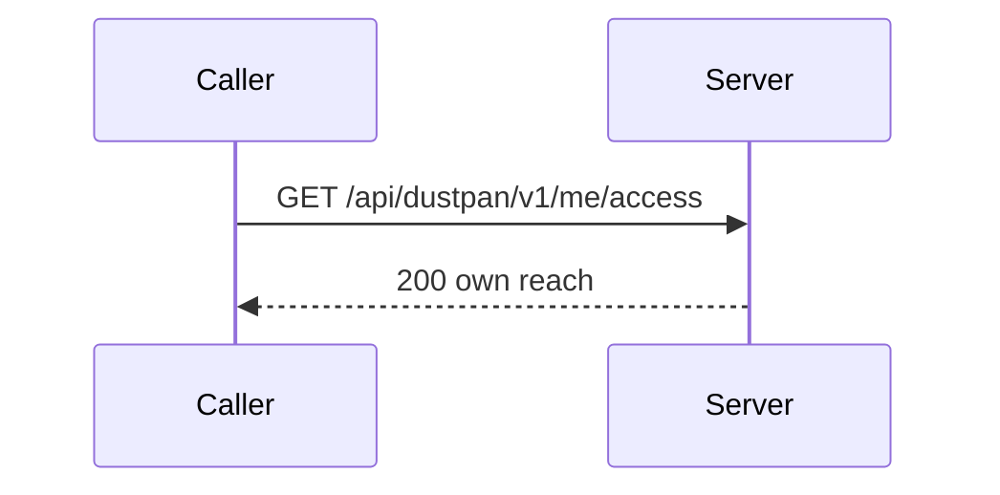
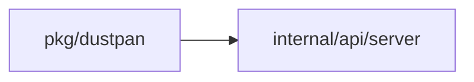
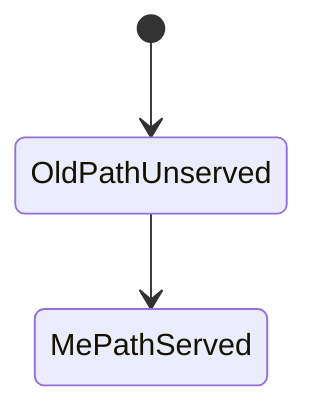
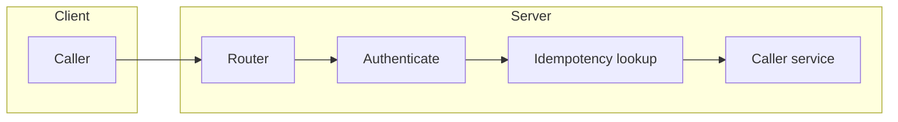

## Context

Caller routes serve only the signed-in principal. The move changes paths, paging names and description labels. Service and authorizer logic stay the same.

## Decisions

1. **Move paths, keep service.** Change the route table and the description labels only. Paging uses the shared page token helper.
2. **Authentication first.** Authenticate before any idempotency lookup. Fail closed with 401. A stored answer holds no token secret.
3. **Caller-scoped authorization.** Each /me route declares its action on the caller principal. The check passes only for the authenticated caller.
4. **Keep metrics label.** The metrics adapter label stays server. It is a label and not a path.

## Structure

No new type. The mountV1 helper registers the paths. The not-moved list and TestClassCheckFailsClosed fail when an old path stays served or an entry has no adapter.

## Risks

- A console or script still calls an old path and gets 404.
- A console list that sends cursor and limit gets 400.
- A caller that loses a rotate answer holds no readable secret; it creates a second token first.

## Diagrams

After this change:

Modules that the change touches, and their imports on main:

States and transitions after this change:

## Quality attributes

| Attribute | Target | Unit | Scope |
| --- | --- | --- | --- |
| compatibility | old caller paths answer 404 | routes | moved /me routes |

## Threat model

Data flow and trust boundaries:

| Boundary | STRIDE | Threat | Layer | Guard | Hostile test |
| --- | --- | --- | --- | --- | --- |
| Client to router | S | A caller replays a token request with an ended token or reads another principal's tokens. | boundary check | The router serves only the /me paths and rejects cursor, limit and a bad key. | Call an old path and a malformed key; require 404 and 400. |
| Client to router | S | A caller replays a token request with an ended token or reads another principal's tokens. | limit | pageSize has a declared maximum. | Send pageSize above the maximum; require 400. |
| Client to router | S | A caller replays a token request with an ended token or reads another principal's tokens. | authorize at point of use | Each route checks the caller principal as the object. | Delete a token of another principal; require 404. |
| Client to router | S | A caller replays a token request with an ended token or reads another principal's tokens. | fail closed | Authentication runs before the idempotency lookup. | Replay with an ended token; require 401 and no stored answer. |

## Contracts

**caller token**

- Invariant: One Idempotency-Key maps to at most one stored answer for each caller, method and path.
- Invariant: Rotate ends the old value once.
- `Token create`: pre: Caller authenticated. Post: At most one token per key.
- `Token rotate`: pre: The token belongs to the caller. Post: The new token is issued and the old token ends in one transaction.

## Failure modes

| Step | Failure | Retry | State after |
| --- | --- | --- | --- |
| POST /api/dustpan/v1/me/tokens/{id}/rotate | The answer is lost after commit. | Create a second token with a new key, confirm it, then delete the old one. | The old token ended and the new token is active. |
| POST /api/dustpan/v1/me/tokens | The replay uses an ended token. | Sign in again and retry with a valid token. | 401 and no stored answer returned. |
