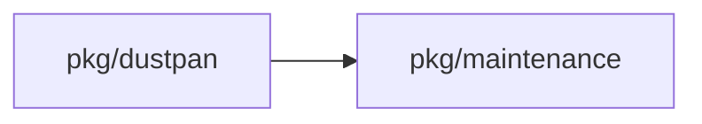

## Context

The reducing-route table is exported from pkg/maintenance. Only the runner entries drive production through pkg/dustpan. The installation-API entries only check the store control path in a test.

## Decisions

1. **Table moves to NEW internal/maintenancegate.** Add the NEW package internal/maintenancegate. It holds an unexported table type built by a constructor. The constructor rejects a method outside GET, POST, PUT, PATCH, DELETE, a path without the /api/ prefix, a path with a query string, an empty table, and a duplicate method and path pair. It exposes IsReducing with method and path strings in and bool out. The Kind constants stay in pkg/maintenance. The doc in pkg/maintenance/reducing.go says production reads only the runner entries, and the installation-API entries only check the store control-path choice in a test. The two-way test keeps an explicit map from each installation-API table entry to its store control-path method name, and checks gate against table and map against table in both directions.

## Structure

An unexported route-table type with a constructor that checks method and path shape. pkg/maintenance keeps only the existing Kind constants.

## Risks

- A caller outside internal still imports the old names. The build fails at that call site.

## Diagrams

Modules that the change touches, and their imports on main:

New imports of this change (each one allowed by the module rules):

- `pkg/dustpan` imports `NEW internal/maintenancegate`

## Quality attributes

| Attribute | Target | Unit | Scope |
| --- | --- | --- | --- |
| none affected | Internal package move with no behavior change |  |  |
