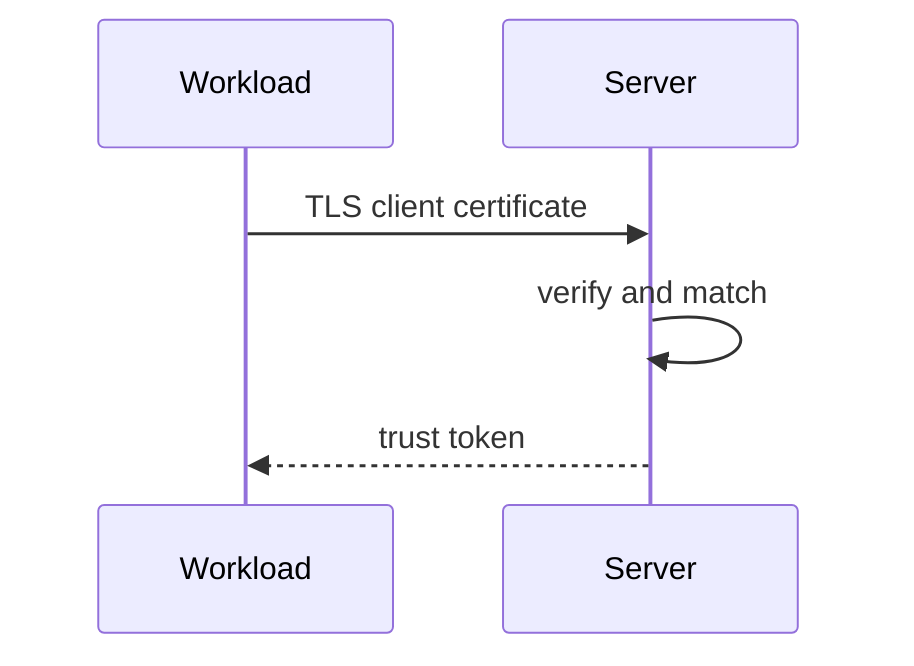
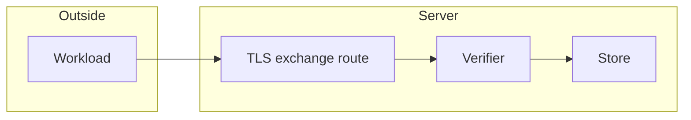

## Context

The exchange is security code on an external TLS endpoint. It fails closed.

## Decisions

1. **Verified chain value only.** The service takes an opaque verified-chain value from the TLS layer and never reads headers for a chain.
2. **Single enabled rule match.** Match picks at most one enabled rule by bundle ID and exact SPIFFE ID; any other result refuses.
3. **Stored issue.** Match check and issue share one transaction. Revoke uses the service-token revoke routes.

## Structure

Unexported mtlsExchange with a constructor that takes the stores, the issuer, the clock and the policy and refuses nil values.

## Risks

- Two rules with the same SPIFFE ID refuse.
- A large chain or high rate loads the verifier.

## Layers (defense in depth)

| Layer | Guard | Hostile test |
| --- | --- | --- |
| boundary check | The TLS adapter checks chain, time, revocation, depth 8 and size 32 KB. | Send another CA, expired, revoked and oversize chains; each refuses. |
| authorize at point of use | The service rechecks rule, bundle, principal and namespace in one transaction. | Send a forged forwarded-chain header, disabled rule and cross-namespace principal; each refuses. |
| limit | The handler caps body size and rate and fails closed. | Flood with no-certificate calls and force a store error; no token. |

## Diagrams

After this change:

## Quality attributes

| Attribute | Target | Unit | Scope |
| --- | --- | --- | --- |
| correctness | 0 tokens issued for refused chains | tokens | mTLS exchange |

## Threat model

Data flow and trust boundaries:

| Boundary | STRIDE | Threat | Layer | Guard | Hostile test |
| --- | --- | --- | --- | --- | --- |
| TLS exchange route | S | A spoofed certificate or forwarded-chain header gains a trust token. | boundary check | Verify chain, time and revocation. | Replay other CA, expired and revoked chains. |
| TLS exchange route | S | A spoofed certificate or forwarded-chain header gains a trust token. | encode or contain | Read the chain only from the TLS session; ignore headers. | Send a forged forwarded-chain header; it refuses. |
| TLS exchange route | S | A spoofed certificate or forwarded-chain header gains a trust token. | limit | Cap chain size, body and rate. | Flood with oversize chains. |
| TLS exchange route | S | A spoofed certificate or forwarded-chain header gains a trust token. | authorize at point of use | Single enabled rule and in-namespace enabled principal. | Replay duplicate rules and cross-namespace principal. |
| TLS exchange route | S | A spoofed certificate or forwarded-chain header gains a trust token. | fail closed | Any error gives no token. | Force a store error; no token. |

## Contracts

**trust-token**

- Invariant: One live token names one namespace, one rule and one non-person principal.
- `exchange`: pre: A verified client chain is present.. Post: A stored token with an audit entry exists, or no token exists..

## Failure modes

| Step | Failure | Retry | State after |
| --- | --- | --- | --- |
| Verify revocation | Responder slow or unreachable | Retry the exchange after the cache TTL. | No token. |
| Issue | Store fails | Retry as a new call. | No token and no audit entry. |
