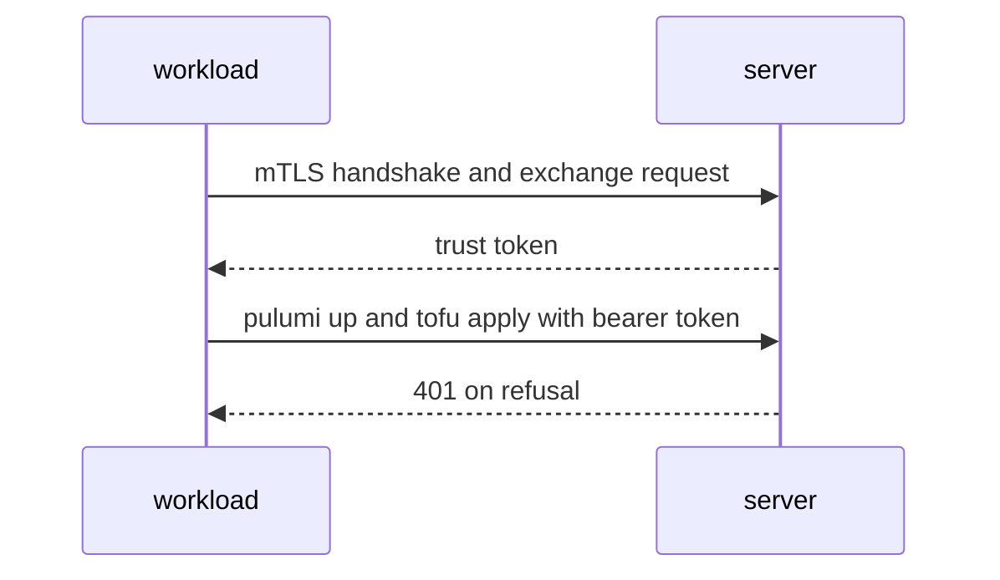
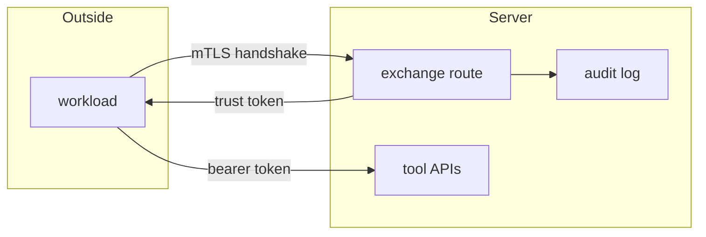

## Context

Bundle, rule, exchange matching, and the stored trust token ship in the first two parts. This part proves that path with the real binary over TLS and the real CLIs, and writes the docs page.

## Decisions

1. **CLIs use the exchanged token.** The workload presents the client certificate only at the exchange call, gets a stored trust token, and runs the Pulumi CLI and OpenTofu with that token as a bearer token.
2. **Proxy and handshake rule for mTLS.** The server requests but does not require a client certificate on the exchange route and reads it only from the TLS handshake. It ignores forwarded certificate headers. Behind a proxy the install must terminate mTLS at the server.
3. **Proof only for refusals.** Refusal logic ships in the first two parts. This part adds no matching code; its scenarios prove those refusals with hostile certificates and headers.

## Structure

No new stored type. The proof uses the trust bundle, the trust rule, and the stored trust token from the first two parts. The e2e helper builds a test CA, a client certificate with a SPIFFE ID in the URI SAN, plus expired, foreign-CA, two-SAN, and wrong-domain certificates.

## Risks

- A docs command that does not run as written hides a setup fault.
- A proxy that strips the client certificate gives a refusal that names the proxy rule.

## Layers (defense in depth)

| Layer | Guard | Hostile test |
| --- | --- | --- |
| boundary check | Check the chain, expiry, and single SPIFFE SAN at the handshake. | Present foreign-CA, expired, two-SAN, and wrong-domain certificates and assert 401. |
| fail closed | Deny on any failure and write a refused audit entry. | Present each hostile certificate and assert a refused entry. |

## Diagrams

After this change:

## Quality attributes

| Attribute | Target | Unit | Scope |
| --- | --- | --- | --- |
| runbook correctness | 100 percent of shell blocks run as written | percent of shell blocks | the mTLS docs page on a new install |

## Threat model

Data flow and trust boundaries:

| Boundary | STRIDE | Threat | Layer | Guard | Hostile test |
| --- | --- | --- | --- | --- | --- |
| TLS handshake at the exchange route | S | A workload spoofs another workload with a forged certificate, header, or cross-namespace token. | boundary check | Check the chain to the bundle, expiry, and single SPIFFE SAN at the boundary. | Present foreign-CA, expired, two-SAN, and wrong-domain certificates and assert 401 with no token. |
| TLS handshake at the exchange route | S | A workload spoofs another workload with a forged certificate, header, or cross-namespace token. | encode or contain | Read the identity only from the handshake; ignore forwarded certificate headers. | Send a forged forwarded header with no handshake certificate and assert 401. |
| TLS handshake at the exchange route | S | A workload spoofs another workload with a forged certificate, header, or cross-namespace token. | limit | Request but never require a client certificate, only on the exchange route. | Call a tool API with a bearer token and no certificate and assert success. |
| TLS handshake at the exchange route | S | A workload spoofs another workload with a forged certificate, header, or cross-namespace token. | authorize at point of use | Enforce the grants of the principal of the rule in each namespace. | Use a grant-less token and a cross-namespace token and assert 403. |
| TLS handshake at the exchange route | S | A workload spoofs another workload with a forged certificate, header, or cross-namespace token. | fail closed | Deny on any check failure and write a refused exchange audit entry. | Present each hostile certificate and assert 401 plus a refused entry. |

## Failure modes

| Step | Failure | Retry | State after |
| --- | --- | --- | --- |
| Wire the e2e step | e2e uses a stale bundle fixture | Rebuild the test CA and bundle fixture and rerun the e2e step. | No token issued; e2e fails before CLI runs. |
| Exchange behind a proxy | Proxy strips the client certificate | Terminate mTLS at the server and repeat the exchange. | Exchange answers 401 with no certificate seen and writes a refused entry. |
| CLI run with trust token | Trust token expires during a long CLI run | Repeat the exchange for a new 1-hour token and rerun the CLI. | CLI call fails 401; no state change from the refused call. |
