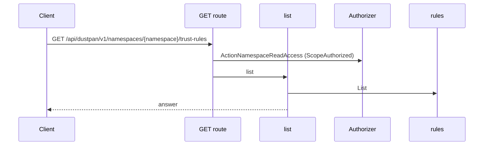
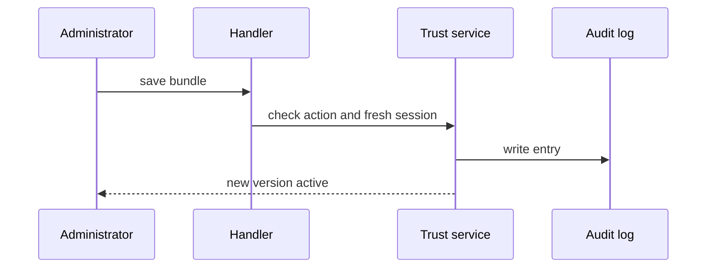
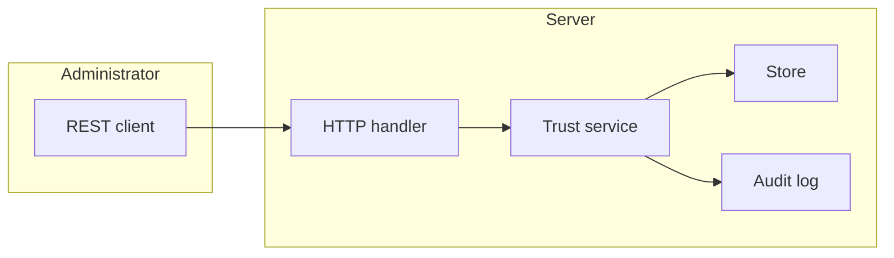

## Context

Namespace trust bundle store plus trust rule CRUD under the namespace path, before any mTLS exchange.

## Decisions

1. **Versioned bundle.** One versioned bundle per namespace, append-only versions, active pointer, no delete of the active version.
2. **Rule references stable IDs.** A rule stores namespace ID, stable rule ID, stable principal subject and the bundle reference; evaluation uses the active version.

## Structure

Add new package pkg/trust with unexported bundleStore and ruleStore types; only constructors make values and check PEM, expiry, bounds, fence and stable IDs.

## Risks

- Rotation overlap permits two CAs at once by design; the read states the overlap end.
- Proxy TLS termination and CLI client certificate transport stay with the exchange part.

## Layers (defense in depth)

| Layer | Guard | Hostile test |
| --- | --- | --- |
| port adapter | Checks fence, PEM, expiry, bounds, SPIFFE shape, issuer refusal and same-namespace version before write. | Save expired CA, malformed PEM, oversize PEM, 11th CA, cross-namespace version; each is refused. |
| service | Checks the namespace action and a fresh session before write. | Write without grant, stale session, token only; each gives 403. |
| HTTP handler | Declares action and object, checks If-Match, audits. | Cross-namespace create, stale If-Match, repeated delete give 403, 412, 404. |

## Diagrams

Today: `GET /api/dustpan/v1/namespaces/{namespace}/trust-rules` on main (from the route table and the handler body, route row internal/api/trustrules/trustrules.go:185, handler internal/api/trustrules/handlers.go:86).

After this change:

## Quality attributes

| Attribute | Target | Unit | Scope |
| --- | --- | --- | --- |
| correctness | 100% of malformed, expired, oversize saves refused with CA index | percent | bundle save refusal |

## Threat model

Data flow and trust boundaries:

| Boundary | STRIDE | Threat | Layer | Guard | Hostile test |
| --- | --- | --- | --- | --- | --- |
| REST API boundary | T | Attacker plants a rogue CA or cross-namespace rule to mint workload tokens | boundary check | Allowlist PEM, SPIFFE shape, bounds, same-namespace version | POST oversize PEM with 11 CAs; server refuses 400 |
| REST API boundary | T | Attacker plants a rogue CA or cross-namespace rule to mint workload tokens | encode or contain | Store parsed keys only; errors show index only | Save PEM with CRLF; error shows index only |
| REST API boundary | T | Attacker plants a rogue CA or cross-namespace rule to mint workload tokens | limit | Cap 64 KB, 10 CAs, 5 kept versions, 24 hour overlap | Flood saves; over-cap input refused |
| REST API boundary | T | Attacker plants a rogue CA or cross-namespace rule to mint workload tokens | authorize at point of use | Namespace action plus fresh session | Replay write with token only; 403 |
| REST API boundary | T | Attacker plants a rogue CA or cross-namespace rule to mint workload tokens | fail closed | Deny and audit on any error | Force store error; nothing stored, refusal audited |

## Contracts

**trust bundle**

- Invariant: One bundle per namespace with append-only versions and one active pointer
- Invariant: Active version holds unexpired CAs only
- `save-bundle`: pre: namespace action held; fresh authentication; PEM valid. Post: new version stored; audit entry written.
- `rotate-bundle`: pre: namespace action held; fresh authentication. Post: new version active; overlap end stated.

**trust rule**

- Invariant: Rule belongs to one namespace
- Invariant: Rule names stable principal subject
- `create-rule`: pre: namespace action held; fresh authentication. Post: rule stored; audit entry written.
- `update-rule`: pre: If-Match matches. Post: rule stored with new ETag.
- `delete-rule`: pre: namespace action held. Post: rule removed; audit entry written.

## Failure modes

| Step | Failure | Retry | State after |
| --- | --- | --- | --- |
| Save bundle | Expired CA in saved bundle | Remove the expired CA and save again | No new version stored |
| Update rule | Stale ETag | Read the ETag and send again | Stored object unchanged, 412 returned |
