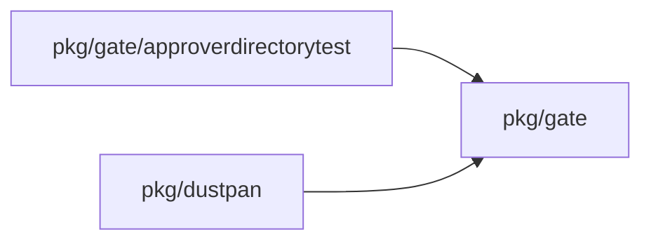

## Context

ConfigService in pkg/gate is a service in the SDK. ADR 272 puts services in internal.

## Decisions

1. **Move the service to the NEW package internal/gatesvc.** The NEW package imports pkg/gate for ports and types. pkg/gate does not import it. pkg/dustpan builds the service and gives it to the installation API as the port serverapi.GateConfig.

## Structure

The NEW type gatesvc.Service has unexported fields and the one constructor NewService, which checks its ports. pkg/gate exports no constructor of the service.

## Risks

- An import cycle if a port type names a service detail.
- A missed caller still imports a moved name from pkg/gate.

## Diagrams

Modules that the change touches, and their imports on main:

New imports of this change (each one allowed by the module rules):

- `internal/gatesvc (NEW)` imports `pkg/gate`
- `pkg/dustpan` imports `internal/gatesvc (NEW)`

## Quality attributes

| Attribute | Target | Unit | Scope |
| --- | --- | --- | --- |
| none affected | Internal move only; no user-visible behavior or limit changes. |  |  |
