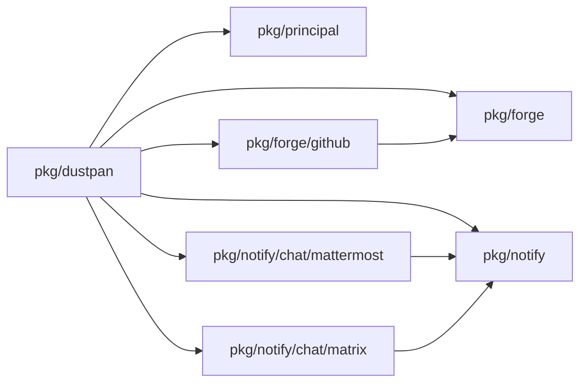

## Context

The principal guard and the built-in forge and notify adapters live in exported pkg packages. The SDK port closure should hold only ports and constructors.

## Decisions

1. **Move scope.** Move only NamespaceServiceGuard, pkg/forge/github and the teams, mattermost and matrix renderers. Keep the ports of pkg/principal, pkg/forge and pkg/notify in place. Each moved adapter keeps its behavior and its constructor arguments. A NEW pkg/dustpan constructor builds it.
2. **Guard rule.** Add each NEW internal package of this change to the depguard domain rule in .golangci.yml. pkg/dustpan is not a domain package, so it may import them. A domain package that imports an adapter fails the lint.
3. **Old paths.** Delete the old paths. Leave no alias package. Docs and tests that name an old path change in the same pull request.

## Structure

Unexported adapter structs in the NEW internal packages. Only the exported constructor of the package, called from the pkg/dustpan constructor, makes a wired value.

## Risks

- An import cycle between pkg/dustpan and a NEW internal package: the internal packages never import pkg/dustpan, and `go build ./...` shows a cycle
- A missed wiring leaves a moved adapter unreachable: the e2e step covers it

## Diagrams

Modules that the change touches, and their imports on main:

New imports of this change (each one allowed by the module rules):

- `pkg/dustpan` imports `internal/principalsvc`
- `pkg/dustpan` imports `internal/forgegithub`
- `pkg/dustpan` imports `internal/notify`

## Quality attributes

| Attribute | Target | Unit | Scope |
| --- | --- | --- | --- |
| none affected | Code move only, with no change of behavior or speed |  |  |
