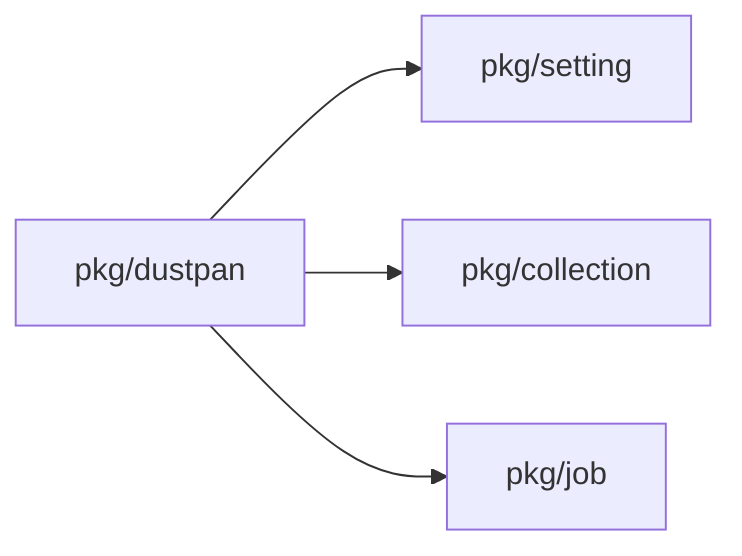

## Context

The services of setting, collection placement and job reconcile live in pkg/. Their ports stay in pkg/. The NEW internal packages import pkg/ ports. pkg/ never imports internal/ for these services, so the direction has no cycle.

## Decisions

1. **Move services to internal.** Add internal/settingsvc, internal/collectionsvc and internal/jobsvc. Move the service code and its tests into them. Port interfaces, types and sentinels stay in pkg/.
2. **Wiring.** pkg/dustpan builds each service through the constructor of its internal package. The server wiring is the only caller.
3. **Default collection.** Owner decision, 13 Nov 2026 (queue P5): the create transaction keeps its default collection and catch-all placement rule. The move edits no code path of it.

## Structure

Each internal package has an unexported service struct and an exported constructor that checks its config. Only the constructor makes a value. The existing depguard rule keeps domain packages from importing internal/.

## Risks

- An import cycle if a port type still sits in a service file. Mitigation: move only the service structs and keep each port interface in pkg/.

## Diagrams

Modules that the change touches, and their imports on main:

New imports of this change (each one allowed by the module rules):

- `internal/settingsvc (NEW)` imports `pkg/setting`
- `internal/collectionsvc (NEW)` imports `pkg/collection`
- `internal/jobsvc (NEW)` imports `pkg/job`
- `pkg/dustpan` imports `internal/settingsvc (NEW)`
- `pkg/dustpan` imports `internal/collectionsvc (NEW)`
- `pkg/dustpan` imports `internal/jobsvc (NEW)`

## Quality attributes

| Attribute | Target | Unit | Scope |
| --- | --- | --- | --- |
| none affected | No behavior change. The move is a package move only. |  |  |

## Change impact (computed from main)

Tests:

- `internal/egress/egresshttp/egresshttp_test.go` names `dustpan.NewServer`
- `internal/cli/client/restore_corrupt_help_test.go` names `dustpan.NewServer`
- `e2e/fetch_test.go` names `dustpan.NewServer`

ADRs:

- `docs/adr/0243-the-source-port-its-adapters-and-conformance.md` names `dustpan.NewServer`
- `docs/adr/0154-history-gaps-found-before-the-implementation.md` names `dustpan.NewServer`
- `docs/adr/0272-the-public-sdk-surface.md` names `dustpan.NewServer`
