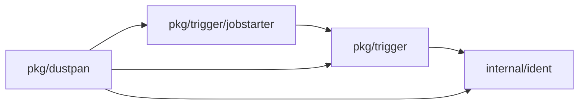

## Context

The trigger service code lives in pkg/trigger, against the SDK rule of the public surface.

## Decisions

1. **One internal service package.** The NEW package internal/triggersvc holds the Manager, the dispatcher, the saver check, OutputReadCheck and the job starter adapter. pkg/trigger keeps the types, the ports, the sentinels, CheckCycle and triggertest. The depguard domain rule lists internal/triggersvc.

## Structure

Each service type has unexported fields and one constructor that checks its port arguments. pkg/dustpan keeps the service in an unexported field, so no exported signature names an internal type.

## Risks

- A missed file keeps a service name in pkg/trigger. The rg task finds it.
- A wiring test in pkg/dustpan fails if the service is not connected.

## Diagrams

Modules that the change touches, and their imports on main:

New imports of this change (each one allowed by the module rules):

- `pkg/dustpan` imports `internal/triggersvc`
- `internal/triggersvc` imports `pkg/trigger`

## Quality attributes

| Attribute | Target | Unit | Scope |
| --- | --- | --- | --- |
| none affected | Package move only. No behavior, route or limit changes. |  |  |
