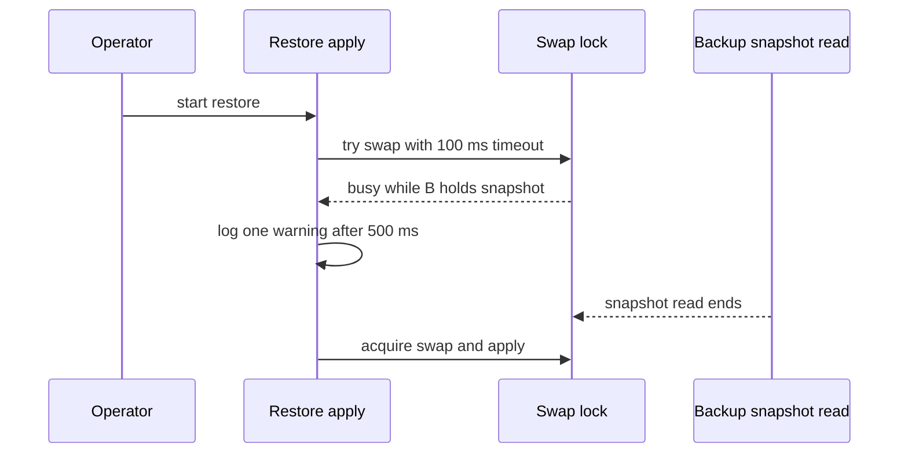
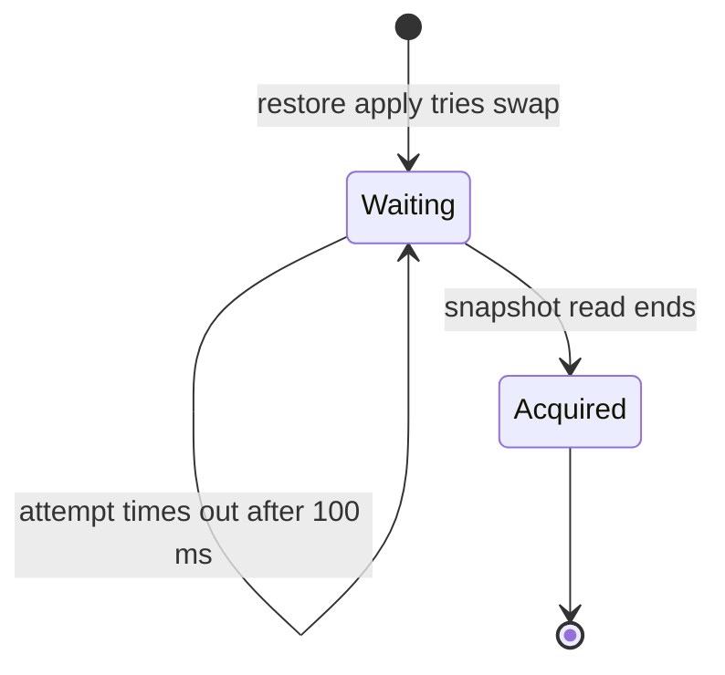
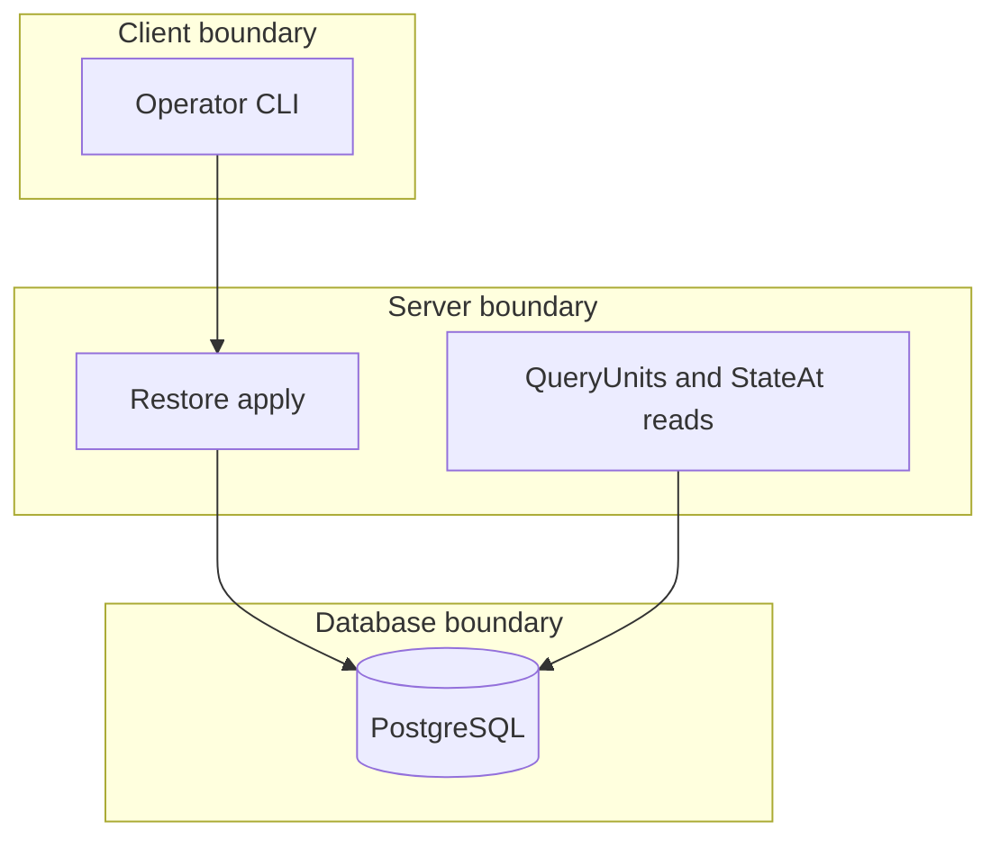

## Context

PostgreSQL snapshot reads and the swap lock from #1499: the swap wait is silent, one page query uses two reads, and two reads skip conflict mapping.

## Decisions

1. **Visible swap wait.** Each swap attempt waits at most 100 ms in the scope of one swap attempt. The holder logs one warning after 500 ms of total wait in the scope of one restore apply holder, once per holder. Apply keeps waiting until the snapshot read ends or the operator cancels the restore.
2. **One-statement page and mapped conflicts.** QueryUnits reads labels with array_agg in the page query, ordered by label key, with NULL as empty, in one statement with no extra transaction, 1 statement per page in the scope of one page read. The swap non-queue test bound is 500 ms per swap attempt sequence in the scope of one test run, which is 5 times swapLockTimeout. StateAt and WorkspaceStateAt pass begin and read errors through readConflict to ErrUnavailable.

## Structure

The warning state is the unexported field warned of the unexported type holderWait, made only by newHolderWait with a start time. No other code can make or reset it, so one holder logs once.

## Risks

- A 500 ms test bound can flake on a slow CI runner.

## Layers (defense in depth)

| Layer | Guard | Hostile test |
| --- | --- | --- |
| fail closed | Snapshot reads start with a read-only snapshot transaction and map 40P01 and 40001 through readConflict. | Inject 40P01 on BeginTx and on select and check ErrUnavailable. |
| encode or contain | The page query reads labels with array_agg in one statement, so no second read can see a newer snapshot. | Add a label between page and label reads and check the single statement still returns one snapshot. |

## Diagrams

After this change:

States and transitions after this change:

## Quality attributes

| Attribute | Target | Unit | Scope |
| --- | --- | --- | --- |
| latency | 500 | ms to first warning | restore apply swap wait |
| latency | 1 | statements per page | QueryUnits page read |

## Threat model

Data flow and trust boundaries:

| Boundary | STRIDE | Threat | Layer | Guard | Hostile test |
| --- | --- | --- | --- | --- | --- |
| Client boundary | D | A backup snapshot read holds the swap and a restore stays in applying with no visible reason. | boundary check | Restore status requires an access token with restore read rights. | Call restore status with no token and check refusal. |
| Client boundary | D | A backup snapshot read holds the swap and a restore stays in applying with no visible reason. | encode or contain | Log text encodes the restore ID and holder ID with no input bytes. | Start a restore with hostile ID text and check the log holds no raw bytes. |
| Client boundary | D | A backup snapshot read holds the swap and a restore stays in applying with no visible reason. | limit | One warning per holder after 500 ms bounds log growth. | Hold the swap for 10 s and count one warning. |
| Client boundary | D | A backup snapshot read holds the swap and a restore stays in applying with no visible reason. | authorize at point of use | Restore cancel checks authorization on the restore object at the point of use. | Cancel another installation restore and check refusal. |
| Client boundary | D | A backup snapshot read holds the swap and a restore stays in applying with no visible reason. | fail closed | A failed swap attempt denies and retries with the 100 ms timeout. | Force swap busy and check the holder waits with no apply. |
| Database boundary | T | A concurrent write corrupts a snapshot read of QueryUnits or StateAt. | boundary check | Snapshot reads use read-only snapshot transactions with allowlisted statements. | Send a hostile at timestamp and check rejection. |
| Database boundary | T | A concurrent write corrupts a snapshot read of QueryUnits or StateAt. | encode or contain | Queries use placeholders only for IDs and timestamps. | Send hostile unit filter text and check it stays a value. |
| Database boundary | T | A concurrent write corrupts a snapshot read of QueryUnits or StateAt. | limit | Reads use the 100 ms swap timeout and 500 ms warning bound per holder. | Hold a snapshot read and check one warning and no unbounded log. |
| Database boundary | T | A concurrent write corrupts a snapshot read of QueryUnits or StateAt. | authorize at point of use | StateAt checks read rights on the unit at the point of use. | Read another namespace unit and check refusal. |
| Database boundary | T | A concurrent write corrupts a snapshot read of QueryUnits or StateAt. | fail closed | 40P01 and 40001 map to ErrUnavailable with 503 and Retry-After. | Inject 40P01 on begin and on select and check 503. |
| Server boundary | I | A stale restore holder swaps after losing its claim. | boundary check | Restore apply checks the fence token in the same transaction as the swap. | Replay a stale holder swap and check refusal. |
| Server boundary | I | A stale restore holder swaps after losing its claim. | encode or contain | Array_agg output encodes labels with ordered keys and empty for NULL. | Insert hostile label bytes and check the page returns them as values. |
| Server boundary | I | A stale restore holder swaps after losing its claim. | limit | One statement per QueryUnits page bounds read time to one snapshot. | Count statements for one page and check one. |
| Server boundary | I | A stale restore holder swaps after losing its claim. | authorize at point of use | QueryUnits checks unit read rights at the point of use. | Query units of another namespace and check refusal. |
| Server boundary | I | A stale restore holder swaps after losing its claim. | fail closed | A conflict denies with ErrUnavailable and no half write. | Inject 40001 mid-page and check ErrUnavailable. |

## Contracts

**Store.QueryUnits**

- Invariant: One QueryUnits page returns units with labels from one snapshot statement.
- Invariant: Labels are ordered by label key and NULL reads as empty.
- `QueryUnits`: pre: The read uses a snapshot read.. Post: Labels are ordered by label key and NULL reads as empty.; One statement returns the page..

**Store.StateAt**

- Invariant: A 40P01 or 40001 on begin or read maps to ErrUnavailable.
- `StateAt`: pre: The read uses a snapshot read.. Post: A conflict answers ErrUnavailable..
- `WorkspaceStateAt`: pre: The read uses a snapshot read.. Post: A conflict answers ErrUnavailable..

## Failure modes

| Step | Failure | Retry | State after |
| --- | --- | --- | --- |
| Restore apply waits for the swap lock. | Holder is killed while waiting for the swap. | Another worker claims the restore and its own holderWait logs its own one warning after 500 ms. | Restore stays in applying until the swap succeeds or the operator cancels. |
| StateAt and WorkspaceStateAt snapshot read. | Snapshot read hits 40P01 or 40001 on begin or select. | Caller retries after Retry-After. The server sends no transaction again. | Read answers ErrUnavailable with 503 and Retry-After. No half write commits. |
| QueryUnits page read with array_agg. | Label row changes between page rows and label read. | No retry. One statement reads one snapshot. | QueryUnits page returns labels ordered by key, NULL as empty. |
