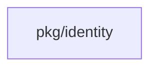
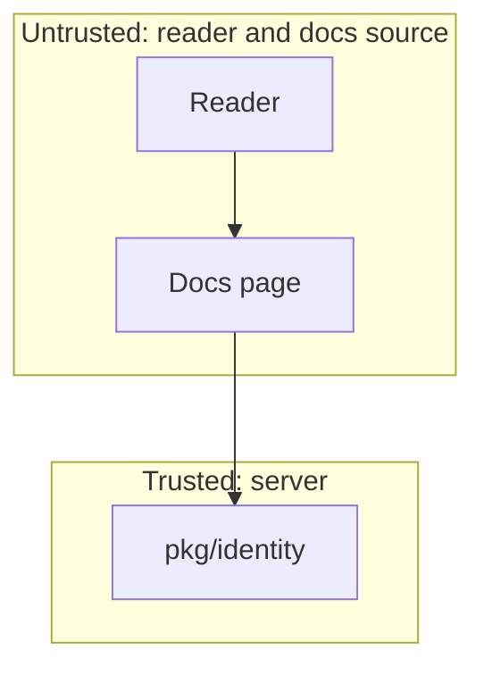

## Context

Identity checks fail closed, but no single user docs page states the defaults in plain words. This part adds that page with no behavior change.

## Decisions

1. **Docs page lists defaults.** Add one user docs page that lists each fail-closed identity default, its effective value, and the denial a caller sees. Content is the defaults as enforced on main: unknown identity denied, missing grant denied, unknown value denied. No code change.

## Structure

Docs-only change: no new type and no constructor change; existing constructors keep enforcing fail-closed defaults.

## Risks

- Docs drift from code if a default later changes without a docs update.

## Diagrams

Modules that the change touches, and their imports on main:

## Quality attributes

| Attribute | Target | Unit | Scope |
| --- | --- | --- | --- |
| none affected | Docs-only change with no runtime behavior change |  |  |

## Threat model

Data flow and trust boundaries:

| Boundary | STRIDE | Threat | Layer | Guard | Hostile test |
| --- | --- | --- | --- | --- | --- |
| Untrusted: reader and docs source | I | Reader trusts a permissive default that the server does not enforce. | boundary check | Docs page states only fail-closed defaults already enforced on main, no new rule. | Insert a permissive default in draft page and refuse it in review against main behavior. |
| Untrusted: reader and docs source | I | Reader trusts a permissive default that the server does not enforce. | encode or contain | Plain words with exact denial text, no credential or secret in page. | Search draft page for secret patterns and fail on any match. |
| Untrusted: reader and docs source | I | Reader trusts a permissive default that the server does not enforce. | limit | Docs-only change, no runtime effect and no privilege change. | Confirm no code diff outside the NEW docs page. |
| Untrusted: reader and docs source | I | Reader trusts a permissive default that the server does not enforce. | authorize at point of use | Page states denials require sign-in and grant at point of use. | Walk each denial to its authorization action and fail when one names no action. |
| Untrusted: reader and docs source | I | Reader trusts a permissive default that the server does not enforce. | fail closed | Unknown or unclear default is denied and omitted from page until proven on main. | Add an unproven default to draft and refuse it for lack of main proof. |
| Trusted: server | T | Docs text tampers with the trusted description of server identity checks. | boundary check | Server keeps enforcing fail-closed identity checks on main independent of docs text. | Remove docs page and confirm denials still occur in server tests. |
| Trusted: server | T | Docs text tampers with the trusted description of server identity checks. | encode or contain | Docs page copies no secret, token, or credential value. | Scan draft page for secret patterns and fail on any match. |
| Trusted: server | T | Docs text tampers with the trusted description of server identity checks. | limit | Docs-only change with no new route, grant, or privilege. | Confirm no route or grant change in the diff. |
| Trusted: server | T | Docs text tampers with the trusted description of server identity checks. | authorize at point of use | Denials stay enforced at point of use in pkg/identity. | Send unauthenticated request at the service and confirm denial. |
| Trusted: server | T | Docs text tampers with the trusted description of server identity checks. | fail closed | Any docs error fails closed toward denial and is fixed by page update, not by relaxing checks. | Insert wrong default in draft and confirm server behavior stays denied. |
