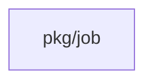

## Context

A job request with no pool or code location takes the unit defaults. The job record today does not name the values it took, so a user cannot see or explain what ran.

## Decisions

1. **Effective values are a stored snapshot of IDs.** Store effective pool as stable pool ID plus display name snapshot and effective code location snapshot on the job at StartJob, and return the stored snapshot on each read of that job. Reads never recompute from current unit settings. Jobs stored before this change return empty effective values with a present flag set to false.
2. **One transaction for job start and its audit entry.** Write the job row and the RecordAutomaticAction audit entry for applied defaults in one transaction. If the audit write fails then StartJob fails and no job starts, so a default is never applied without a record. The server actor value is `server` and the reason shape is {rule, detail} where rule names the default rule and detail names the source unit setting.

## Structure

Unexported struct effectiveValues with a constructor resolveEffectiveValues that fills a missing pool and code location from unit settings, so a job cannot exist without resolved or explicitly refused values.

## Risks

- Stored snapshots look stale next to later unit defaults; the read labels them as the values at start to stop confusion.

## Diagrams

Modules that the change touches, and their imports on main:

## Quality attributes

| Attribute | Target | Unit | Scope |
| --- | --- | --- | --- |
| none affected | No latency, storage, or rate target changes; read adds two stored fields to an existing record. |  |  |

## Contracts

**Job**

- Invariant: Effective pool ID and effective code location are set once by StartJob and never change after start.
- Invariant: Effective values are a snapshot at start; later unit-setting edits never change them.
- `StartJob`: pre: Unit settings supply defaults when the start request omits pool or code location.. Post: Job record carries effective pool ID and effective code location resolved by StartJob..
- `ShowEffectiveJobValues`: pre: Job record was stored by StartJob or stored before this change.. Post: Read of one job returns the stored effective pool ID and effective code location..

**Audit entry**

- Invariant: Each automatic entry names the server actor and a reason with rule and detail.
- `RecordAutomaticAction`: pre: Action was started by the server through RecordAutomaticAction rather than by a named principal.. Post: Entry carries server actor value and reason shape read by the audit entries API..
