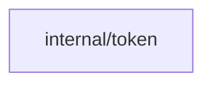
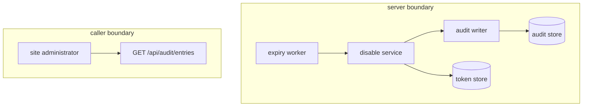

## Context

Automatic token disables change what a principal can do without a person acting. The server must show who did it and why in the audit log.

## Decisions

1. **One audit entry per automatic disable.** Write one audit entry for each automatic token disable in the same transaction as the disable. Actor is the server. Reason is a fixed code plus the rule that fired. Token identifiers use the stable token ID, never the secret value. A repeated disable of an already-disabled token writes no second entry.

## Structure

No new unexported type. The existing automatic-disable path calls the existing audit writer with a NEW audit kind for automatic disables.

## Risks

- Automatic disables without a record keep an implicit behavior with no record.
- A record that carries the secret value leaks the credential.

## Diagrams

Modules that the change touches, and their imports on main:

## Quality attributes

| Attribute | Target | Unit | Scope |
| --- | --- | --- | --- |
| storage growth | 1 audit entry | entries | per automatic token disable |

## Threat model

Data flow and trust boundaries:

| Boundary | STRIDE | Threat | Layer | Guard | Hostile test |
| --- | --- | --- | --- | --- | --- |
| server boundary | T | Tampered expiry event forges a disable or suppresses the audit entry. | boundary check | Allowlist the disable rule to token expiry with a fixed reason code; reject unknown rules. | Send a forged rule name to the disable service and check it is rejected. |
| server boundary | T | Tampered expiry event forges a disable or suppresses the audit entry. | encode or contain | Bind the token by stable token ID with SQL placeholders; never interpolate the token ID or secret. | Send a token ID with SQL metacharacters and check the store treats it as one ID. |
| server boundary | T | Tampered expiry event forges a disable or suppresses the audit entry. | limit | Run the disable with the smallest grant and a bounded transaction of 1 entry per disable. | Force a bulk expiry run and check each disable writes at most 1 entry. |
| server boundary | T | Tampered expiry event forges a disable or suppresses the audit entry. | authorize at point of use | Check the audit read grant at ANY /api/audit/entries for the requested token scope at the point of use. | Request entries for a token ID without the audit read grant and check denial. |
| server boundary | T | Tampered expiry event forges a disable or suppresses the audit entry. | fail closed | Refuse the disable when the audit write fails and omit the secret value on any error. | Fail the audit write and check the token stays enabled with no secret in the error. |
| caller boundary | I | Disclosure of the token secret through the disable audit entry or its read path. | boundary check | Validate the token ID filter at the boundary against the stable ID allowlist; reject malformed IDs. | Request entries with a malformed token ID and check rejection. |
| caller boundary | I | Disclosure of the token secret through the disable audit entry or its read path. | encode or contain | Encode the entry as JSON with the token ID field; never return the secret value. | Read the disable entry and check the body holds no secret value. |
| caller boundary | I | Disclosure of the token secret through the disable audit entry or its read path. | limit | Page the entries list with a bounded page size. | Request an unbounded page and check the server bounds it. |
| caller boundary | I | Disclosure of the token secret through the disable audit entry or its read path. | authorize at point of use | Check the audit read grant for the token scope at the point of use. | Request entries for a token outside the caller reach and check denial. |
| caller boundary | I | Disclosure of the token secret through the disable audit entry or its read path. | fail closed | Deny and audit-log the read on authorization failure with audit.entry-not-found where the entry is not visible. | Request entries without the grant and check fail-closed denial. |
