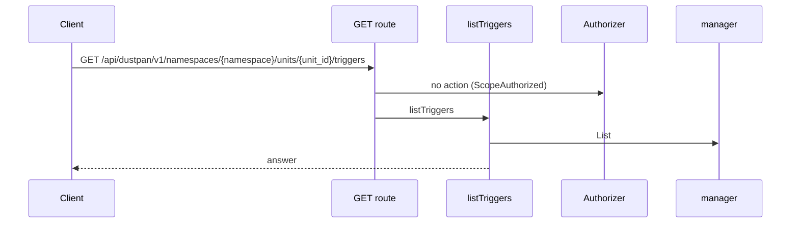
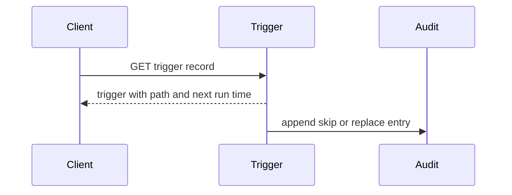
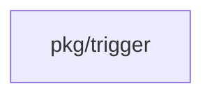

## Context

Trigger scheduler skips slots and replaces stored plans without a visible record, so a person cannot explain why a plan did not run.

## Decisions

1. **Record gaps where they are read.** Compute the evaluated trigger path at read time from the stored trigger record with no schema change, return null next run time when the trigger cannot fire, and write one audit entry with server actor and one allowlisted reason for each skipped slot and each replaced plan.

## Structure

Unexported trigger gap record built only by a constructor that requires trigger ID, slot time, one allowlisted reason, and server actor.

## Risks

- Frequent schedules write one audit entry per skipped slot.

## Diagrams

Today: `GET /api/dustpan/v1/namespaces/{namespace}/units/{unit_id}/triggers` on main (from the route table and the handler body, route row internal/api/triggers/routes.go:93, handler internal/api/triggers/serve.go:123).

After this change:

Modules that the change touches, and their imports on main:

## Quality attributes

| Attribute | Target | Unit | Scope |
| --- | --- | --- | --- |
| storage growth | 1 | entries per slot per trigger | per schedule slot that does not start a plan |

## Contracts

**Trigger**

- Invariant: Each gap record references the stable trigger ID, which stays valid after the trigger is removed and made again.
- `RecordSkip`: pre: A schedule slot reached its time and did not start a plan.. Post: A skipped slot audit entry exists with server actor, slot time, and one allowlisted reason..
- `RecordReplace`: pre: A stored plan was replaced before it ran.. Post: A replaced plan audit entry exists with server actor, replaced plan ID, and one allowlisted reason..
