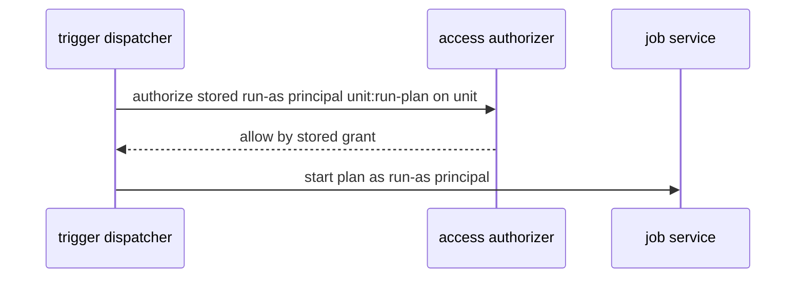
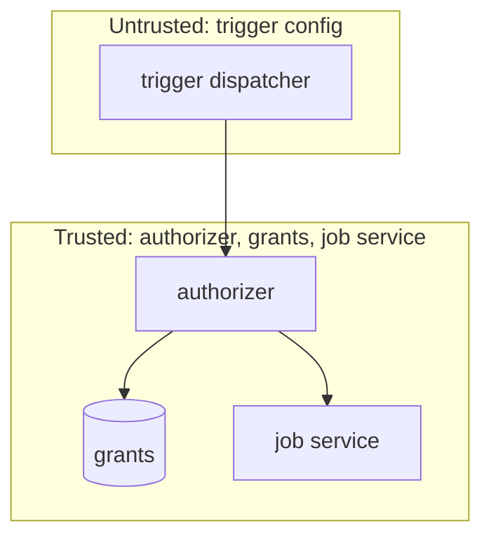

## Context

Trigger starts run as an in-memory namespace service principal allowed by a code rule that no administrator can list, audit, or revoke.

## Decisions

1. **Remove the code rule, authorize stored grants only.** Delete NamespaceServiceRule in pkg/identity/namespace_service.go and the authorizeNamespaceService branch in pkg/access/authorizer.go. Every trigger, schedule catch-up, manual fire, and follows start authorizes the stored run-as service principal of that trigger through stored grants only, and records it as actor. A trigger with no run-as principal, a person named as run-as, or a missing grant is refused with an audit entry and no job.

## Structure

Delete the unexported code-rule path and keep stored grants as the only path: remove NamespaceServiceRule and authorizeNamespaceService so no constructor for the in-memory principal remains.

## Risks

- A leftover caller that builds the old principal fails closed with an audited refusal.
- Existing triggers with no run-as principal stop starting until the actor item gives them a run-as principal.

## Diagrams

After this change:

## Quality attributes

| Attribute | Target | Unit | Scope |
| --- | --- | --- | --- |
| none affected | Authorization uses the existing stored-grant check path. |  |  |

## Threat model

Data flow and trust boundaries:

| Boundary | STRIDE | Threat | Layer | Guard | Hostile test |
| --- | --- | --- | --- | --- | --- |
| Trigger start into the authorizer | E | A trigger starts a plan with authority its administrator cannot see or revoke. | boundary check | Only unit:run-plan starts a plan through the trigger path. | Send unit:run-apply through the trigger path and show refusal. |
| Trigger start into the authorizer | E | A trigger starts a plan with authority its administrator cannot see or revoke. | encode or contain | Run-as reference resolves by stable principal ID. | Rename the principal and show the start still resolves by ID. |
| Trigger start into the authorizer | E | A trigger starts a plan with authority its administrator cannot see or revoke. | limit | Run-as principal holds only its stored grants. | Start a plan on a unit with no grant and show refusal. |
| Trigger start into the authorizer | E | A trigger starts a plan with authority its administrator cannot see or revoke. | authorize at point of use | Stored-grant check at each job start. | Revoke the grant and show the next start is refused and audited. |
| Trigger start into the authorizer | E | A trigger starts a plan with authority its administrator cannot see or revoke. | fail closed | Unknown, suspended, or missing run-as denies and writes an audit entry. | Delete the grant and show no plan is created. |
