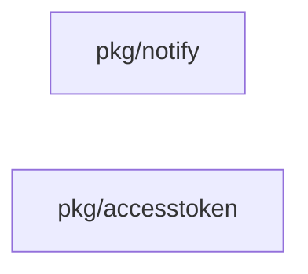
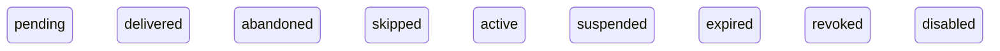
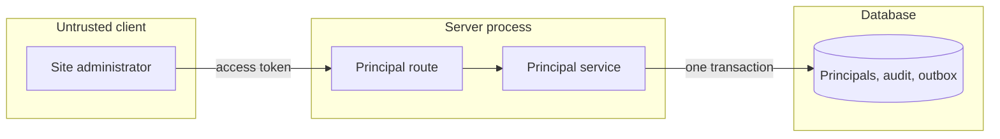

## Context

The audit entry is the only record of a break-glass change today. No production code writes to the notification outbox.

## Decisions

1. **Same-transaction notice.** A disable or delete writes the notice in the transaction of the change. An outbox error rolls back the change and answers 500.
2. **Refusal notice.** A refusal writes audit and notice in its own transaction and then answers 409. If that transaction fails, the answer is 500. One refusal notice for each actor and target in 10 minutes.
3. **Recipients.** The recipients are the enabled site administrators except the actor, read in the same transaction.
4. **Serialized floor check.** The floor check and the change run in one transaction that locks the break-glass rows of the installation.

## Structure

One unexported function builds the notice from the stable principal IDs, so a caller cannot write a notice that names a renamed account or holds a reason.

## Risks

- The notice holds no reason text, so it cannot leak a reason.
- An empty recipient list writes no row and the audit entry stays.

## Layers (defense in depth)

| Layer | Guard | Hostile test |
| --- | --- | --- |
| fail closed | An outbox error on a change rolls back the change and answers 500. | Force an outbox error and check that the account stays enabled. |
| limit | One refusal notice for each actor and target in 10 minutes. | Refuse the same delete 50 times and count one notice. |

## Diagrams

Modules that the change touches, and their imports on main:

States on main in the touched packages:

## Quality attributes

| Attribute | Target | Unit | Scope |
| --- | --- | --- | --- |
| storage growth | At most 1 outbox row for each other site administrator for each break-glass change, and 1 refusal row for each actor and target in 10 minutes | rows | one installation |

## Threat model

Data flow and trust boundaries:

| Boundary | STRIDE | Threat | Layer | Guard | Hostile test |
| --- | --- | --- | --- | --- | --- |
| Client to server | R | An administrator changes a break-glass account and nobody learns of it. | boundary check | The route accepts only a principal ID from the allowlist form and repeats nothing of the input. | Send a malformed ID and check the 400 text holds no input. |
| Client to server | R | An administrator changes a break-glass account and nobody learns of it. | encode or contain | The notice is built from stable IDs and fixed text with no reason. | Disable with a reason of control characters and check the notice holds none. |
| Client to server | R | An administrator changes a break-glass account and nobody learns of it. | limit | One refusal notice for each actor and target in 10 minutes. | Repeat 50 refusals and count one notice. |
| Client to server | R | An administrator changes a break-glass account and nobody learns of it. | authorize at point of use | The service checks the principal action on the target object before the change. | Call with a developer token and check 403 and no notice. |
| Client to server | R | An administrator changes a break-glass account and nobody learns of it. | fail closed | An outbox error rolls back the change and answers 500. | Force an outbox error and check the account stays enabled. |
| Server to database | D | Parallel disables remove the last two break-glass accounts. | boundary check | The service reads the enabled count inside the transaction. | Run two parallel disables and check one is refused. |
| Server to database | D | Parallel disables remove the last two break-glass accounts. | encode or contain | SQL placeholders only. | Use a principal ID with SQL text and check no effect. |
| Server to database | D | Parallel disables remove the last two break-glass accounts. | limit | The transaction locks only the break-glass rows. | Check other principal changes do not wait on it. |
| Server to database | D | Parallel disables remove the last two break-glass accounts. | authorize at point of use | The store checks the fence of the installation in the same transaction. | Write with a stale fence and check refusal. |
| Server to database | D | Parallel disables remove the last two break-glass accounts. | fail closed | A failed refusal transaction answers 500 and not 409. | Fail the refusal write and check the 500. |

## Failure modes

| Step | Failure | Retry | State after |
| --- | --- | --- | --- |
| Notice write in the transaction of a disable or delete | The outbox write fails. | The administrator repeats the request. | The change rolls back, the account stays enabled and the server answers 500. |
| Refusal transaction (audit and notice) | The refusal write fails. | The administrator repeats the request. | The account is unchanged and the server answers 500, not 409. |
| Floor check with two parallel disables | The second transaction sees one enabled account. | None needed. | One account stays enabled and the second request answers 409. |
