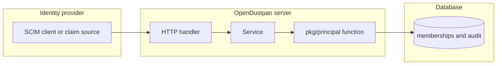

## Context

Sign-in claim adapters and the SCIM adapter are not on main. This change lands the domain function, its tests, and the guard on the configuration routes that exist.

## Decisions

1. **One membership function.** Add ApplyIdentityProviderMemberships in pkg/principal. It takes the principal, group IDs, the source scim, claim or ldap, and the provider or token ID. It returns the sentinel ErrIdpAddRefused for a refused add.
2. **Closed wins.** A closed group refuses even when trusted or full sync is on. A protected group without trust and without full sync refuses. Otherwise the add is accepted with its source. A local membership keeps its source and one audit entry names both sources.
3. **One transaction with audit.** Flags, rows and audit entries share one transaction snapshot per request. A SCIM PATCH is atomic and commits nothing when one row is refused. A Bulk request gives a status for each operation.
4. **Alert channel.** Each configuration change writes an audit entry and a WARN line with the injected logger. The scheduled check warns 168 hours before SCIM token expiry, once per token per expiry value, from a stored alert record.

## Structure

Unexported type membershipChange with constructor newMembershipChange that checks source, provider or token ID, and group flags. Only the constructor can build a write.

## Risks

- Adapters that bypass the one function bring back divergent behavior.
- WARN lines are not a durable channel.

## Layers (defense in depth)

| Layer | Guard | Hostile test |
| --- | --- | --- |
| port adapter | The port checks closed first, then protected with trust and full sync, before any write. | Add to a protected group, a closed trusted group and a closed full-sync group; each returns ErrIdpAddRefused with no row. |
| service | The service refuses in the write transaction and audits in the same transaction. | Remove the port check and show the service still refuses; fail the audit write and show 500 and no row. |
| HTTP handler | The handler maps refusal to a SCIM error or to skip-with-sign-in, and declares server:manage-sign-in plus a fresh check. | Call each configuration route without a fresh step and show 403; send a SCIM add to a protected group and show the SCIM error. |

## Diagrams

Modules that the change touches, and their imports on main:

States on main in the touched packages:

## Quality attributes

| Attribute | Target | Unit | Scope |
| --- | --- | --- | --- |
| Membership function latency | 50 | milliseconds, 95th percentile | one add of up to 100 groups on SQLite and PostgreSQL |
| Expired-token audit volume | 1 | audit entry per token per expiry value | one installation, any number of uses |

## Threat model

Data flow and trust boundaries:

| Boundary | STRIDE | Threat | Layer | Guard | Hostile test |
| --- | --- | --- | --- | --- | --- |
| Identity provider to server | E | The identity provider adds itself or a person to a protected group. | authorize at point of use | The function refuses protected and closed groups in the write transaction. | Add to a protected group and a closed trusted group and show no row. |
| Identity provider to server | E | The identity provider adds itself or a person to a protected group. | fail closed | An audit failure ends the change. | Fail the audit write and show 500 and no row. |
| Identity provider to server | R | A refused or accepted change leaves no record. | fail closed | The audit entry shares the transaction with the membership. | Fail the audit write and show no membership. |
| Identity provider to server | D | A client floods expired-token uses to fill the audit log. | limit | One audit entry per token per expiry value. | Replay 1000 uses and count one entry. |
| Administrator to server | S | A caller with no fresh step changes the provider configuration. | boundary check | The route needs server:manage-sign-in and a fresh step inside the one window. | Call each route with an aged step and show 403. |

## Failure modes

| Step | Failure | Retry | State after |
| --- | --- | --- | --- |
| Refused SCIM add | Audit write fails. | Return 500 with no SCIM refusal body. | No state change. |
| Refused group claim | Audit write fails. | Block the sign-in with 500. | No state change. |
| SCIM token expiry alert | Scheduler restarts before the 168-hour check. | Recompute from the stored expiry and the stored alert record. | One alert per expiry value. |
