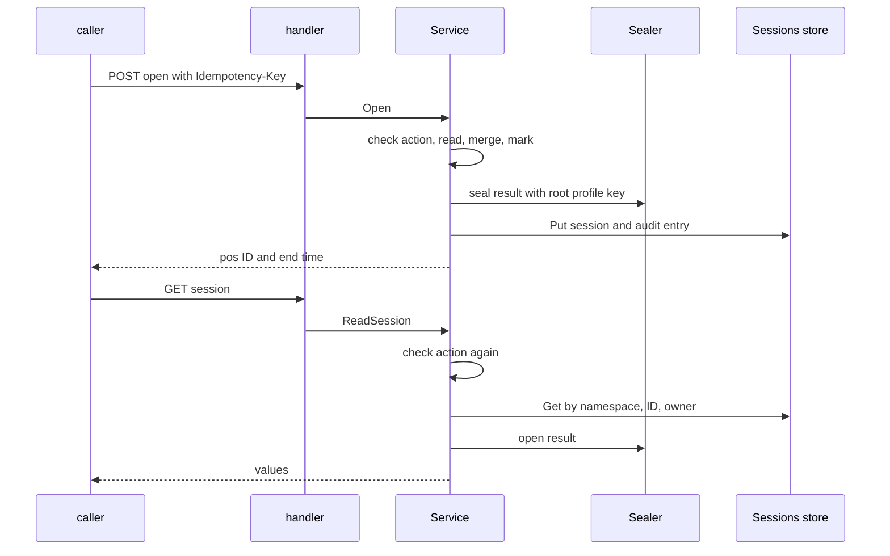
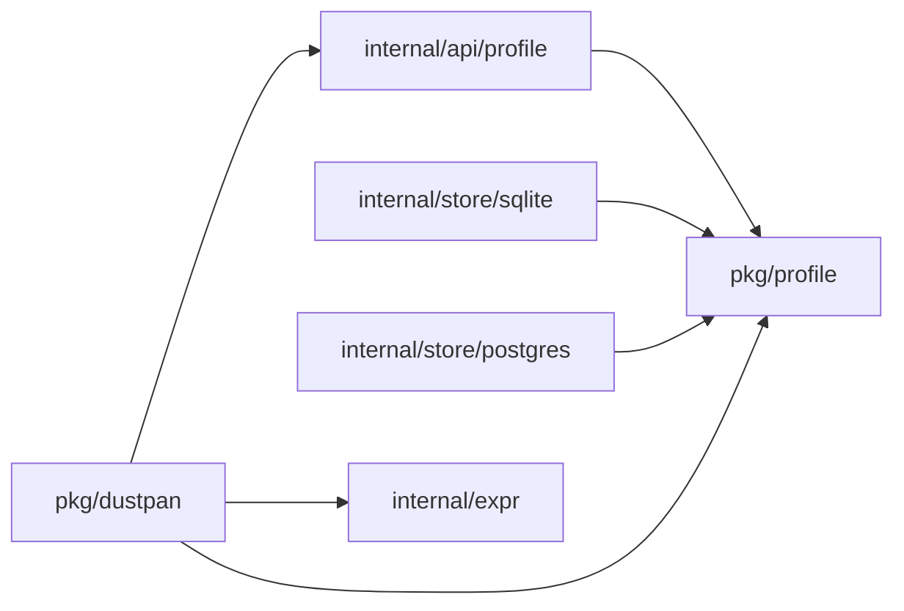
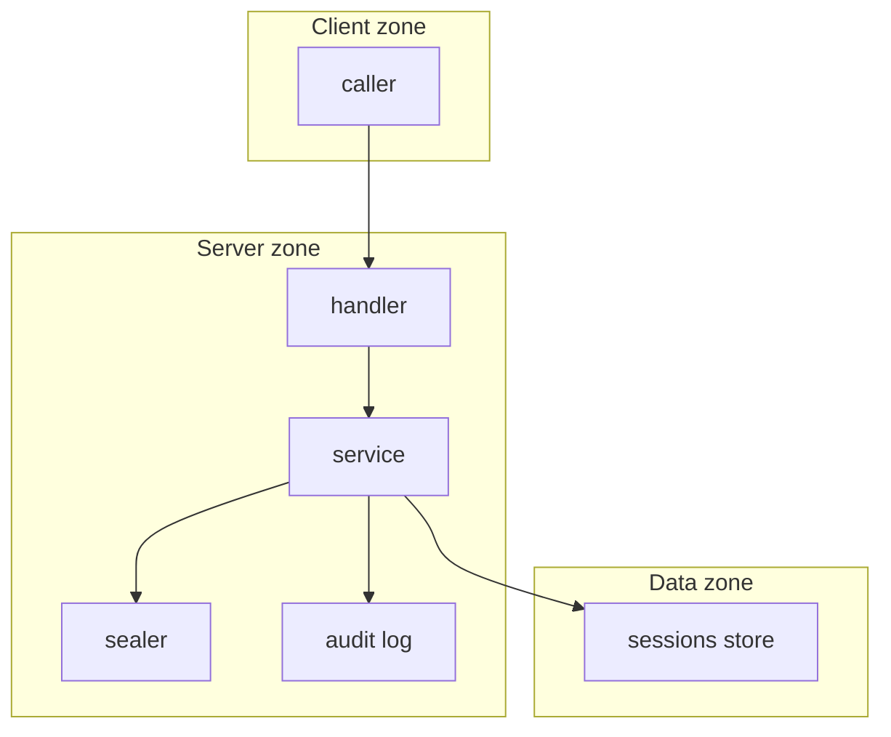

## Context

Main has no open of a profile. It has the document rules, the revisions, the reveal of one revision, and the idempotency middleware. This change adds the open of a static profile with the consumers api, console and pulumi, one session store, and two routes. The provider blocks, the checks, the job open and the other consumers are out of scope (see the proposal).

The change `add-profile-provider-port-its` depends on this change. This change lands first. It refuses a provider block with `ErrProvider` in one place of `Service.Open`. That change replaces this refusal with a call of the provider registry through a port that `pkg/profile` defines, because `pkg/profile/provider` imports `pkg/profile` and `Service.Open` must not import it.

## Decisions

1. **Resolve with no provider call.** `Service.Open` reads each revision that the open reaches once, merges the imports in list order, keeps each `$final` value, computes each `${ }` value of the own tree, carries the marks, and fails closed on a provider block, a rule in `checks`, a job token, a consumer other than api, console and pulumi, and an expression name other than `values`. The checks of the open run in this order: actor, ref, paths, consumer, duration, action, fence, then the first read.
2. **One action check on the namespace.** The profile actions are checked on the namespace object, because no grant on a single profile exists (`internal/api/profile/routes.go:110-112`). So one check of `profile:open` covers the root profile and each import, which are in one namespace. The service still calls the Authorizer again before each read of a revision that it reaches, so a later grant on one profile needs no change of the open.
3. **The service seals, the store keeps ciphertext.** `Service.Open` serializes the result and seals it with `Sealer.Encrypt` under `scopeOf(namespace, root profile ID)`. `Sessions.Put` stores the ciphertext, the namespace, the root profile ID, the owner subject, the consumer, the end time and the ID. The store adapters hold no key.
4. **The owner is the principal.** A session belongs to the subject of `identity.Principal`. A read by another subject answers 404. A second token of the same principal reads the session, as ADR 203 says. The job rule is out of scope.
5. **Sessions port.** The port keeps the shape of the stopped builder branch (`origin/builder/open-profile-serve-open-sessions`, `pkg/profile/sessions.go`), without its job owner. `Put(ctx, Session, fence, []audit.Entry)` checks the fence and the ID, then stores the session and each audit entry in one transaction under the namespace fence. It refuses with `namespace.ErrFenced`, `ErrConflict` or `ErrInvalid` before it writes. It carries the idempotency `Completion`, passes a NEW `SessionWritten`, and returns `idempotency.ErrLost` when the pending record is not in place. `Get(ctx, ns, id, owner, now)` reads as `ErrNotFound` for a missing, ended, other-owner or other-namespace session. `Delete(ctx, id, owner, fence, []audit.Entry)` is a write in the namespace of the fence, so it takes the fence and writes one audit entry in the same transaction, as `Put` does. It reads as `ErrNotFound` for a missing, other-owner or other-namespace session, and then writes no entry. It refuses with `namespace.ErrFenced` for a stale fence. `Sweep(ctx, now, limit)` deletes at most `limit` ended sessions of all namespaces, takes no fence and writes no audit entry (the sweep of the replay records works the same way, and the open that made each row wrote its entry), and a limit below 1 is `ErrInvalid`. `Session.Live(now)` is the one expiry rule. NEW `SessionOwner` has the kind `principal` only: the owner is the subject of `identity.Principal`. The kind `job` of the builder branch is dropped (owner, 2026-11-20: the owner kind is `principal` only until job opens are specified). A schedule calls `Sweep` as `sweepIdempotency` calls its sweep (`pkg/dustpan/idempotency.go:40-60`).
6. **Table.** NEW table `profile_open_sessions` in the one baseline of each dialect, edited in place at its place in the name order (after `profile_revisions`, `profiles` and their neighbors). Columns: `namespace_id`, `id`, `root_profile_id` (the stable ID of the root profile, with a foreign key to `profiles (namespace_id, id)`), `owner_kind`, `owner_id`, `consumer`, `paths` (a JSON array of text, and the empty array means all paths), `sealed` (BLOB or bytea), `created_at_ms` and `expires_at_ms` (BIGINT, Unix milliseconds). Primary key (`namespace_id`, `id`), foreign key to `namespaces`. Checks: the ID starts with `pos-` and is longer than 4 characters, `owner_kind` is `principal`, `owner_id` and `sealed` are not empty, `consumer` is one of `api`, `console` and `pulumi`, and `expires_at_ms` is above `created_at_ms`. One index, on `expires_at_ms`, for the sweep. No query counts the sessions of an owner, so no index on the owner exists. The column `mode` of the builder branch is dropped, because the open request has no mode. Queries in `queries.sql`, each in the name order next to the queries of its area (never at the end): get, insert, delete by owner, delete ended with a LIMIT, with placeholders. The numbers 1 minute, 12 hours and 2 hours are the time policy of ADR 203 decision 3 and are constants of `pkg/profile`. Sessions have no cap on their count (ADR 392). The rate limit on opens that replaces the cap is not in this change: RFC 135 is open. Until the owner accepts a decision on RFC 135, the server has no limit on the count of sessions and no rate limit on opens. The name differs from the console table `sessions`. A database from another baseline fails with `ErrSchemaDiverged`, and `opendustpan dev reset` clears it. The table is in `backup.EmptiedTables`, with a column list in both adapters, so a backup leaves it out and a restore empties it.
7. **Replay record.** The open route is a keyed route whose answer holds a secret in the sense of the idempotency middleware: it passes `SecretAnswer`, which returns the session ID. The record holds that ID in place of the answer, and a replay answers 409 with `request.idempotency-key-replayed-secret` and the ID. `Route` gets the field for it, and `serveKeyed` passes it on (`internal/api/profile/routes.go:162`).
8. **Expr.** `pkg/profile` defines the port `Evaluator` with one method that computes the value of one expression of the own tree and returns the value, its type and the paths that it read. `internal/expr` implements it and stays the only importer of the library. The environment holds `values` only. A name other than `values` fails with `ErrReference`. Main reads the paths of `values` with `refsIn` (`pkg/profile/document_taint.go:23`), and the open uses the same reads to carry the marks before it runs the expression.
9. **Errors.** Each new sentinel has an error code in `internal/errcode/catalog_profile.go` and HTTP 422 in `profileErrors`: `profile.provider`, `profile.never-store`, `profile.final`, `profile.reference`, `profile.import-cycle`. A denial is 403 through the existing path. There is no error for a count of sessions (ADR 392). `ErrLimit` and `profile.limit` stay for the limits of one open.

## Structure

An unexported `openResolver` holds the state of one open (the revisions read, the count of revisions, the marks). Only the constructor in `Service.Open` makes it, and the constructor takes the actor, the ref, the paths, the consumer, the duration and the fence, and checks all of them before it reads a revision. The session value has unexported fields and a constructor that checks the end time, the owner and the ID prefix, so a store never gets a session that fails them.

## Layers (defense in depth)

| Layer | Guard | Hostile test |
| --- | --- | --- |
| port adapter (Sessions store) | Get holds namespace, ID, owner and the clock in one query. Put checks the fence in its own transaction. | Get with another owner, another namespace, an ended session or a forged ID answers ErrNotFound. |
| service (Open, read) | Service checks the arguments, the consumer, the action on the namespace and the fence before any read, checks the action again at each read, seals before Put and compares the owner again. | Each hostile argument is refused before the store sees a call. A read after revoke answers a denial and deletes. A Put error or a seal error stores no session and answers no value. |
| HTTP handler | The route declares its action. The handler decodes the body strictly with a size limit, validates the paths and the duration, takes the key only as the route declares it, and never writes a value to a log, an audit entry or a replay record. | An unknown field, a body above the limit, a path with a control character, a path list above its limit and a key on a route that does not take it are refused. A route with no action fails the route test. |

### Hostile cases of the port adapter (table in profiletest/sessions.go)

| Case | Expected |
| --- | --- |
| Get with the ID of another namespace | ErrNotFound |
| Get with another owner | ErrNotFound |
| Get at or after the end time | ErrNotFound |
| Get with an ID that has no pos- prefix | ErrNotFound |
| Put with a stale fence | the fence error and no row, no audit entry |
| Put with an end time not after the start, an empty Sealed, an owner with no ID, an ID with no pos- prefix or an empty entry list | ErrInvalid |
| Sweep with a limit below 1 | ErrInvalid |
| Put twice with one ID | ErrConflict and one row |
| Delete of the session of another owner | ErrNotFound and the row stays |
| Sweep with live and ended sessions | the ended rows go, the live rows stay |

### Hostile cases of the service (table in pkg/profile/open_test.go)

| Case | Expected |
| --- | --- |
| No profile:open | denial, one denied audit entry, no read of a revision, no Put |
| Job token principal (owner, 2026-11-20) | denial, one denied audit entry, no read of a revision, no Put |
| Consumer run, opentofu, launcher, observe or an unknown string | ErrInvalid |
| Duration of 59 seconds or 12 hours and 1 second | ErrInvalid |
| Paths list with 1,025 items, an empty path, a path with CR or LF | ErrInvalid |
| Ref of another namespace or a deleted profile | ErrNotFound |
| Import cycle, depth 17, 65 revisions, result above 4 MiB | ErrImportCycle, ErrLimit |
| Replace of a final value by a later import | ErrFinal naming the path and both profiles |
| Expression that reads providers, imports, profiles or context | ErrReference |
| Expression that reads a secret and feeds a plain path | the result has the secret mark |
| Never-store value on an asked path | ErrNeverStore naming the path, no Put |
| Provider block in an import | ErrProvider naming the block |
| Rule in checks, in the root or in an import (owner, 2026-11-20) | ErrInvalid naming the profile, no Put |
| Fault in Sealer.Encrypt | the error, no Put, no value in the error text |
| Fault in Put | the error and no value in the error text |
| Read by another subject | ErrNotFound and the session stays |
| Read after profile:open ended | denial and the session is deleted |
| Read with a fault in Delete after a denial | the denial stays the answer and no value leaves |

### Hostile cases of the HTTP handler (table in internal/api/profile/open_test.go)

| Case | Expected |
| --- | --- |
| Body with an unknown field, a body above the size limit, a body that is not JSON | 400 |
| Session ID that is not pos- plus the ID alphabet, or has %2F | 404 |
| Namespace in the path that the caller cannot open | 403 |
| Idempotency-Key on the session read | 400 (the route does not take it) |
| Replay with another body | 422 request.idempotency-key-reused |
| Replay after profile:open ended | 403 |
| Open answer, logs and audit entries of a run with a known secret value | contain the value 0 times |
| Response headers of the session read | Cache-Control: no-store |

## Diagrams

After this change:

Modules that the change touches, and their imports on main:

New imports of this change (each one allowed by the module rules):

- `internal/expr` imports `pkg/profile`, to return the types of the port `profile.Evaluator`. `pkg/profile` never imports `internal/expr`.
- `pkg/dustpan` passes the Sessions adapter and the Evaluator into `profile.Config`.

## Quality attributes

| Attribute | Target | Unit | Scope |
| --- | --- | --- | --- |
| confidentiality | 0 | secret values | logs, audit entries, error text and replay records |
| correctness | 1 | sessions per Idempotency-Key | concurrent replays of one open |
| limit | 64 | profile revisions | one open |
| limit | 4 | MiB | the result of one open |

## Threat model

Data flow and trust boundaries:

| Boundary | STRIDE | Threat | Layer | Guard | Hostile test |
| --- | --- | --- | --- | --- | --- |
| Client to server | I | A caller reads a session of another principal. | boundary check | Handler validates the ID with the pos- alphabet, the paths and the duration. | A hostile ID, a hostile duration and oversize paths are refused. |
| Client to server | I | A caller reads a session of another principal. | encode or contain | Store reads by namespace, ID and owner in one query with placeholders. The service compares the owner again. | Another owner and a forged ID answer 404. |
| Client to server | D | A principal fills the store with sessions. | limit | A result limit of 4 MiB. The count of sessions has no cap (ADR 392), and the rate limit on opens that guards a runaway loop is not in this change (RFC 135 is open). | A result above 4 MiB is refused. |
| Client to server | I | A caller reads a session after it lost the grant. | authorize at point of use | Service checks profile:open on each read. | A read after revoke answers 403 and deletes the session. |
| Client to server | I | A store or seal error leaks a value. | fail closed | A seal error, a Put error or a Get error answers an error with no value. | A forced error answers 500 and the answer holds no value. |
| Server to data | I | A reader of the database or a backup gets a value. | encode or contain | The service seals the result with the key of the root profile. The table is in EmptiedTables. | The table holds no plain value, and a backup holds no row. |
| Server to data | T | A caller replays an open to make more sessions. | limit | The replay record holds the session ID and the same key stores one session. | A replay with the same key leaves one session. |
| Server to audit | R | An open leaves no record. | fail closed | Put writes the session and the audit entry in one transaction. | A forced audit failure leaves no session. |

## Contract

**profile-sessions**

- Invariant: Each session belongs to one root profile and one owner subject, and holds only ciphertext.
- `Put`: pre: the fence is current; the end time is after now. Post: one live session and its audit entries stored in one transaction.
- `Get`: pre: the namespace, the ID and the owner match a session whose end time is after now. Post: the ciphertext answered, else ErrNotFound.
- `Delete`: pre: the owner holds the session in the namespace of the fence, and the fence is current. Post: the session is gone and its audit entries are stored in the same transaction.
- `Sweep`: pre: limit of 1 or more. Post: at most limit sessions with an end time at or before now are deleted.

## Failure modes

| Step | Failure | Retry | State after |
| --- | --- | --- | --- |
| POST open | Crash between the session put and the audit write | Replay with the same key | The transaction holds both or neither, so a replay opens once. |
| POST open | Seal error | Replay with the same key | No session, no record, no value. |
| GET session | Revoke between open and read | Read again answers 403 | The session is gone. The access entry of the open stays. |
| GET session | Store error | Read again | The session stays. The answer is 500 with no value. |
| Sweep | Crash during a sweep | The next sweep | Rows that stay are ended, so no read answers them. |
