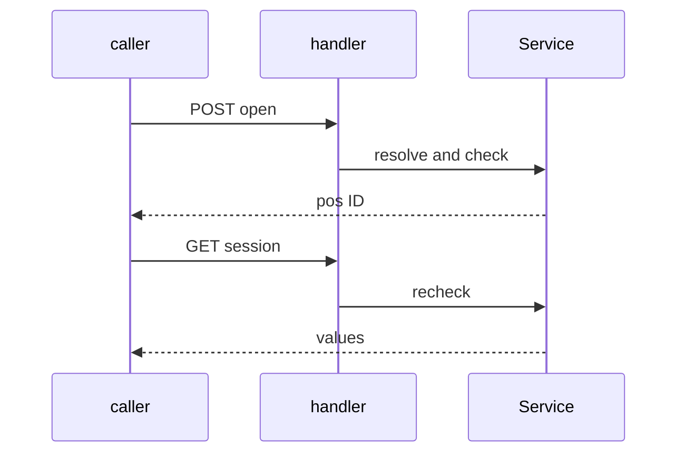
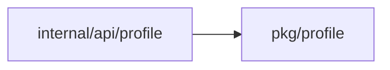
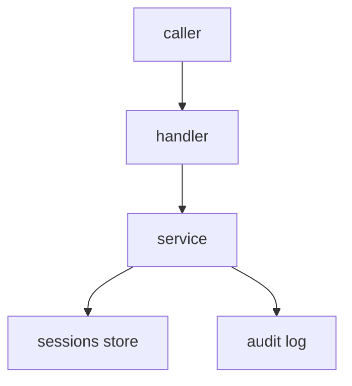

## Context

Open of a static profile with import merge, final, checks, Expr values, marks, sessions, two new routes, audit and idempotent replay.

## Decisions

1. **Resolve without provider blocks.** Service.Open reads each revision once, merges later wins, honors $final, runs checks, evaluates ${ }, propagates marks, fails with ErrProvider on a block, and refuses never-store leaves for consumer pulumi and mode data. Sessions exist only for api, console and pulumi; other consumers get a direct answer.
2. **Sessions store and lifecycle.** Sessions has Put, Get and Sweep in both dialects. Each session is sealed with the data key of the root profile only. The limit is 100 live sessions for each principal or each job; duration 1 minute to 12 hours, 2 hours by default. Sessions stay out of backups. Get checks the action again and deletes the session only on an explicit refusal; a store error answers 500 and keeps it.
3. **Replay record.** The replay record holds only the session ID, keyed hash, for 24 hours. The same key with another body or principal answers conflict and stores nothing.

## Structure

Unexported openResolver, made only by the constructor in Service.Open, which checks actor, ref, paths, consumer, mode, duration and fence before any read.

## Risks

- A secret value reaches logs, audit or the replay record.
- An old provider build skips the never-store refusal.
- Sessions stay readable after revoke or key rotation.

## Layers (defense in depth)

| Layer | Guard | Hostile test |
| --- | --- | --- |
| service | Service checks profile:open on the root and each reached profile before any read, and on each Get. | Open with no grant answers 403 and writes one access entry; a read after revoke answers 403 and deletes the session. |
| store | Store seals with the root data key and checks fence, owner, expiry and limit in one transaction. | Read by another credential, an ended session, or after root key rotation answers 404 with no value. |
| handler | Handler takes Idempotency-Key and never writes values to logs, audit or replay records. | Replay with the same key stores one session; logs and audit hold no secret value. |

## Diagrams

After this change:

Modules that the change touches, and their imports on main:

New imports of this change (each one allowed by the module rules):

- `internal/api/profile` imports `pkg/profile`

## Quality attributes

| Attribute | Target | Unit | Scope |
| --- | --- | --- | --- |
| confidentiality | 0 | secret values | logs, audit and replay records |
| correctness | 1 | sessions per Idempotency-Key | concurrent replays of one open |

## Threat model

Data flow and trust boundaries:

| Boundary | STRIDE | Threat | Layer | Guard | Hostile test |
| --- | --- | --- | --- | --- | --- |
| Client to server | I | A caller reads a session of another principal. | boundary check | Handler validates ID, paths and duration. | Hostile duration and oversize paths are refused. |
| Client to server | I | A caller reads a session of another principal. | encode or contain | Store seals with the root data key. | A tampered ID answers 404. |
| Client to server | I | A caller reads a session of another principal. | limit | 100 live sessions for each principal or job. | The 101st open fails. |
| Client to server | I | A caller reads a session of another principal. | authorize at point of use | Service checks profile:open on each Get. | Read after revoke answers 403. |
| Client to server | I | A caller reads a session of another principal. | fail closed | Unknown input denies; a store error answers 500. | A forced store error answers 500 with no value. |

## Contracts

**profile-sessions**

- Invariant: Each session belongs to one root profile and one owner credential.
- `Put`: pre: Owner holds profile:open; Live count below 100. Post: One live session stored.
- `Get`: pre: Session is live. Post: Values answered only to the owner.
- `Sweep`: pre: Session ended. Post: Session deleted.

## Failure modes

| Step | Failure | Retry | State after |
| --- | --- | --- | --- |
| POST open | Crash between session put and audit write | Replay with the same key | Neither or both appear once. |
| GET session | Revoke between open and read | Read again answers 403 | Session gone; access entry kept. |
