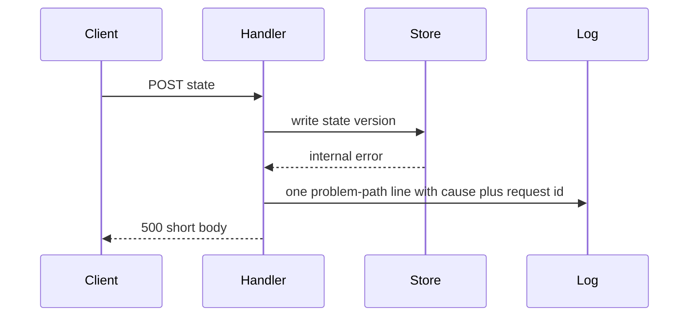

## Context

Twelve state POST answers returned 500 in 0.3 s on both instances. The ERROR line named no cause and no request id.

## Decisions

1. **Add redacted cause and request id to problem-path line.** Build after the writer-gate change. Add the redacted wrapped cause and the request id to the one problem-path fault-log line for POST /tofu/state/{namespace}/{workspace}. Write no second ERROR line. Keep the 15 byte body unchanged. Touch only internal/api/tofuhttp/state_write.go.

## Structure

No new structure. Add the missing attributes to the existing problem-path log call of the state write handler in internal/api/tofuhttp/state_write.go.

## Risks

- Raw driver detail in the log leaks internals; log the redacted chain only.

## Diagrams

After this change:

Modules that the change touches, and their imports on main:

## Quality attributes

| Attribute | Target | Unit | Scope |
| --- | --- | --- | --- |
| none affected | Logging-only change; no latency or storage target changes |  |  |
