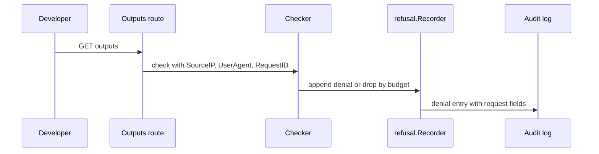
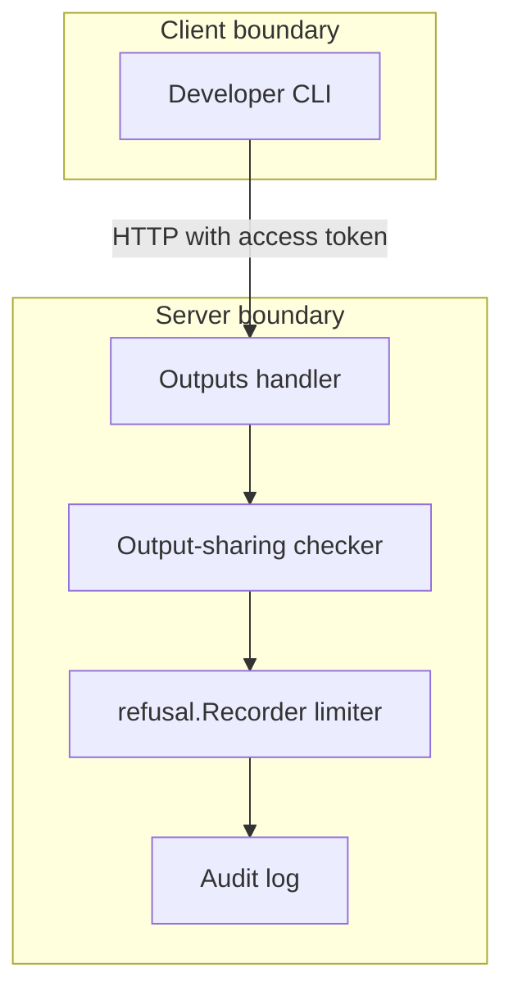

## Context

Denied output reads write one audit entry for each request with no request fields and no limiter. A caller with read permission can flood the audit log with refused reads.

## Decisions

1. **Reuse the refusal recorder.** Route each denied output-read audit write through refusal.Recorder so the entry carries the request fields that the issue names and passes the shared limiter with its existing budget.
2. **Pass request fields at the boundary.** Pass the request fields that the handler observes to the output-sharing checker instead of building the denial entry inside the checker with empty fields. The handler adds no new header parsing and trusts no new proxy header; it passes the same observed values that existing recorder call sites pass.

## Structure

The unexported recorder field on the output-read handler owns denial writes; only its constructor wires the shared refusal.Recorder, so no call site appends a denial without the request fields and without the limiter.

## Risks

- A flood of refused reads fills the audit log before this change ships.

## Layers (defense in depth)

| Layer | Guard | Hostile test |
| --- | --- | --- |
| boundary check | Handler copies the observed client address, user agent and request ID into the checker call; the checker writes only what it receives and invents no address. | Send a denied output read with empty and forged client fields direct to the handler and check the entry holds the observed values. |
| limit | The checker writes the denial only through refusal.Recorder, which applies its limiter before the append. | Flood denied output reads and check the recorder stops further denial entries after its budget. |
| fail closed | The denial path keeps the 403 or 409 answer for the read when the recorder drops or fails the entry, so a limiter or audit error never grants the read. | Force the audit append to fail or exhaust the budget during a denied read and check the read still fails closed. |

## Diagrams

After this change:

## Quality attributes

| Attribute | Target | Unit | Scope |
| --- | --- | --- | --- |
| denial-audit-write amplification | 1 | audit entry per refused read within budget | denied output reads of one unit |
| denial-audit-write ceiling under flood | 0 | additional denial entries per refused read over budget | denied output reads over recorder budget |

## Threat model

Data flow and trust boundaries:

| Boundary | STRIDE | Threat | Layer | Guard | Hostile test |
| --- | --- | --- | --- | --- | --- |
| Client to server | S | A caller spoofs client fields or replays requests to pollute denial entries or probe sharing rules. | boundary check | Handler passes only the observed connection address, user agent and request ID to the checker with no new proxy-header trust. | Send forged forwarding headers and check the entry keeps the observed values. |
| Client to server | S | A caller spoofs client fields or replays requests to pollute denial entries or probe sharing rules. | encode or contain | Read answer never includes the audit fields or secret values. | Read a refused response body and check it holds no SourceIP, UserAgent, RequestID or secret value. |
| Client to server | S | A caller spoofs client fields or replays requests to pollute denial entries or probe sharing rules. | limit | Denial writes go only through refusal.Recorder, which enforces its budget before the append. | Flood refused reads and check denial writes stop while reads stay refused. |
| Client to server | S | A caller spoofs client fields or replays requests to pollute denial entries or probe sharing rules. | authorize at point of use | Handler authenticates the access token and authorizes unit:read-outputs before the sharing check. | Send an output read with no token and with a forged token and check the server refuses without a sharing-check denial. |
| Client to server | S | A caller spoofs client fields or replays requests to pollute denial entries or probe sharing rules. | fail closed | Limiter drop or append failure still refuses the read with 403 or 409. | Fail the audit append and check the read still refuses with no outputs. |
| Server to audit store | D | A holder of unit:read-outputs floods refused reads and fills the audit log. | boundary check | Handler passes only the observed connection address, user agent and request ID with length bounds of the audit store. | Send an overlong user agent and check the stored entry stays bounded. |
| Server to audit store | D | A holder of unit:read-outputs floods refused reads and fills the audit log. | encode or contain | Denial entry holds only the request fields and the refusal reason with no output values. | Read stored denials after refused reads and check no entry holds a secret value. |
| Server to audit store | D | A holder of unit:read-outputs floods refused reads and fills the audit log. | limit | Denial writes go only through refusal.Recorder, which enforces its budget before the append. | Flood refused reads and check denial writes stop while reads stay refused. |
| Server to audit store | D | A holder of unit:read-outputs floods refused reads and fills the audit log. | authorize at point of use | Only the sharing-check refusal path writes through this recorder; authorization refusals keep their existing path. | Send a read with no unit:read-outputs grant and check it does not write a sharing-check denial. |
| Server to audit store | D | A holder of unit:read-outputs floods refused reads and fills the audit log. | fail closed | Limiter drop or append failure still refuses the read with 403 or 409. | Fail the audit append and check the read still refuses with no outputs. |

## Contracts

**output-sharing**

- Invariant: A denied output read returns no output values.
- Invariant: A denial audit entry never holds a secret value.
- `Denial entry carries request fields`: pre: Caller holds unit:read-outputs on the consumer.. Post: Allowed reads return outputs with no denial entry.; Refused reads return 403 or 409 and write at most one denial entry through the limiter..

## Failure modes

| Step | Failure | Retry | State after |
| --- | --- | --- | --- |
| Write denial audit entry | Audit append fails for a reason other than the limiter. | No retry of the read; caller retries the same GET after the cause is fixed. | Read stays refused with 403 or 409 and no output values. |
| Apply refusal limiter | Limiter budget is exhausted by a flood of refused reads. | No retry of the audit write; later refused reads stay refused until the budget resets. | Reads stay refused with 403 or 409; further denial entries stop. |
