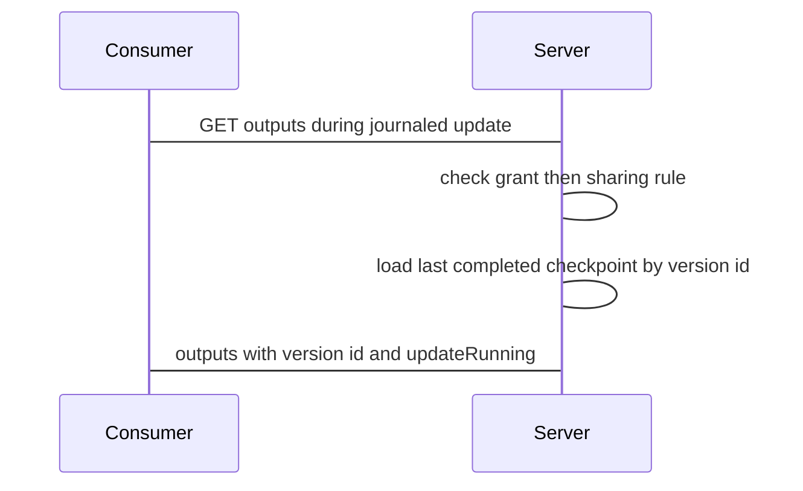

## Context

Output reads must answer from one stable latest state with bounded cost. The owner export rebuilds a running journaled update from stored batches. Consumer output reads stay on the last completed checkpoint.

## Decisions

1. **Latest state for output reads excludes the running journal.** Latest state for consumer output reads is the last completed checkpoint. Batches of a running journaled update are not part of latest state until the update completes and writes a new checkpoint. The owner export behavior does not change.
2. **Authorization before existence check.** Check order is grant, then sharing rule, then checkpoint existence. A missing grant or a missing rule returns 403 denied before any 404 check.

## Structure

The output read path loads a CompletedCheckpoint value through constructor NewCompletedCheckpoint that accepts only rows with completed_at set and refuses a running update row, so a partial journal has no value of the serving type.

## Risks

- A consumer reads outputs that are older than the running update until the update completes.

## Diagrams

After this change:



## Quality attributes

| Attribute | Target | Unit | Scope |
| --- | --- | --- | --- |
| bounded read cost | 1 | completed checkpoint loads per read, zero journal batch replays | consumer output read during a running journaled Pulumi update |

## Threat model

Data flow and trust boundaries:

```mermaid
Consumer -> outputs read route -> sharing rule check -> checkpoint load -> outputs answer
```

| Boundary | STRIDE | Threat | Layer | Guard | Hostile test |
| --- | --- | --- | --- | --- | --- |
| outputs read route | I | A consumer reads outputs of a producer without a sharing rule during a running update. | authorize at point of use | Deny read without a stored sharing rule from producer to consumer and without unit:read-outputs at the point of use. | Call the outputs route with no stored rule, then remove the rule mid-read; each call returns 403 denied. |

## Contracts

**Output read of a producer stack**

- Invariant: The read serves one completed checkpoint by stable state version id.
- Invariant: The read never serves batches of a running journaled update.
- `ReadOutputs`: pre: Caller holds unit:read-outputs on the consumer scope.; Sharing rule from producer to consumer exists.. Post: Return outputs of the last completed checkpoint with its state version id and field updateRunning..

## Failure modes

| Step | Failure | Retry | State after |
| --- | --- | --- | --- |
| Consumer output read during journaled update | Checkpoint completes between running-update check and checkpoint load. | Serve the one checkpoint loaded in the read transaction at read-committed isolation; next read serves the newer checkpoint. | Read returns one completed checkpoint with its version id. |
| Consumer output read during journaled update | Server restarts mid-journal before read. | Read loads last completed checkpoint; running batches stay unread. | Read returns last completed checkpoint. |
| Consumer output read during journaled update | Journaled update is cancelled or fails mid-journal. | Read loads last completed checkpoint before the failed update. | Read returns last completed checkpoint. |
