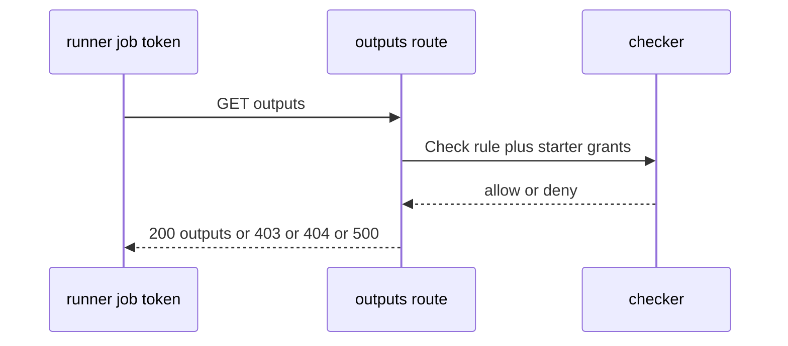
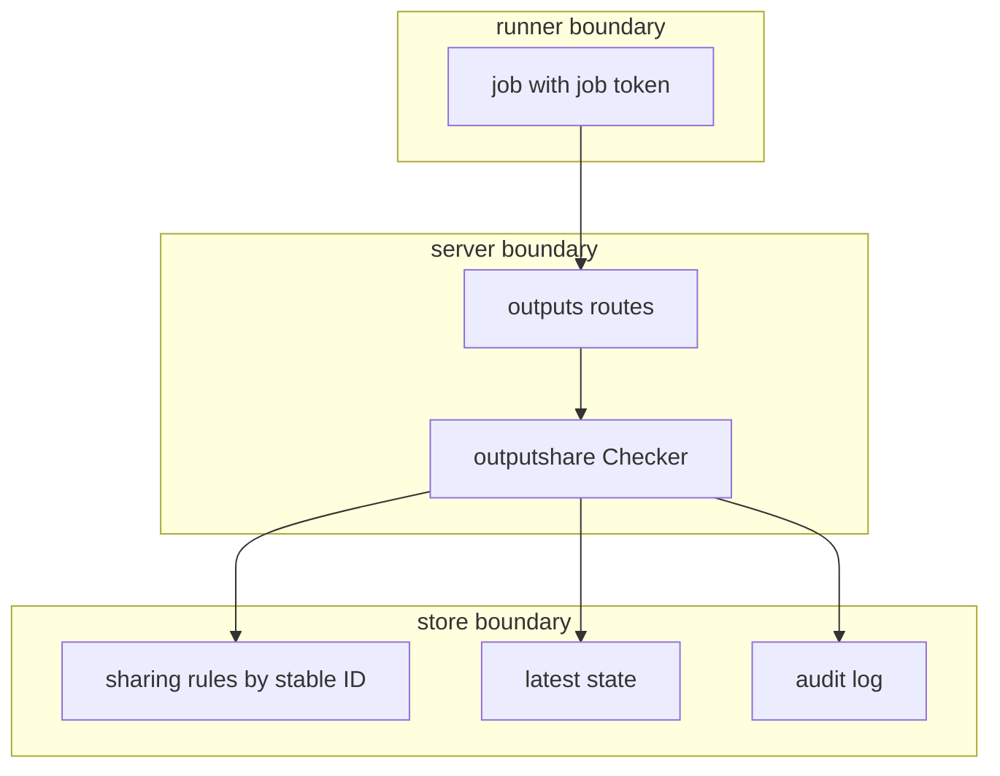

## Context

Cross-tool output reads run on runners through the existing tool APIs. The job token carries the job unit. The producer namespace holds each sharing rule keyed by stable IDs, managed by add-output-sharing-setting-new.

## Decisions

1. **Two checks at each read.** Checker evaluates both ADR 273 decision 5 checks at each read: rule names consumer unit, collection, or namespace, and starter holds unit:read-outputs plus unit:read-secrets for secret outputs with current grants. No cached grant passes the read.
2. **Separate read and decrypt checks.** The outputs read and its audit write share one store read that serves the response. The Pulumi decrypt call is a separate request with its own recheck of rule and starter grants under read-committed isolation; no single transaction spans read and decrypt.
3. **Rate-limited denials.** Denied outputs reads carry a per-job-token rate limit. Repeated denials return 429 after the limit with no extra audit flood, and an audit-store outage fails reads closed with 500.

## Structure

Unexported outputshare.checker built only by NewChecker with Store, Access, Attachments, and States ports; constructor rejects nil ports so no read path skips a required check.

## Risks

- Stale starter grants leak secret outputs when the read trusts job start state.
- Consumer-namespace-wide rule widens read reach beyond intent.
- Tool output route returns more than root outputs of latest state.

## Layers (defense in depth)

| Layer | Guard | Hostile test |
| --- | --- | --- |
| HTTP adapter | HTTP adapter allowlists producer object kinds and unit references, and declares unit:read-outputs on the producer object. | GET outputs read with principal name as consumer gets 403. |
| service | Service rechecks rule match and starter grants at read time, including unit:read-secrets for secret outputs. | Revoked starter grant or removed rule between job start and read denies the in-flight read with 403. |
| store | Checker matches rules by stable ID only, so a renamed unit still matches and a removed-and-made-again unit does not match. | Consumer removed and made again under the same name is denied until a new rule names the new stable ID. |

## Diagrams

After this change:

New imports of this change (each one allowed by the module rules):

- `internal/api/pulumi` imports `pkg/outputshare`
- `internal/api/tfe` imports `pkg/outputshare`

## Quality attributes

| Attribute | Target | Unit | Scope |
| --- | --- | --- | --- |
| outputs-read latency | 500 | ms p99 | tool-neutral outputs GET on one producer with latest state |
| denial correctness | 100 | percent denied with 403 | outputs reads with no naming rule or without starter read-secrets |

## Threat model

Data flow and trust boundaries:

| Boundary | STRIDE | Threat | Layer | Guard | Hostile test |
| --- | --- | --- | --- | --- | --- |
| runner to server | S | A job spoofs another consumer unit to read producer outputs. | boundary check | Outputs route requires job token with consumer unit attachment and checks allowlisted kinds. | Send principal name as consumer; server rejects with 403. |
| runner to server | S | A job spoofs another consumer unit to read producer outputs. | encode or contain | Secret outputs stay sealed except through Decrypt path. | Request Decrypt of non-output ciphertext; server denies. |
| runner to server | S | A job spoofs another consumer unit to read producer outputs. | limit | Scope reads to root outputs of latest state only. | Request older state ciphertext; server denies. |
| runner to server | S | A job spoofs another consumer unit to read producer outputs. | authorize at point of use | Checker rechecks rule and current starter grants at each read. | Revoke grant after job start; next read denies with 403. |
| runner to server | S | A job spoofs another consumer unit to read producer outputs. | fail closed | Deny when any check errors or IDs are missing. | Remove consumer attachment; server denies with 403 and no outputs. |
| server to store | T | A caller tampers with rule IDs or state IDs to widen a read. | boundary check | Rule lookup binds producer namespace and allowlisted kinds before store read. | Send unknown kind; server rejects before store read. |
| server to store | T | A caller tampers with rule IDs or state IDs to widen a read. | encode or contain | Stable IDs compared as opaque IDs with no name fallback. | Remake consumer under same name; read denies until new rule. |
| server to store | T | A caller tampers with rule IDs or state IDs to widen a read. | limit | Per-token rate limit caps denied reads and audit writes. | Flood denied reads; server returns 429 after limit. |
| server to store | T | A caller tampers with rule IDs or state IDs to widen a read. | authorize at point of use | Rule match uses stable IDs bound to producer namespace. | Remove and remake consumer under same name; read denies until new rule. |
| server to store | T | A caller tampers with rule IDs or state IDs to widen a read. | fail closed | Read, Decrypt, and audit share fail-closed behavior per request. | Fail audit write; server returns 500 with no outputs. |
| server to runner response | I | A denied read leaks secret output values in errors or logs. | boundary check | Error shape validated to carry only code and message with no state values. | Read secret outputs without read-secrets; response holds no secret. |
| server to runner response | I | A denied read leaks secret output values in errors or logs. | encode or contain | Error shape carries code unit.forbidden with no secret values. | Read secret outputs without read-secrets; response holds no secret. |
| server to runner response | I | A denied read leaks secret output values in errors or logs. | limit | Rate limit caps repeated denials to one audit batch per window. | Flood denied reads; audit holds only the first batch. |
| server to runner response | I | A denied read leaks secret output values in errors or logs. | authorize at point of use | Denials write audit entry with producer, consumer, and starter. | Trigger 403 read; denial entry exists. |
| server to runner response | I | A denied read leaks secret output values in errors or logs. | fail closed | Any audit failure returns 500 with no outputs. | Fail audit write on denial; server returns 500 with no outputs. |

## Contracts

**outputshare.Checker**

- Invariant: Checker holds non-nil Store, Access, Attachments, and States ports.
- Invariant: Rule match uses stable IDs only, never names.
- Invariant: Each allowed read has a matching audit entry.
- `Check`: pre: caller presents job token with consumer unit attachment; producer unit stable ID is known. Post: returns allow only when a producer rule names the consumer and the starter holds unit:read-outputs plus unit:read-secrets for secret outputs.
- `Decrypt`: pre: Check passed for the same job token and producer state. Post: decrypts only ciphertext held by root outputs of latest checkpoint; denies other ciphertext with 403.

## Failure modes

| Step | Failure | Retry | State after |
| --- | --- | --- | --- |
| Serve outputs read | Audit write fails during read or denial | No retry of the read; caller retries the same outputs GET after the store recovers. | Request fails with 500 and no outputs leave the server. |
| Recheck rule and grants at each read | Rule deleted or starter grant revoked mid-read | No retry; job owner saves a new rule or grant and reruns the job. | In-flight read denies with 403 and a denial audit entry. |
| Serve outputs read | Producer has no latest state | Retry the read after the first state write of the producer. | Request fails with 404 unit.not-found. |
| Serve denied outputs read | Repeated denied reads flood audit log | Caller waits for the rate-limit window, then retries one outputs GET. | Server returns 429 with no further audit writes until the window ends. |

## Change impact (computed from main)

Tests:

- `pkg/installation/instances_test.go` names `Rule.Validate`
- `pkg/tempadmin/tempadmin_test.go` names `Rule.Validate`
- `internal/removalalertsvc/fakes_test.go` names `Rule.Validate`

ADRs:

- `docs/adr/0141-freeze-schedules.md` names `Rule.Validate`
- `docs/adr/0273-output-sharing-rules-and-the-read-outputs-action.md` names `Rule.Validate`
- `docs/adr/0174-the-cli-engine-and-its-execution-port.md` names `Rule.Validate`
